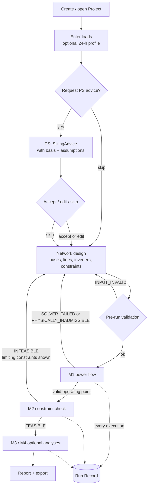

# 01 — Project Brief, Users and Journeys

> Doc set: pre-implementation architecture docs for the microgrid design web app (v2 prompt, 2026-10-17).
> Feeds: proposal Bab I (latar belakang, rumusan masalah, tujuan, batasan) and Bab III (gambaran sistem). Mapping is finalised in Doc 11.

## Ringkasan

Dokumen ini menjelaskan aplikasi web yang akan dibangun: alat bantu desain tahap awal untuk *microgrid* AC terisolasi (*islanded*) dengan inverter pembentuk jaringan (*grid-forming*) berkendali *droop*. Pengguna utamanya adalah insinyur junior yang ingin memeriksa dengan cepat apakah suatu rancangan layak dan apa yang membatasinya. Aplikasi disusun sebagai alur bertahap: data beban, saran kapasitas awal, desain jaringan, aliran daya, pemeriksaan batasan, lalu analisis lanjutan dan laporan. Seluruh perhitungan diperlakukan sebagai "kotak hitam" di balik satu antarmuka (Engine Port), sehingga aplikasi dapat dibangun dan diuji lebih dahulu dengan mesin tiruan (Fake Engine). Setiap eksekusi analisis menghasilkan catatan (Run Record) yang dapat diekspor dan dijalankan ulang agar hasilnya dapat ditelusuri. Aplikasi hanya berjalan lokal, untuk satu pengguna, tanpa basis data. Dokumen ini juga menetapkan batas ruang lingkup dan menandai hal yang masih berupa asumsi atau memerlukan sumber.

---

## 1. Problem

1. A junior engineer planning an isolated, inverter-based, droop-controlled microgrid has no lightweight tool that goes from load data to a checked preliminary design in one guided flow.
2. General-purpose power-system tools are oriented to detailed simulation rather than quick "is this design feasible, and what limits it?" iterations. **[NEEDS SOURCE]** — any claim naming HOMER, ETAP or PowerFactory must be backed by their official documentation or by literature from the LR before it appears in the proposal.
3. Results are hard to trace back to the exact inputs and solver settings that produced them, which weakens reproducibility of early design decisions. **[NEEDS SOURCE]** for the general claim; the app's own answer is the Run Record.
4. Thesis-side problem: the web application's structure must be fixed and defensible **before** the calculation engine is built, so the engine can be added later without redesigning the app.

## 2. Motivation

- Early design is iterative: the user changes a rating, a line or a constraint and re-checks. Short, traceable iterations matter more than simulation fidelity at this stage.
- A clear distinction between *"the solver failed"*, *"the answer is physically meaningless"* and *"the design violates a constraint"* is itself useful design feedback; collapsing them into one "error" misleads the user.
- Separating the app from the engine lets the app be built and tested now, while the engine maths is developed and validated against PSIM later (skripsi scope).
- Prior evidence: a reference prototype (`App/`) already exercised the engine's status categories and the Python + Next.js stack. It is cited as a feasibility signal only, not as a binding design.

## 3. Product objectives

These are **product** objectives (PO) of the web app. They are **not** the thesis Tujuan (T); the existing T wording in the Bab I–III draft is not changed here. The PO ↔ T mapping is done in Doc 11. **[ASSUMPTION]**: PO-1…PO-6 can be mapped onto the approved T without rewording T.

| ID | Objective |
|---|---|
| PO-1 | Guide the user from load data to a checked preliminary design through a fixed pipeline: Load data → PS → Network design → M1 → M2 → {M3, M4} → Report. |
| PO-2 | Give an explicit verdict for every analysis using one status model (`INPUT_INVALID`, `SOLVER_FAILED`, `PHYSICALLY_INADMISSIBLE`, `INFEASIBLE`, `FEASIBLE`, `UNAVAILABLE`), and name the limiting constraint(s) when infeasible. |
| PO-3 | Make every result reproducible: each execution yields an exportable, re-runnable Run Record. |
| PO-4 | Isolate all calculations behind one Engine Port so the app is fully testable with a Fake Engine and the real engine can be swapped in without app changes. |
| PO-5 | Keep projects portable as versioned JSON files with forward-only migration. |
| PO-6 | Produce a summary report that a non-technical decision maker can read. |

## 4. Scope

### In scope (v1)

- Single-user, local web app (browser UI served by one local process).
- Capabilities by MoSCoW (from the v2 capability table):
  - **Must:** PS (load-based preliminary sizing advice, optional for the user), M1 (droop power flow, frequency unknown), M2 (constraint check + preliminary sizing, verdict and limiting constraints).
  - **Should:** M3a local sensitivity, M3b 1-D sweep, M3c scenario comparison, M4a small-signal stability, M4b transient stability.
  - **Could:** M3d 2-D feasibility envelope.
  - **Won't (v1 UI):** M5 PSIM validation; stays an offline script, its report goes into the thesis.
- Project save/load as versioned JSON; Run Record export, import and re-run.
- Synchronous execution with a time budget (~30 s **[ASSUMPTION]**), sweep-size cap (value **[ASSUMPTION]**) and `UNAVAILABLE`/`TIMEOUT` on overrun.
- Report view and export.

### Out of scope (v1)

- Authentication, multi-user, database, hosted deployment, async job queue.
- Any engine maths: equations, solvers, numerical settings, accuracy claims (→ skripsi scope).
- M5 inside the UI.
- Thesis-level technical exclusions: grid-following inverters, VSM, secondary/tertiary control, unbalance, harmonics, protection, automatic optimisation, detailed battery models.
- Techno-economic and environmental analysis, PV/wind/diesel resource-based sizing and dispatch strategies listed in the generic project instructions. They are excluded unless explicitly added later; this follows the fixed islanded-droop scope.

## 5. Future work

- **AI/LLM features** (e.g. assisted interpretation of results). Out of scope for v1; recorded here and in Doc 9 only.
- Other future items (async jobs, hosted demo, database) are tracked in Doc 9, not here.

## 6. Users

| ID | Persona | Goal | Interaction |
|---|---|---|---|
| U1 | **Junior engineer** (primary) | Reach a feasible preliminary design quickly and know what limits it. | Uses the full pipeline. Knows basic power-system terms (bus, line, kW/kvar, droop) but is not a numerical-methods expert. |
| U2 | **Thesis advisor** | Approve overall direction. | Reads each document's Ringkasan and the Doc 11 executive summary. Does not read code. |
| U3 | **Academic reviewer** | Judge rigour, justification, traceability. | Reads PRD IDs, ADRs, register and traceability map. |
| U4 | **Developer (the student, later)** | Build the app safely in phases. | Uses Fake Engine, contract suite and phase gates. |

## 7. Key tasks (U1)

| ID | Task | Capability |
|---|---|---|
| K1 | Create, name and describe a project | — |
| K2 | Enter loads (table) and optionally a 24-point daily profile | — |
| K3 | Request, then accept / edit / skip sizing advice | PS |
| K4 | Build the network: buses, lines, inverters, design constraints | — |
| K5 | Run power flow and the constraint check; read the verdict and limiting constraints | M1, M2 |
| K6 | Explore sensitivity, sweeps, scenarios | M3a–d |
| K7 | Check stability | M4a, M4b |
| K8 | Export a report | — |
| K9 | Save / open a project file | — |
| K10 | Export, import and re-run a Run Record | — |

## 8. User journeys

### J1 — Main design pipeline (U1)

Notes:
- Every arrow back to "Network design" is a design iteration, not an app error. The status tells the user which kind of problem it is.
- If M1 has no valid operating point, M2 and M4 return `UNAVAILABLE` with the dependency named; they are not hidden.
- PS advice becomes design data only on explicit accept (or accept-after-edit).
- M3 and M4 may also be run on an `INFEASIBLE` design (e.g. a sweep to find where it becomes feasible). Decided 2026-10-17 (was A4).

### J2 — Continue a saved project (U1)

1. User opens a project file.
2. App reads `schema_version`:
   - current version → load;
   - older, migratable → migrate forward, inform the user;
   - unmigratable or unknown → reject with a clear message, nothing is loaded or overwritten.
3. User continues at the pipeline step where the project stands.

### J3 — Reproduce a result from a Run Record (U1, U3)

1. User imports a Run Record file.
2. App checks it: file schema valid; stored SHA-256 matches the hash recomputed over the canonical input snapshot.
3. App shows the stored engine version/commit next to the current one; if they differ, it warns and still re-runs (decided 2026-10-17, was A6).
4. User re-runs. App compares the new result with the stored one:
   - same status and results within solver tolerance → "reproduced";
   - otherwise → warning listing what differs.
5. The re-run produces its own new Run Record; the imported one is never modified.

### J4 — Review the plan (U2, U3)

U2 reads the Ringkasan of each document and the one-page executive summary (Doc 11). U3 follows requirement IDs (Doc 2) → ADRs (Doc 5) → tests (Doc 8) → register (Doc 9).

## 9. Assumptions and open points raised here (→ Doc 9)

| # | Item | Type |
|---|---|---|
| A1 | Time budget ~30 s per request | [ASSUMPTION] |
| A2 | Sweep/envelope size cap value | [ASSUMPTION] |
| A3 | PO-1…PO-6 map onto approved thesis T without rewording | [ASSUMPTION] |
| D-A4 | M3/M4 allowed on `INFEASIBLE` designs | DECIDED 2026-10-17 |
| D-A5 | Report export: HTML view, printed to PDF by the browser | DECIDED 2026-10-17 |
| D-A6 | Re-running a Run Record on a different engine version: warn, still run | DECIDED 2026-10-17 |
| S1 | Claims about existing tools (HOMER, ETAP, PowerFactory) | [NEEDS SOURCE] |
| S2 | General claim that early-design results lack traceability | [NEEDS SOURCE] |
| K1 | Supervisor note "mathematical modelling required" vs. settled decision 19. **Resolved by user 2026-10-17:** the proposal has no mathematical formulation; it discusses the methodology, which must be clear, directed and fit for a proposal. Supervisor confirmation still advisable. | KONFLIK → RESOLVED (user) |
| K2 | Supervisor Bab III notes (independent/dependent variables, parameter variation, flowchart with iterations) assume a calculation method. **User 2026-10-17:** acceptable for now; Bab III uses an iterative flowchart and must state the software development methodology clearly. | KONFLIK → ACCEPTED (user, revisit after supervisor) |

## 10. Terminology flag for Doc 3

"Sizing" appears twice: **PS** gives load-based advice *before* any network exists; **M2** gives network-based preliminary sizing *after* power flow. Decided 2026-10-17: `SizingAdvice` = PS output (advisory, pre-network); `SizingCheck` = M2 preliminary-sizing output (network-based). Doc 3 defines both.

## 11. Self-review

- **Weakest point:** the problem statement (§1 items 2–3) rests on claims that are not yet sourced. Without S1/S2, Bab I's "gap" is an opinion. The LR's B09 batch (design software tools) is the first place to look.
- **What a skeptical reviewer would attack:** (a) "Why web if it only runs locally?" — answer belongs in ADR backend/frontend: browser UI is the delivery medium, local serving is a deployment choice; (b) "A proposal with no maths for a power-systems thesis" — K1 resolved by user; Bab III must therefore be strong on methodology (iterative flowchart, phase gates, verification plan); (c) PO vs. T: two objective lists can look like double bookkeeping unless Doc 11 maps them one-to-one.
- **Still undecided:** nothing raised here; A4–A6 decided 2026-10-17.

## Log delegasi

| Task | Model | Retries/escalation | Orchestrator fixes |
|---|---|---|---|
| Doc 1 drafting (from settled v2 spec) | Opus (inline, ≤3 tool calls) | none | — |

DOC 1 COMPLETE
