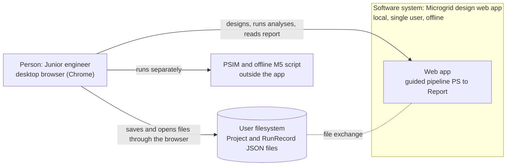
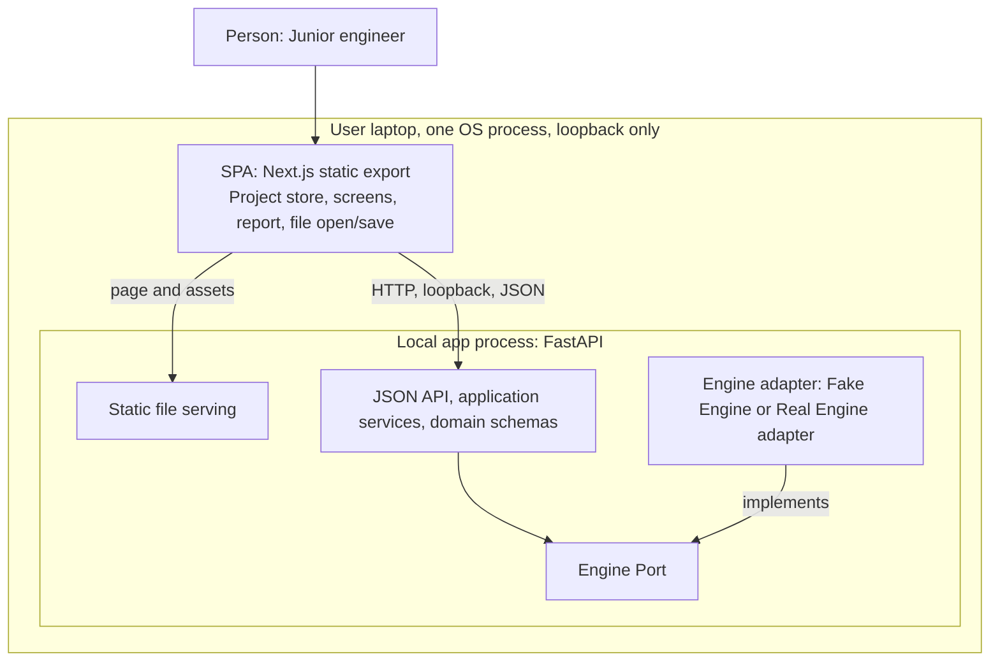
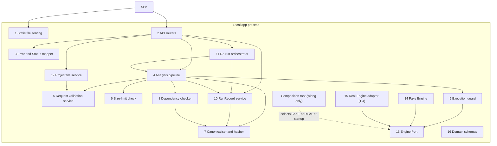
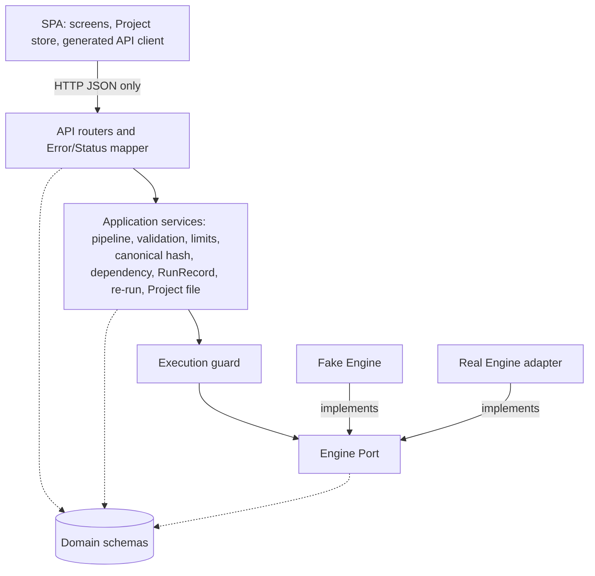
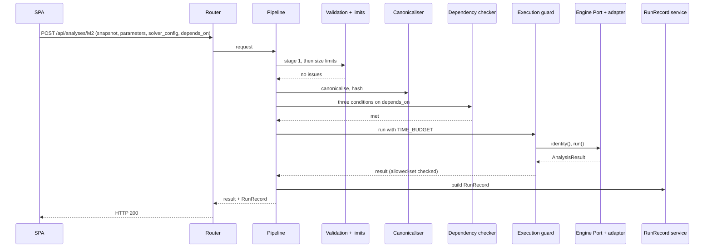

# 04 — Architecture Overview

> Doc 4 of the doc set. **Aligned with the final seminar-proposal manuscript (`Seminar.pdf`, subbab 4.3.1–4.3.3, 4.4.2, Gambar 4.4a–4.4b, C.5a–C.5b, Tabel D.1) on 2026-11-01** (Doc 14 items D2, D3); the manuscript wins on any conflict. Names follow Doc 3. Equations are allowed (user decision 2026-11-01). Software phases P0–P4 of the earlier draft are replaced by the manuscript stages 1.1–1.7 (Doc 10). The prototype `App/` is reference only.

## Ringkasan
Dokumen ini menggambarkan struktur aplikasi web pada tiga tingkat: konteks sistem, wadah (*container*), dan komponen. Aplikasi berjalan sebagai satu proses lokal yang melayani antarmuka peramban sekaligus API JSON, tanpa basis data dan tanpa koneksi internet. Server tidak menyimpan keadaan: Project yang sedang dibuka dan seluruh RunRecord berada di peramban, dan setiap permintaan analisis memuat semua data yang dibutuhkan. Proses lokal terdiri atas enam belas komponen, termasuk orkestrator eksekusi ulang yang memutus ketergantungan siklik antara layanan RunRecord dan *pipeline*. Semua perhitungan hanya dapat dicapai melalui Engine Port, dan di antara layanan hanya pengawal eksekusi yang mengimpor port itu, sehingga anggaran waktu selalu diterapkan pada titik pemanggilan mesin. Arah ketergantungan dibuat satu arah dan diperiksa saat *build* dengan import-linter dan dependency-cruiser. Dokumen ini juga memuat empat alur utama dalam diagram urutan, prosedur jalan lokal, dan sepuluh putusan beserta pemicu tinjauan ulangnya.

## 1. Architectural drivers
Seven drivers of manuscript 4.4.1 (D1–D7), plus the cross-cutting qualities they imply.

| Driver | Consequence for architecture |
|---|---|
| D1 Python engine in the same process | Backend is Python; the Real Engine adapter runs in the app process, no language bridge. |
| D2 Explicit HTTP seam, testable with the Fake Engine | Engine Port separates app from calculations; every FR with a backend effect is reachable through the API. |
| D3 Schema-first contracts with units | One domain-schemas module (Pydantic); OpenAPI generated from it; frontend types generated from OpenAPI. |
| D4 Interactive network editor, state across screens | SPA with one client-side Project store (Context + reducer). |
| D5 Local, single user, minimal components | One process, one command, static frontend, loopback bind, no DB, no server-side storage. |
| D6 Solo developer, mainstream tools | Built-in mechanisms first; thin margins stated in ADRs. |
| D7 Prototype on the same stack | Lower learning risk only; never the sole reason for a choice. |
| Reproducibility (NFR-01, FR-46–FR-53) | Self-contained requests; canonical snapshot + SHA-256; RunRecord created by the application layer, never the engine. |
| Testability (NFR-07, NFR-08, NFR-14) | Deterministic Fake Engine for all six Statuses, TIMEOUT and a defective profile; one contract suite for both adapters. |
| Time budget (FR-43, NFR-04) | Synchronous call guarded in the application layer; overrun → `UNAVAILABLE`/`TIMEOUT`. |
| Dependency direction (NFR-10, NFR-11) | Inward-only dependencies, checked in the build. |

## 2. C4 Level 1 — System context (Gambar 4.4a)

No internet dependency. M5 is Won't in the UI. Files are read and written only by the browser; the server never touches the user's filesystem.

## 3. C4 Level 2 — Containers

| Container | Responsibility | Holds state? |
|---|---|---|
| SPA | All screens; the single Project store holds the open Project and its RunRecords; file open/save via the browser; report view. Talks only to the JSON API; types generated from OpenAPI. | Yes (browser memory); localStorage autosave is a backup only, never a saved Project (manuscript 4.3.1). |
| Local app process | Static files and JSON API; validates, limits, hashes, checks dependencies, guards the engine call, builds RunRecords. | No; writes nothing to disk. |
| Engine adapter | Fake Engine (stage 1.1); Real Engine adapter from stage 1.4. | No (stateless between calls). |

Stateless backend (ADR-010): every analysis request carries snapshot, `parameters`, `solver_config`, and for dependent analyses `depends_on` (RunRecordRef, Doc 3 §5.1); M3c carries `scenarios`. Consequence (manuscript 4.3.1): larger bodies and possible loss of work on a closed tab, mitigated by export prompts and autosave.

## 4. C4 Level 3 — Sixteen components of the local process (Gambar 4.4b)

`A --> B` means A depends on B; the adapters depend on (implement) the port. Domain schemas are depended on by every component (edges omitted). The composition root is wiring, not a request-time component, and is not counted among the sixteen. [ASSUMPTION: the manuscript figure is an image; the list above is reconstructed from Doc 4 (2026-10-21) plus the size-limit step of manuscript 4.3.3, and the count of sixteen matches the manuscript text. Verify against Gambar 4.4b when the figure is redrawn.]

| # | Component | Responsibility | Depends on | Must not depend on |
|---|---|---|---|---|
| 1 | Static file serving | Serves the frontend build from the same process. | — | Domain logic |
| 2 | API routers | 15 endpoints (Doc 6); parse transport; hand off; return bodies. | 3, 4, 10, 11, 12, 16 | 13, adapters, engine package |
| 3 | Error and Status mapper | Every analysis outcome → HTTP 200 with AnalysisResult + RunRecord; request-model failures → `INPUT_INVALID`/`MALFORMED_REQUEST` (no 422); engine exception or disallowed Status → `UNAVAILABLE`/`ENGINE_ERROR`; unknown `analysis_type` → 404; 4xx transport only, 5xx defect. | 16 | 13, adapters |
| 4 | Analysis pipeline | Fixed order (manuscript 4.3.3): stage-1 validation → size limits → canonicalise + hash → dependency check → guarded engine call → RunRecord. | 5–10, 16 | 13, adapters |
| 5 | Request validation service | Stage 1 (Doc 3 §4), all issues collected; no physics. | 16 | 13, adapters |
| 6 | Size-limit check | SWEEP_CAP and other caps → `INPUT_INVALID` (e.g. SWEEP_CAP_EXCEEDED) before any engine call. | 16 | 13, adapters |
| 7 | Canonicaliser and hasher | Canonical snapshot (server-derived `r_ohm`, `x_ohm`), six canonicalisation rules, SHA-256 of snapshot and of {status, payload}. Single source of hash truth. | 16 | 13, adapters |
| 8 | Dependency checker | Three conditions on `depends_on` (FEASIBLE, snapshot hash, result hash) → `UNAVAILABLE`/`DEPENDENCY_NOT_MET`; "stale" wording when only the snapshot hash fails. | 7, 16 | 13, adapters |
| 9 | Execution guard | **The only service importing the Engine Port** (manuscript 4.3.1): reads engine identity, makes the one `run` call under TIME_BUDGET (30 s initial), maps overrun to TIMEOUT and exceptions to ENGINE_ERROR, enforces the allowed-Status set. | 13, 16 | concrete adapters, engine package |
| 10 | RunRecord service | Builds the 17-field RunRecord for every request; verifies imported records (schema, both hashes); compares a re-run (REPRODUCED iff status and result_hash equal). | 7, 16 | 13, 4 |
| 11 | Re-run orchestrator | Verify → send stored input through the pipeline → compare. Added to break the RunRecord service ↔ pipeline cycle (manuscript 4.3.1). | 4, 10, 16 | 13, adapters |
| 12 | Project file service | `schema_version`, forward migration, refusal, stage-1 validation after migration; FileCheckResult, not a Status. | 5, 16 | 13, adapters |
| 13 | Engine Port | Interface: `run`, `identity` (§5). | 16 | everything else |
| 14 | Fake Engine | Deterministic canned results (§5.3). | 13, 16 | services, api, 15 |
| 15 | Real Engine adapter | Engine package behind the port; unit conversion; version/commit/kind. Stage 1.4. | 13, 16, engine package | services, api, 14 |
| 16 | Domain schemas | Doc 3 entities, enums, request/result/RunRecord shapes; source of OpenAPI. | nothing in the app | — |

Report assembly is client-side (print to PDF, FR-60).

## 5. Engine Port

### 5.1 Operations and the seven rules (Tabel D.1)
`run(AnalysisRequest) → AnalysisResult`; `identity() → {engine_kind (FAKE|REAL), engine_version, engine_git_commit}`.

| # | Rule | Consequence in the app |
|---|---|---|
| 1 | Stateless between calls | M1 travels in the request (`depends_on`). |
| 2 | Deterministic | Basis of hash comparison (REPRODUCED). |
| 3 | Never creates a RunRecord | The RunRecord service does. |
| 4 | Failures as status, code, message; no exceptions | An exception becomes `UNAVAILABLE`/`ENGINE_ERROR` (never SOLVER_FAILED). |
| 5 | Reports version, commit, kind | Stored in the RunRecord. |
| 6 | Does not handle the time budget | The execution guard does. |
| 7 | Contract units | Conversion is the Real Engine adapter's job. |

### 5.2 Allowed Status per analysis type (manuscript 4.3.2)
Every type may also return `INPUT_INVALID` and `UNAVAILABLE`.

| analysis_type | Additional allowed Status |
|---|---|
| PS | FEASIBLE (closed form) |
| M1 | FEASIBLE ("operating point found"), SOLVER_FAILED, PHYSICALLY_INADMISSIBLE; never INFEASIBLE |
| M2 | FEASIBLE, INFEASIBLE |
| M3a–M3d | FEASIBLE when the request completes; per-point Status in the payload |
| M4a, M4b | FEASIBLE (class in payload), SOLVER_FAILED |

A Status outside the set → `UNAVAILABLE`/`ENGINE_ERROR`. An analysis type the active adapter does not support → `UNAVAILABLE`/`NOT_APPLICABLE` (route exists, HTTP 200, RunRecord).

### 5.3 Contract suite and Fake Engine
One suite, nine behaviours, run on every adapter (manuscript 4.3.2, 4.5.1), and also against a **defective Fake profile**, which must make the suite fail:

1. Exactly one Status per request, with non-empty `status_code` and `message`; an unsupported type → `UNAVAILABLE`/`NOT_APPLICABLE`.
2. Returned Status within the allowed set (§5.2); M1 never `INFEASIBLE`.
3. `INFEASIBLE` carries non-empty `limiting_constraints` with valid kind, element, unit, negative margin.
4. Payload presence follows the Status table (null for INPUT_INVALID, SOLVER_FAILED, UNAVAILABLE).
5. Payload fields match Doc 3 §6 for the type.
6. Determinism and statelessness: repeated and re-ordered calls give equal results.
7. The request is not mutated; no RunRecord or file is produced.
8. Identity (kind, version, commit) non-empty and stable.
9. Failures surface as Statuses, never as exceptions.

Fake Engine: canned deterministic results per `analysis_type` for all six Statuses, a delay beyond TIME_BUDGET (TIMEOUT), a raise mode (ENGINE_ERROR test of the guard, excluded from the suite) and the defective profile. Every Fake result carries `engine_kind` FAKE and warning `ENGINE_KIND_FAKE`. Scenario selection and call recording are in-process test controls, never a request field or route (Doc 8 §5).

## 6. Layering and dependency direction

- Inward only: UI → API → services → Engine Port ← adapters. Among services only the execution guard imports the Engine Port; only the Real Engine adapter imports the engine package (NFR-10, NFR-11).
- Checked in the build: **import-linter** (Python) and **dependency-cruiser** (TypeScript); any violation fails the build (manuscript 4.3.1). Contracts in Doc 8 §2.
- The frontend has no Next.js server features (static export); `fetch` only in the API client.
- Engine selection by startup configuration (FAKE | REAL), never per request.

## 7. Key runtime flows
All analysis outcomes return HTTP 200 with AnalysisResult and RunRecord.

### (a) Dependent analysis (M2)

If a stage fails, the flow stops there without an engine call and still builds a RunRecord with null engine fields.

### (b) INPUT_INVALID
Stage-1 issues (or a request-model failure, or a size limit) → INPUT_INVALID with all issues in `diagnostics.issues`; the submitted snapshot is canonicalised and hashed as submitted; no engine call; HTTP 200, never 422.

### (c) TIMEOUT
The guard reads `identity()` first, then runs the call in a worker thread and waits at most TIME_BUDGET. On overrun it returns `UNAVAILABLE`/`TIMEOUT`; the late result is discarded. Engine fields in the RunRecord are filled because the engine was called. **Decision (user 2026-11-01, closes Doc 9 A-15):** worker thread with abandon for stage 1.1; a thread cannot be killed, so a runaway Real Engine call keeps a CPU busy until it ends. Revisit at WP 1.4.3 (option: subprocess per call). An engine exception follows the same path with `ENGINE_ERROR`.

### (d) RunRecord re-run
Router → re-run orchestrator → RunRecord service verifies (schema, both hashes; mismatch → HASH_MISMATCH, nothing runs) → pipeline runs the stored input → new RunRecord with `replay_of_record_id` → comparison (REPRODUCED iff status and result_hash equal; otherwise DIFFERS with differences). A differing engine version warns and still runs. The imported record is never modified.

## 8. Deployment view (local)
| Aspect | Description |
|---|---|
| Build | Frontend built once into static files copied to `backend/src/mgapp/static/` (`python tools/build_frontend.py`). |
| Start | One command: `uv run mgapp` (NFR-02); serves UI and API from one process. |
| Binding | 127.0.0.1 only (NFR-17). |
| Network | Offline at runtime (NFR-03). |
| Engine | FAKE in stage 1.1–1.3; REAL selectable from stage 1.4 (`MGAPP_ENGINE=FAKE|REAL`). |
| Target machine | Windows 11 laptop (manuscript Tabel 3.5); the cloud session only builds and tests. |

## 9. Cross-cutting concerns
| Concern | Approach |
|---|---|
| Reproducibility | Canonical JSON + SHA-256 (Doc 3 §7); RunRecord per request; exact-equality comparison; `app_version` pins library versions via the lock files. |
| Units | Contract units only in the app; engine units converted by the Real Engine adapter. |
| Logging | Console only, no log file (a file would be a server disk write). |
| Versions | app version; Project `schema_version`; RunRecord `schema_version`; engine identity; API description version (`/api/meta`). |
| Security | Local, no authentication, loopback; residual local-port risk accepted. Hashes detect accident, not tampering. |

## 10. Decisions (manuscript Tabel 4.11)
| Decision | Choice | Rejected | Margin and revisit trigger | ADR |
|---|---|---|---|---|
| Backend | FastAPI | Flask, Django/DRF, Streamlit/Dash | Flask still viable; revisit if the engine adapter cannot run in one process | 001 |
| Frontend | Next.js, static export only | Streamlit/Dash, Vite, htmx, Electron/PyQt | Thin vs Vite; revisit if static export blocks a feature, or a shared server is needed | 002 |
| API style | JSON/HTTP, resource and action | GraphQL, WebSocket/SSE, single-endpoint RPC | Not thin; revisit if async execution is adopted | 003 |
| Storage | Versioned Project JSON file | SQLite, browser storage | Not thin; revisit for multi-user, or a Project file above 10 MiB | 004 |
| Client state | Context + reducer | Zustand, TanStack Query | Thin; revisit if one edit on the largest test Project takes more than 100 ms | 005 |
| Status handling | Six-value enum, HTTP 200 | HTTP code per status, exception per failure | Not thin; revisit if a client needs HTTP failure signals | 006 |
| Execution model | Synchronous with time budget and sweep cap | Async queue, background thread with polling | Not thin; revisit if engine time measured at WP 1.4.3 exceeds 30 s | 007 |
| Engine boundary | Engine Port, Fake Engine first | Direct calls, function mocks | Not thin; revisit if stage 1.4 shows gaps in canned results | 008 |
| Methodology | Iterative-incremental with stage gates | Waterfall, V-model, Scrum | Not thin; revisit if a second developer joins | 009 |
| Stateless backend | Server without state | In-memory sessions, file workspace | Not thin; revisit if request bodies exceed the 10 MiB limit | 010 |

Trigger thresholds are the author's initial values and are re-checked at WP 1.7.1 (manuscript 4.4.2).

## 11. Open points
| # | Item | Tag | → doc |
|---|---|---|---|
| 1 | Component list reconstructed from text; verify against Gambar 4.4b. | [ASSUMPTION] | — |
| 2 | Timeout mechanism (thread + abandon) revisited at WP 1.4.3. | DECIDED for 1.1 | 9 |
| 3 | Caps without values (SCENARIO_CAP, M3a parameter cap, M4b duration cap). | [ASSUMPTION] | 6, 9 |
| 4 | Measured TIME_BUDGET (WP 1.4.3); SWEEP_CAP, MARGIN_WARN, body limit (WP 1.7.1). | [ASSUMPTION] until measured | 9 |

## Log
| Date | Change |
|---|---|
| 2026-10-17 – 10-21 | Drafted; J1–J7, K1–K6; C5.1, C5.10, C5.12 (re-run orchestrator). |
| 2026-11-01 | Aligned with the manuscript (Doc 14 D2, D3): sixteen components incl. size-limit check and re-run orchestrator; only the execution guard imports the Engine Port; seven port rules (Tabel D.1); allowed Status sets of 4.3.2 replace the ◇ table; contract suite with defective Fake profile; `ENGINE_KIND_FAKE` decided; import-linter and dependency-cruiser decided; timeout mechanism decided for 1.1; Tabel 4.11 margins and triggers; stages 1.1–1.7 replace P0–P4; one start command named. |
