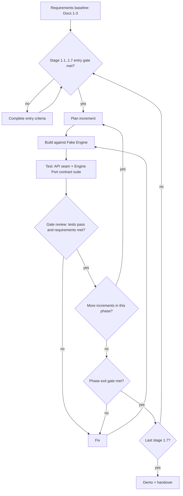

# ADR-009 — Development methodology: iterative-incremental with phase gates, Fake-Engine-first

- Status: Accepted (2026-10-17)
- Drivers: D6; NFR-18, NFR-09, NFR-08, DR-04

## Context
Solo developer, a short planning window, AI-assisted implementation later, and a calculation engine that does not yet exist. Requirements are baselined by the doc set (Docs 1-3); work must not silently jump ahead of a gate (NFR-18).

## Options considered
| Option | Pros | Cons | Verdict |
|---|---|---|---|
| Iterative-incremental with phase gates, Fake-Engine-first | Working increments early; gates stop silent skipping; engine risk deferred behind the port | Gate reviews are self-administered (solo) | **Chosen** |
| Waterfall | Simple, document-driven | Late feedback; engine arrives last so integration risk is concentrated | Rejected |
| V-model | Explicit requirement-to-test pairing | Heavy sequential structure for a small tool | Not adopted as a process; **vocabulary borrowed** for the requirement-to-test mapping in Doc 8 |
| Scrum | Common | Roles and ceremonies assume a team | Rejected (solo) |

## Decision
Stages (Doc 10, manuscript Tabel 4.15, after proposal acceptance): 1.1 skeleton + Fake Engine; 1.2 Must features on the Fake Engine; 1.3 calculation engine; 1.4 Real Engine adapter for PS/M1/M2; 1.5 Should features; 1.6 offline PSIM validation (with 1.4); 1.7 hardening + evidence package; 1.8 management throughout. Each increment is built against the Fake Engine, tested at the API seam plus the contract suite, then reviewed at a gate. Any literature claim on these methodologies is [NEEDS SOURCE].

## Trade-offs and consequences
- Positive: engine risk isolated to stages 1.3-1.4; each increment demonstrable.
- Negative: self-review gates are weaker than independent review; mitigated by advisor review at phase boundaries [ASSUMPTION].
- Follow-up: requirement-to-test table in Doc 8.

## Revisit when
- **Manuscript trigger (Tabel 4.11):** A second developer joins. Margin: not thin. Threshold values are the author's initial values, re-checked at WP 1.7.1 (aligned 2026-11-01, Doc 14 D3).
- A second developer joins.
- The Real Engine adapter at stage 1.4 forces changes to the baselined contract.
