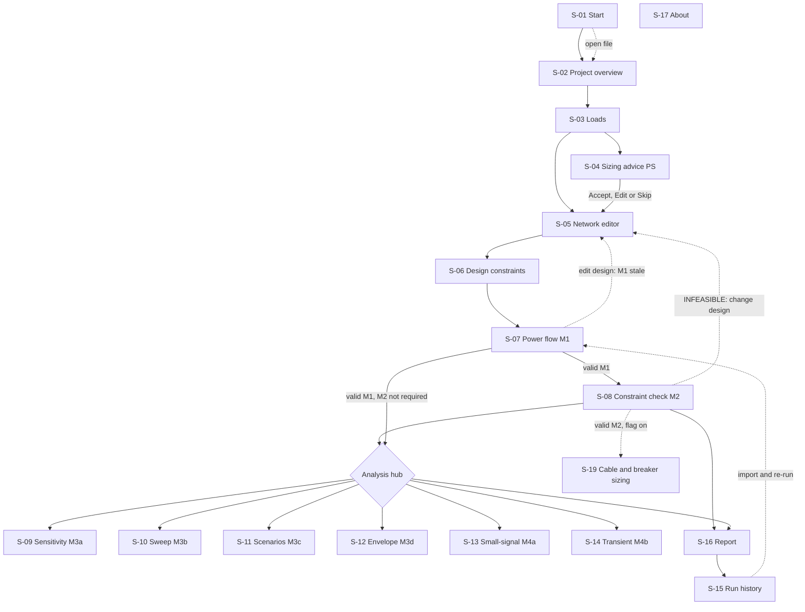
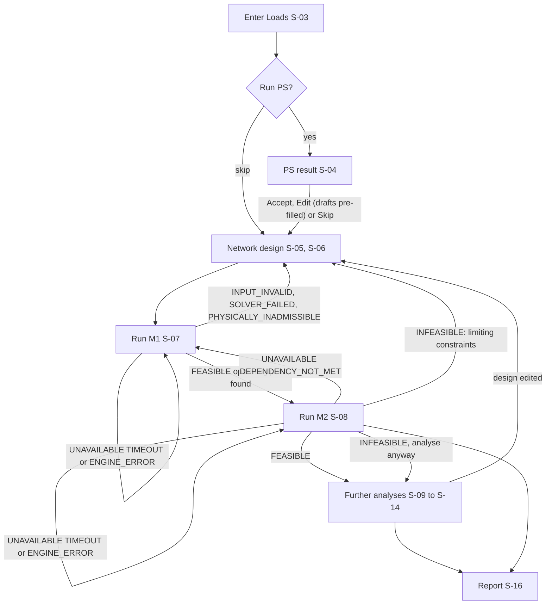
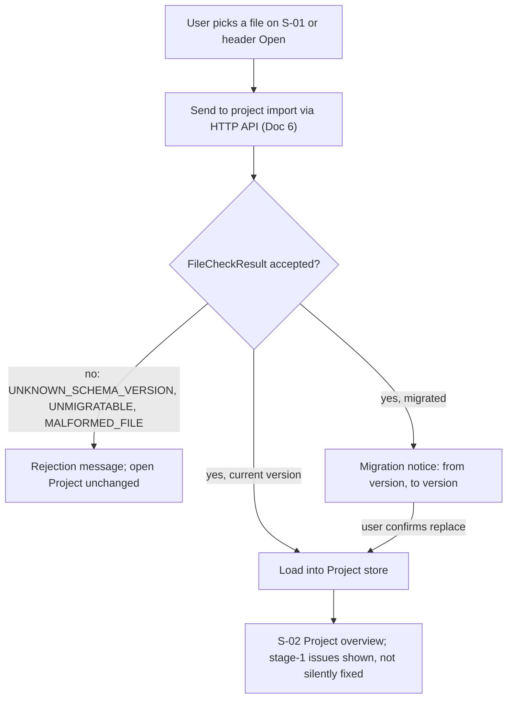
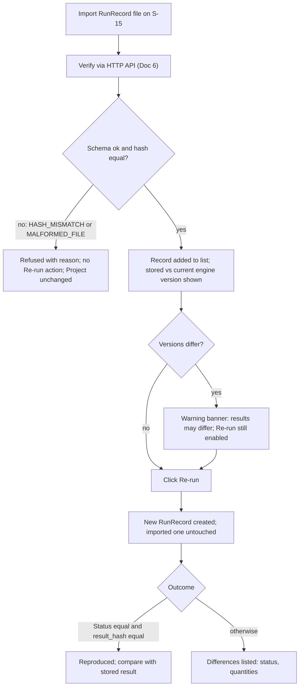
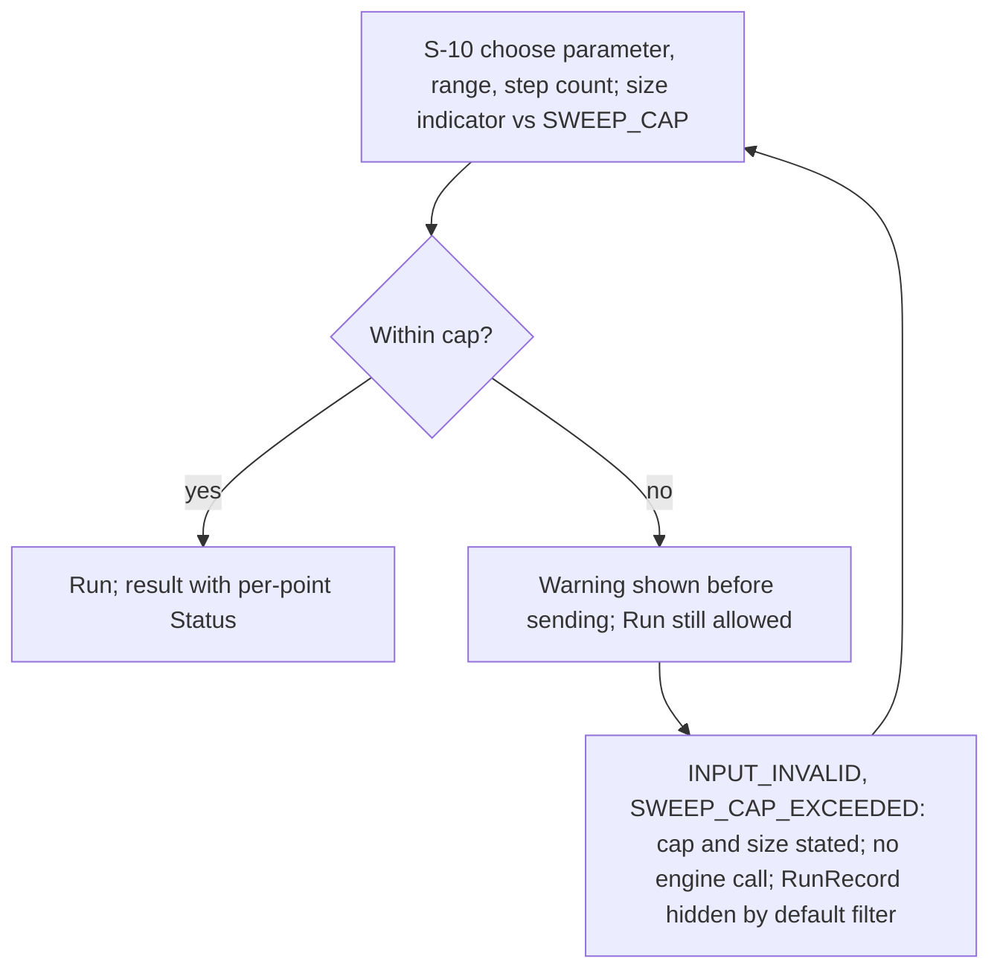

# 07 — UI Information Architecture

> Doc 7 of 11. Inputs: PROMPT_v2 (user stories, pipeline order), Docs 1–4, ADR-002/005/010, decisions G, I, J, K (2026-10-17). Names and FR IDs follow Docs 2–3. The HTTP API is specified in Doc 6 and is referred to here only as "the HTTP API (Doc 6)". Wireframes use placeholders only. **Aligned with the final manuscript (`Seminar.pdf` 4.3.7, 4.2) on 2026-11-01 (Doc 14 D4)**: 17 routes (10 Must, 6 Should, 1 Could) confirmed; no-equations guardrail removed (Doc 14 A20). Phases P0–P4 read as stages 1.1, 1.2, 1.4, 1.5, 1.7.

## Ringkasan
Dokumen ini menjelaskan susunan layar aplikasi: layar apa saja yang ada, bagaimana pengguna berpindah antar layar, dan apa yang ditampilkan pada setiap kondisi. Aplikasi dirancang mengikuti alur kerja satu arah, yaitu data beban, saran kapasitas, desain jaringan, aliran daya (M1), pemeriksaan batasan (M2), analisis lanjutan, lalu laporan. Setiap hasil analisis selalu ditampilkan bersama status dan pesan yang mudah dipahami, tidak pernah hanya berupa kode. Saran kapasitas dari tahap PS dibedakan secara visual dari data desain, dan hanya menjadi data desain setelah pengguna menerimanya. Dokumen ini juga memuat aturan kapan suatu langkah boleh dijalankan, misalnya M2 hanya aktif bila ada hasil M1 yang masih berlaku. Sketsa layar bersifat kasar dan tidak memuat angka sebenarnya. Pilihan bahasa antarmuka belum diputuskan dan dicatat sebagai poin terbuka beserta rekomendasinya.

## 1. Principles

| # | Principle | Consequence in the UI | Source |
|---|---|---|---|
| P1 | Pipeline first | A persistent stepper of eight steps (Loads → Sizing advice (PS) → Network → Constraints → Power flow (M1) → Constraint check (M2) → Further analyses (M3/M4) → Report; labels as in §3) shows where the user is and what is done, stale or blocked. Side analyses (M3, M4) hang off the stepper after M2. | PROMPT pipeline, US-18..34 |
| P2 | Status is always visible and never a bare code | Every result screen opens with a Status banner: Status name, plain message, next-step hint (§5). `status_code` is shown only as secondary detail. The header shows engine kind (FAKE or REAL) on every screen so Fake results are never mistaken for real ones. | FR-35, FR-36, NFR-06 |
| P3 | Units next to every field | Every numeric input has a unit label (kW, kvar, kV, Hz, Hz/kW, kV/kvar, km, Ω/km, p.u.); no hidden conversion; derived Line totals are labelled "derived, read-only". | FR-05, NFR-05, Doc 3 §1 |
| P4 | Design data differs visibly from advice | SizingAdvice (PS) and SizingCheck (M2) use an "advisory" visual treatment (dashed outline, "Advice" tag) and never sit in editable design tables; SizingAdvice becomes design data only on explicit Accept. | FR-08, FR-27 |
| P5 | Table editing is the Must baseline | Buses, Lines, Loads, Inverters are fully editable as tables. The network diagram is Should and read-only-first [ASSUMPTION]; nothing needs the diagram. | FR-10..13 Must, FR-14 Should |
| P6 | Validation does not block a run request | Readiness hints are shown before a run, but a run can be requested anyway so an `INPUT_INVALID` result (with a RunRecord) lists every issue. Dependent analyses are the exception (§3 gating). | FR-17, FR-20, FR-46 |
| P7 | Nothing is lost silently | Unsaved-changes indicator, export prompt before leaving or closing, failed open/import never alters the open Project. | NFR-16, ADR-010 |

## 2. Screen inventory
Routes are Next.js static-export paths (file-based routing, ADR-002), no dynamic segments; selected items are held in the Project store or query string.

| ID | Screen | Route | Purpose | Main FR IDs | Priority |
|---|---|---|---|---|---|
| S-01 | Start | `/` | Create a new Project; open a Project file (import: check + forward migration, or reject with message); recent autosave offer; open the guided example (Doc 12 X9). | FR-01, FR-54, FR-55, FR-56, FR-57, FR-99 | Must (migration notice: Should) |
| S-02 | Project overview | `/project/` | Name and description; pipeline status per step; design readiness checklist; Save Project (export JSON); counts of Buses, Lines, Loads, Inverters, RunRecords. | FR-02, FR-54, FR-55, FR-57 | Must (name/description: Should) |
| S-03 | Loads (+ LoadProfile) | `/loads/` | Load table (Bus, P, Q or power factor with direction); optional 24-point LoadProfile editor; inline validation. | FR-03, FR-04, FR-05, FR-17, FR-18 | Must (LoadProfile: Should) |
| S-04 | Sizing advice (PS) | `/sizing/` | Run PS; show SizingAdvice with basis and assumptions; Accept / Edit / Skip; stale-advice notice. | FR-06, FR-07, FR-08, FR-09, FR-27 | Must (pre-fill: Should) |
| S-05 | Network editor | `/network/` | Tabs Buses, Lines, Inverters (tables); delete guard for Buses; derived Line totals; diagram panel (Should). | FR-10, FR-11, FR-12, FR-13, FR-14, FR-05, FR-19 | Must (guard, diagram: Should) |
| S-06 | Design constraints | `/constraints/` | Voltage band (p.u.), frequency band (Hz), Inverter loading limit, Line current limit; **no numeric defaults**: every field starts empty and an empty limit is shown as "not evaluated" (manuscript 4.2.4). | FR-15, FR-16, FR-05 | Must ("not evaluated" display: Should) |
| S-07 | Power flow (M1) | `/power-flow/` | Run M1; Status banner (an `INPUT_INVALID` result lists all violations, §5); bus voltages, system frequency, Inverter outputs, Line flows; freshness badge (current or stale). | FR-22, FR-23, FR-17, FR-19, FR-20, FR-21, FR-35, FR-36, FR-37, FR-42, FR-43, FR-45 | Must (all-violations list, progress: Should) |
| S-08 | Constraint check (M2) | `/constraint-check/` | Run M2 with design margins m_inv, m_line (required, no default) and optional storage settings; verdict; limiting constraints list; margins; separate "Not evaluated" list (empty limits, never counted as satisfied); loadability λ_c, λ_s with resolution (λ_s labelled "solution existence, not a stability limit"); SizingCheck panel (separate from SizingAdvice). | FR-24, FR-25, FR-27, FR-26, FR-35, FR-36, FR-37, FR-38, FR-40 | Must (margins: Should) |
| S-09 | Sensitivity (M3a) | `/sensitivity/` | Choose parameters and output metrics; run; ranked sensitivities. | FR-28, FR-39, FR-41 | Should |
| S-10 | Sweep (M3b) | `/sweep/` | Choose an axis (one parameter, a shared scale factor over a set of elements, or load scale λ), range, step count; optional per-point metrics (λ_c, ζ_min, Re λ_dom, indicators) and eigenvalues per point (Doc 3 §6.5, D-95); size indicator vs `SWEEP_CAP` (initial 1 000); per-point Status plot and table; first infeasible value. | FR-29, FR-44, FR-39, FR-41 | Should |
| S-11 | Scenarios and comparison (M3c) | `/scenarios/` | Save current design as Scenario; edit overrides; select 2 or more; compare with explicit deltas. | FR-30, FR-31, FR-39, FR-41 | Should |
| S-12 | Envelope (M3d) | `/envelope/` | Two parameters and ranges; grid of per-point Status; feasible fraction. | FR-32, FR-44 | Could |
| S-13 | Small-signal (M4a) | `/small-signal/` | Run; eigenvalues, damping, dominant modes, participation (when available) tables; stability class STABLE / MARGINAL / UNSTABLE in words; indicators r_τ, κ, r_in, ε_X with "evaluated" flag and reason, labelled "validity not calibrated" until stage 1.6; optional τ_in and damping threshold inputs. | FR-33, FR-39, FR-41 | Should |
| S-14 | Transient (M4b) | `/transient/` | Define disturbance from the four-kind catalogue (load step, load scaling on one or all buses, reference step on P*, Q*, V* or ω*, inverter outage; permanent or finite duration); run; frequency, voltage, P and Q time responses; transient class RECOVERED_STABLE / CRITERIA_VIOLATED / UNSTABLE in words; max RoCoF (descriptive). | FR-34, FR-39, FR-41, FR-103 | Should |
| S-15 | Run history | `/runs/` | RunRecord list (INPUT_INVALID hidden by default); detail; export; import; verify; re-run; reproduction outcome; version comparison. | FR-46..FR-53, FR-57 | Must (version warning: Should) |
| S-16 | Report | `/report/` | HTML report: verdict, limiting constraints, margins, assumptions, tables, charts, RunRecord hashes; print layout. | FR-48, FR-58, FR-59, FR-60 | Must (print: Should) |
| S-17 | About and limits | `/about/` | App, schema and engine versions (FAKE or REAL); active limits (`TIME_BUDGET`, `SWEEP_CAP`, `SCENARIO_CAP`); glossary; offline note. | FR-51, NFR-02, NFR-03 | Should [ASSUMPTION] |
| S-19 | Cable and breaker sizing (experimental, Doc 12 X10) | `/cable-sizing/` | Installation settings with per-element overrides; Run; fixed islanded caveat; results table per Line and Inverter feeder with expandable factor rows. Hidden when `feature_cable_sizing` is off. | FR-105, FR-106, FR-112 | Could |

Global elements on every screen (not separate screens): header (Project name, unsaved indicator, Save and Open buttons, engine kind badge), pipeline stepper (§3), a status toast area for transport errors (HTTP 4xx or 5xx, "cannot reach the local service").

### 2.1 Must-FR placement check

| Screen | Must FRs placed there |
|---|---|
| S-01 | FR-01, FR-54, FR-55, FR-57 |
| S-02 | FR-54, FR-55, FR-57 |
| S-03 | FR-03, FR-05, FR-17, FR-18 |
| S-04 | FR-06, FR-07, FR-08, FR-27 (separation from SizingCheck) |
| S-05 | FR-10, FR-12, FR-13, FR-19, FR-05 |
| S-06 | FR-15, FR-05 |
| S-07 | FR-17, FR-19, FR-21, FR-22, FR-23, FR-35, FR-36, FR-37, FR-42, FR-43 |
| S-08 | FR-24, FR-25, FR-27, FR-35, FR-36, FR-37, FR-38, FR-40 |
| S-15 | FR-46, FR-47, FR-48, FR-49, FR-50, FR-52, FR-53, FR-57 |
| S-16 | FR-48 (hash shown), FR-58, FR-59 |

Every Must FR with a UI effect appears in at least one screen. FR-35 applies to all result screens through the Status banner (§5).

### 2.2 UX and analytics additions (Doc 12 X0–X7, D-72)

Presentation only; every value comes from a payload already returned. Tile and chart sources are listed in `docs/UX_ANALYTICS_GUIDELINES.md` §4–§5.

| Screen | KPI strip (FR-87) | Charts (FR-86, FR-88; crosshair FR-89 on line and point charts) | Inspector (FR-90) |
|---|---|---|---|
| S-05 | — | — | from table rows and diagram nodes |
| S-07 | frequency, lowest and highest bus voltage, highest inverter loading, total load, total losses, iterations, ε_X (indicator, threshold not yet calibrated) | bus voltage profile, inverter loading, power sharing (Advice), line loading | from result table rows |
| S-08 | verdict, violated count, tightest constraint, not-evaluated count, λ_c, λ_s (solution existence, not a stability limit) | margin chart, loadability axis | from constraint rows |
| S-09 | — | tornado per output metric | — |
| S-10 | points, first infeasible value, points per Status | chosen metric vs axis value, marker by Status | — |
| S-11 | — | grouped bars per metric across scenarios | — |
| S-12 | feasible fraction, points, points per Status | status grid with the word in every cell | — |
| S-13 | stability class, ζ_min, damping check (only with a threshold), dominant mode frequency, outside definition | eigenvalue plot, participation grid | — |
| S-14 | transient class (or "not classified" with reason), settled, max RoCoF (descriptive) | frequency, bus voltage, P and Q per inverter vs time | — |
| S-16 | — | static versions of the S-07, S-08 and run-specific charts, no crosshair | — |

The strip sits under the page head and the Status banner; the inspector is a side panel, not a modal. Every result screen shows the latest RunRecord of its type that matches the current design (FR-93). Domain terms carry a "?" toggletip with Indonesian text (FR-91, §9 #1); S-17 About, built in this round, lists the glossary. Every chart, strip and inspector fed by a FAKE run carries the FAKE marking.

### 2.3 Example mode (Doc 12 X9, D-92)

Presentation and workflow only (`docs/EXAMPLE_MODE_PRD.md`). Entering: S-01 "Open guided example (D2)" opens `frontend/public/examples/guided-d2.mgproj.json` as a new unsaved copy (FR-99). Leaving: the header button "Leave example mode", or opening, creating or importing another Project; the Project and its RunRecords stay. Save writes a normal Project file; the example settings are not saved (stated in the toggletip of the header Tag).

| Element | Where | Behaviour |
|---|---|---|
| Tag "Example mode" + "Leave example mode" | Header, next to the engine badge | Visible only in example mode (FR-99). |
| Info banner + "What this step shows" | S-03 – S-16 under the page head | Info role, not a status colour; guidance 2–4 sentences, English, no result numbers, with the manuscript section it paraphrases (FR-102). On the Fake Engine it adds "Results on the Fake Engine are placeholders. Start with `MGAPP_ENGINE=REAL` to see engine results." Hidden in print; S-16 adds the printed line "Produced in example mode from the guided example D2." (D-97). |
| "Example" tag | Each prefilled field | Toggletip names the source (FR-100). A field without a confirmed value shows "Not set in the example: enter a value." |
| "Reset to example values" | Each form screen | Ghost button; re-applies the example layer only. |
| "Next: <step>" | Under a successful result | Pipeline order (§3); further analyses M3a → M3b → M3c → M3d → M4a → M4b → Report (FR-102). Shown after a FEASIBLE or INFEASIBLE run, and always on S-03, S-05, S-06 (no Run button); none on the Report (D-97 K251). |
| Example disturbances | S-14 | DR-01 load step, TS-02 inverter outage, DR-02 P* step (Doc 13 §5); choosing one refills the disturbance fields (FR-103). |
| Read-only notice | S-06 | The study limits of the example come from the Project file. |
| "Run the whole example" | S-02 | Could, built last (FR-104, D-92 K228). Runs the pipeline in order with each screen's starting values, skips steps the example leaves unset, stops at the first result that is not FEASIBLE, then opens the Report (D-98). |

**Settings file** `frontend/public/examples/guided-d2.example.json`, read only by the frontend: `example_settings_version` (1), `project` (path of the Project file), `screens` mapping a screen id to `fields` (field name → {value, source}) and `guidance` ({text, source}), and `presets` for S-14 (id, label, source, disturbance fields). It is validated on load by a hand-written type guard: unknown keys are ignored; a value that fails the field's stage-1 rule or a `parameter_path` that does not resolve (Doc 3 §3.10) is dropped with a console warning and treated as not set; a missing or invalid file hides the S-01 action.

### 2.4 Cable and breaker sizing (Doc 12 X10, D-100)

S-19 exists only when the feature flag `feature_cable_sizing` is on (FR-105); it sits under Further analyses, after M2. Layout per `docs/CABLE_BREAKER_FEATURE_GUIDELINES.md` §6: settings panel (Project defaults) → Run → Status banner → the fixed caveat "Grid-forming inverters limit their fault current. A breaker sized here for overload may not trip on a fault in islanded operation. Fault protection is not assessed by this tool." → results table; a row expands to the factors, the table and page used for each factor, and the catalogue match (FR-112). Outcomes use Carbon support colours with icon and word, never brand colours. After a current run the single-line diagram shows a breaker symbol on each sized Line and Inverter feeder (FR-113); S-16 adds the section "Cable and overload sizing (experimental)" (FR-114); S-18 gains the entry kind `BREAKER` (FR-115).

## 3. Navigation


Stepper steps: 1 Loads, 2 Sizing advice (optional, can be skipped), 3 Network, 4 Constraints, 5 Power flow, 6 Constraint check, 7 Further analyses, 8 Report. Run history and About are reachable from the header at any time. The stepper is guidance, not a wizard lock: the user can jump to any screen whose route is enabled.

### 3.1 Gating rules

| Step | Enabled when | Otherwise shows |
|---|---|---|
| S-02..S-06 (editing) | A Project is open. | Redirect to Start with "Create or open a Project first." |
| S-04 Run PS | At least one Load exists. | Disabled button; "Add at least one load first" with link to S-03. Viewing earlier advice stays possible. |
| S-07 Run M1 | A Project is open. Readiness checklist shown (Loads, Inverter, connected network, constraints). | Button stays enabled; unmet items listed as warnings. A run with missing items returns `INPUT_INVALID` with all issues (P6, FR-20). |
| S-08 Run M2 | A valid M1 exists for the current design (M1 Status `FEASIBLE`, design not edited since). | Disabled button; panel "Run power flow (M1) first" or, if edited, the stale banner below. The HTTP API (Doc 6) still enforces the dependency (FR-38). |
| S-09..S-14 Run | A valid M1 exists (as for M2). M2 verdict not required; an `INFEASIBLE` design is allowed. | Disabled button; same M1 message. `INFEASIBLE` M2 shows an info note "This design violates constraints; further analyses are still allowed" (FR-41). |
| S-10, S-12 Run | Valid M1 and requested point count within `SWEEP_CAP`. | Size indicator turns to error; request still sendable, result is `INPUT_INVALID` / `SWEEP_CAP_EXCEEDED` (F4). |
| S-19 Run (flag on) | A valid M2 exists for the current design (Status FEASIBLE or INFEASIBLE, design not edited since). | Disabled button; "Run the constraint check (M2) first" or the stale banner. The API returns `UNAVAILABLE / DEPENDENCY_NOT_MET` (FR-111). |
| S-11 Compare / S-15 Re-run | 2 or more Scenarios selected (up to `SCENARIO_CAP` [ASSUMPTION]) / a RunRecord with verified hash. | "Select two or more Scenarios." / Re-run hidden after failed verification (FR-50). |
| S-16 Report | At least one RunRecord with a result exists. | Empty state "No results yet. Run M1 and M2 first." |

**Stale-M1 rule.** Any edit to design data (Buses, Lines, Loads, LoadProfile, Inverters, DesignConstraints, adopted SizingAdvice) after an M1 run marks that M1 result "stale" in the Project store. A stale banner appears on S-07, S-08 and S-09..S-14: "The design changed after the last power flow. Re-run M1 to continue." and the stepper shows steps 6 and 7 as blocked. The authoritative check is the application service (hash comparison, FR-38, FR-40); the UI flag is a conservative early warning. Editing and reverting a value leaves the flag set until M1 is re-run or the hash is re-checked [ASSUMPTION, see §9 item 3].

## 4. Key flows
First phase per flow (aligned with Doc 8 T5 and Doc 10, C5.4, 2026-10-21): F1 core (load entry → PS → design → M1/M2 → report), F2 core and F3 core are E2E-tested from P1. F4 and the branches that need Should items (F1 further analyses S-09–S-14, F2 migrated file FR-56, F3 version warning FR-51) are E2E-tested from P3.

### F1 Main pipeline with failure loops


Loop meanings: `INPUT_INVALID` returns to the screen that owns the first named field; `SOLVER_FAILED` and `PHYSICALLY_INADMISSIBLE` return to the design (S-05, S-06) with a hint to review the Inverter and Line data (no diagnosis of causes beyond the message); `INFEASIBLE` returns to the design with the limiting element highlighted; `UNAVAILABLE` / `TIMEOUT` or `ENGINE_ERROR` offers "Try again" on the same screen.

### F2 Open or import a Project file


If a Project with unsaved changes is open, a confirm step offers "Save current Project first" before replacing it. Unreadable RunRecords inside the file are reported in a list and skipped, never deleted silently (Doc 3 §8).

### F3 RunRecord import, verify, re-run, compare


### F4 Sweep refused over cap


## 5. Status presentation
Visual treatment uses colour **roles**, always paired with an icon and the Status name in text (§8). Every banner has: headline (Status in words), plain message, next-step hint, collapsible "Details" (status_code, issue list, diagnostics).

| Status / reason | Visual treatment | Plain message pattern | Next-step hint |
|---|---|---|---|
| FEASIBLE (M1, "operating point found") | Success role, check icon | "Power flow completed: an operating point was found. This is not yet a check against your limits." | "Run the constraint check (M2)." |
| FEASIBLE (M2); (PS, M3, M4: "Advice produced" / "Analysis completed") | Success role | "The design meets all constraints." Margins listed. | "Explore further analyses or open the report." PS: "Accept, edit or skip." |
| INFEASIBLE (M2) | Warning/negative role, cross icon | "A valid operating point exists, but the design violates N constraint(s)." Limiting list below. | "Change the element named first, then re-run M1 and M2." |
| SOLVER_FAILED | Error role, distinct icon | "The calculation did not reach a solution. This is a calculation problem, not a limit violation." | "Check Inverter and Line data, then retry; keep the RunRecord for the developer." |
| PHYSICALLY_INADMISSIBLE | Error role, distinct icon | "A solution was found but it is not physically possible, so it is not used." Partial values, if any, marked "diagnostic only". | "Review loads, ratings and impedances; later analyses stay blocked." |
| INPUT_INVALID | Caution role, list icon | "The input has N problem(s). Nothing was calculated." One row per issue: screen, element, field, plain message. | "Fix the listed fields (links open the field)." |
| INPUT_INVALID / SWEEP_CAP_EXCEEDED | Caution role | "This sweep has too many points: requested <n>, allowed <cap>. Nothing was calculated." | "Reduce the range or step count." |
| UNAVAILABLE / TIMEOUT | Neutral-attention role, clock icon | "The analysis took longer than <TIME_BUDGET> s and was stopped." | "Retry, or reduce the problem size. The attempt is kept in Run history." |
| UNAVAILABLE / DEPENDENCY_NOT_MET, missing | Neutral-attention role, link icon | "This analysis needs a valid power flow (M1) result, and none is available." | "Go to Power flow and run M1." |
| UNAVAILABLE / DEPENDENCY_NOT_MET, stale | Neutral-attention role | "The power flow result is out of date because the design changed. M1 must be re-run." | "Re-run M1, then retry." |
| UNAVAILABLE / DEPENDENCY_NOT_MET, M1 not usable (failed status) | Neutral-attention role | "The power flow (M1) did not produce a usable result, so this analysis cannot run." | "Fix the M1 problem first." |
| UNAVAILABLE / NOT_APPLICABLE | Neutral role, info icon | "This analysis does not apply to this design." Reason text from engine. | "Choose another analysis or change the design." |
| UNAVAILABLE / ENGINE_ERROR | Error role, wrench icon | "The calculation engine reported an unexpected error. Your data is unchanged." | "Retry; if it repeats, export the RunRecord and report it." |

Non-Status outcomes (not shown with the table above): file checks show the FileCheckResult message with a rejection or acceptance banner (§4 F2, F3); transport failures (unparseable body, unreachable service, HTTP 5xx) show a toast "The local service did not answer correctly" and create no result.

### 5.1 Limiting-constraint display (M2, also S-10, S-11 summaries)

| Element | Display |
|---|---|
| Table columns | Constraint kind (words, e.g. "Bus voltage, upper limit"), element (Bus, Line, Inverter or "System"), value with unit, limit with unit, margin with unit (negative = violated). |
| Sorting | Violated first, then smallest margin first (mirrors `constraint_margins` order). |
| Violation row | Negative-role row, text "Violated by <margin> <unit>". Clicking the element id opens S-05 with that element selected (and highlighted in the diagram when available). |
| Near-limit highlight | Rows with margin below `MARGIN_WARN` get a caution badge "Near limit" (FR-26, Should). `MARGIN_WARN` value and its unit handling per kind [ASSUMPTION], defined in Doc 3 / Doc 6. |

## 6. Low-fidelity wireframes
Notation: `[ ]` button/field, `( )` option, `<..>` placeholder. Header and stepper omitted from blocks after 6.1 except where relevant.

### 6.1 Load entry (S-03)
```
+--------------------------------------------------------------+
| <Project name> *unsaved [Save][Open]  Engine:<FAKE> |stepper|
| Loads                                         [+ Add load]   |
| Bus      | P <kW> | Q <kvar> or PF | PF dir      | [x]       |
| [<bus> v]| [    ] | (Q)(PF) [    ] | [lag/lead v]| [delete]  |
| row error: <plain message>                                   |
| LoadProfile (optional, 24 hourly values)  [Edit] [Clear]     |
| h0 <kW> h1 <kW> ... h23 <kW>     sparkline <plot>            |
| [Run sizing advice ->]   Needs at least one load.            |
```
- Regions: header and stepper; Load table; LoadProfile editor; footer action to S-04.
- Actions: add, edit, delete rows; choose Q or power factor per row (the other field disables, enforcing "exactly one"); continue to S-04.
- States: Empty: "No loads yet. Add the first load." with the Add button focused; an empty LoadProfile reads "Optional; storage advice needs it." Error: per-row inline message from stage-1 codes (negative power, power factor above 1, direction missing); the row stays editable and nothing is sent. Loading: not applicable (local editing); the Run advice button shows a progress state on S-04.

### 6.2 PS advice (S-04)
```
+--------------------------------------------------------------+
| Sizing advice (PS)                       [Run advice] [Re-run]|
| [Status banner: <FEASIBLE: advice produced> / next step]     |
| +- - - - - - - - - - ADVICE (not design data) - - - - - - -+ |
| Settings: margin m_inv <->  units n <->  redundancy r <0|1>  |
|   autonomy <h> (opt.)  η_dc <-> (opt.)  DoD <-> (opt.)      |
| : Total inverter rating <kVA>   Basis <text> Assumptions   : |
| : Inverters             <n> x <kVA>   Basis, Assumptions   : |
| : Storage energy <kWh> stage <AC|DC|NOMINAL> (LoadProfile + autonomy) : |
| +- - - - - - - - - - - - - - - - - - - - - - - - - - - - -+ |
| State: <PROPOSED>   [Accept] [Edit values] [Skip]            |
| Stale notice if loads changed since advice was made.         |
```
- Regions: PS settings form with the six parameters of Doc 3 §6.1 (m_inv, n, r required, no defaults; autonomy, η_dc, DoD optional), Status banner; dashed advice panel (P4); state line and decision buttons. A PROFILE_PEAK_ABOVE_LOADS warning is shown above the panel when present.
- Actions: Run, Accept (marks ACCEPTED; offers pre-filled Inverter drafts in S-05, FR-09), Edit (edit values; original stays visible), Skip (moves on, no design change).
- States: Empty: "No advice yet." If no Load exists, the Run button is disabled with the reason. Without a LoadProfile the storage row is replaced by "Storage advice needs a LoadProfile" (no empty value). Loading: button label "Running...", rest of the app stays usable (FR-45). Error: Status banner per §5; no advice panel for non-FEASIBLE results; Skip remains available.

### 6.3 Network editor (S-05)
```
+--------------------------------------------------------------+
| Network    Tabs: [Buses] [Lines] [Inverters]    [Diagram >>] |
| Lines                                       [+ Add line]     |
| id | from  | to    | r <ohm/km> | x <ohm/km> | len <km> | I lim|
| .. |[bus v]|[bus v]| [      ]   | [      ]   | [     ]  |<A>   |
|    derived total R <ohm>, X <ohm> (read-only)                |
| Issues panel: <isolated bus>, <duplicate line>, <no inverter>|
| Diagram panel (Should): single-line diagram (X8)             |
|   [GFM]      [GFM]                                           |
|  ==B1== LN1 ==B2==        Not connected:  - - B9 - -        |
|     v          v   (loads)    [Show results] [Download SVG] |
| [Delete bus] -> refused: "Bus is used by <Line id>, <Load id>"|
```
- Regions: tabs (Buses, Lines, Inverters), editable table, live issues panel (topology: isolated Bus, missing Inverter, duplicate Line), collapsible diagram panel (Should).
- Actions: add, edit, delete rows; Inverter form with rating, droop settings, setpoints; Bus delete guard lists dependents (FR-11); diagram selection syncs with table selection; diagram position changes are layout-only. Single-line diagram (Doc 12 X8, FR-94 – FR-98, ADR-013): busbars, Inverters above and Loads below their Bus, orthogonal Lines, system block and legend; hover or focus opens a tooltip with the same rows as the inspector; Enter, Space or click opens the inspector (FR-90) and highlights the table row; "View as table" lists every element; no symbol for anything not modelled. The same diagram with a results overlay appears on S-07 and S-08 (FR-96) and as a static figure on S-16 (FR-97).
- States: Empty: "No buses yet. Add a bus to start." Lines tab disabled until two Buses exist; Inverters tab asks for a Bus first. Loading: none. Error: inline field messages; refused deletion shown as a dismissible message; diagram unavailable shows "Diagram could not be drawn; the tables still work."

### 6.4 M2 results with limiting constraints (S-08)
```
+--------------------------------------------------------------+
| Constraint check (M2)              M1 result: <current|stale>|
| [Run M2] (disabled: "Run power flow first")                  |
| [Status banner: INFEASIBLE - <n> constraints violated]       |
| Kind             | Element | Value <u> | Limit <u> | Margin  |
| <Bus volt. max>  | <Bus>   | <pu>      | <pu>      | <-pu> X |
| <Line current>   | <Line>  | <A>       | <A>       | <A>  !  |
| All margins [show]   (!) near limit < MARGIN_WARN            |
| +- - - - - - - SIZING CHECK (advisory) - - - - - - - - - -+  |
| : per Inverter: <id> loading <ratio> -> suggested <kVA>   :  |
| [Go to element in editor]   [Open report]                    |
```
- Regions: M1 freshness badge; Status banner; limiting-constraint table (§5.1); SizingCheck panel with advisory style, labelled "From the network" to separate it from SizingAdvice.
- Actions: run; open element in S-05; toggle all margins; link to report.
- States: Empty: before first run "Not run yet." Blocked: stale or missing M1 banners (§3.1, §5). Loading: progress indicator on button, navigation enabled. Error: banners per §5; UNAVAILABLE shows the dependency name (M1) and a link to S-07.

### 6.5 Sweep, sensitivity, scenario (S-10, S-09, S-11)
```
+--------------------------------------------------------------+
| Sweep (M3b)                         M1: <current>  [Run sweep]|
| Parameter [<path> v]  from <unit> [   ] to <unit> [   ]      |
| Steps [   ]    Points: <n> of cap <cap>   (ok | too many)    |
| [Status banner]   Plot: x <param, unit> y <metric, unit>     |
|   marks: o feasible  x infeasible  - unavailable             |
| First infeasible value: <value unit> | none in range         |
| Table: value | Status | key metrics | limiting constraint    |
```
- Regions: parameter form with size indicator; Status banner; plot; point table.
- Actions: choose parameter, range, steps; run; click a point to see its limiting constraints; add the sweep to the report.
- States: Empty: "No sweep run yet." Loading: progress, navigation enabled. Error: `SWEEP_CAP_EXCEEDED` banner (§5), blocked M1 banner.
- **Sensitivity (S-09)** shares the pattern: parameter picker (multi-select), output metric picker, result as ranked bar list per metric (parameter, sign, size with unit). Empty: "Pick at least one parameter."
- **Scenarios (S-11)**: left list of Scenarios (name, overrides count; Save current design as Scenario, Edit, Delete); right comparison table: rows = metrics, columns = Scenarios with Status, plus a delta column against the reference Scenario ("difference <unit>"). Empty: "No scenarios yet. Save the current design as a Scenario." Comparison needs two or more selected.

### 6.6 Stability (S-13, S-14)
```
+--------------------------------------------------------------+
| Small-signal (M4a)          M1: <current>        [Run M4a]   |
| [Status banner]  Class: <STABLE | MARGINAL | UNSTABLE>       |
| Indicators r_τ κ r_in ε_X  (validity not calibrated)         |
| Eigenvalues, damping, dominant modes tables (<1/s>, <Hz>)    |
| Transient (M4b)     Disturbance [<kind> v] element [<id> v]  |
|   magnitude <kW> (load step only)  start <s>  duration <s>   |
| [Run M4b]   [Status banner]   Class: <RECOVERED_STABLE | CRITERIA_VIOLATED | UNSTABLE>  Settled: <yes | no> |
| Plot: system frequency <Hz> vs <s>   Plot: bus voltage <kV>  |
```
- Regions: M4a and M4b are two screens (S-13, S-14) shown together here; each has Status banner, run control, results; M4b adds the disturbance form.
- Actions: run; select modes to see their elements in S-05; choose buses and Inverters to plot; M4b disturbance kind list per Doc 3 §6.9 [ASSUMPTION].
- States: Empty: "Not run yet." Missing disturbance: Run allowed, result `INPUT_INVALID` names the field. Loading: progress, navigation enabled. Error: blocked M1, UNAVAILABLE reasons per §5.

### 6.7 Report and export (S-16)
```
+--------------------------------------------------------------+
| Report (screen view)               [Print / Save as PDF]     |
| <Project name>   <date>   Engine: <FAKE|REAL>  <versions>    |
| 1 Verdict:  <INFEASIBLE> - plain sentence                    |
| 2 Limiting constraints (§5.1) + sentence each; 3 Margins     |
| 4 Design summary (units); 5 Results and charts (M1, M3, M4)  |
| 6 Assumptions; advisory items marked as advice               |
| 7 Traceability: analysis | RunRecord id | snapshot hash       |
| Section toggles: [x]M1 [x]M2 [ ]M3 [ ]M4                     |
```
- Regions: control strip (screen only), report body, traceability table at the end.
- Actions: toggle sections; print via the browser (print layout hides controls and avoids clipped tables or charts, FR-60); copy a hash.
- States: Empty: "No results yet" with links to S-07 and S-08. Error/partial: the report states when a section's latest run was not FEASIBLE and shows the Status in words; a stale result is labelled "outdated: design changed after this run". Exact content and layout [ASSUMPTION] (Doc 2 open point 14).

### 6.8 Run history (S-15)
```
+--------------------------------------------------------------+
| Run history   Filter: [x] hide INPUT_INVALID  type[all v]    |
| [Import RunRecord]                                           |
| Time | Type | Status | Code | Engine | Hash(short) | Actions |
| <t>  | M2   | <INFEAS>| <..> | <FAKE> | <hash>  | [View][Export][Verify][Re-run] |
|--------------------------------------------------------------|
| Detail: input snapshot, hash, parameters, solver config,     |
|   versions: stored <v> | current <v>  (warn if different)    |
| Re-run outcome: <Reproduced | Differs: status, <quantity>>   |
```
- Regions: filter bar and import; record table; detail pane; re-run outcome pane.
- Actions: view, export one file (FR-49), import (verify schema and hash), verify, re-run (adds a new row, imported record unchanged), compare with stored result, show or hide `INPUT_INVALID` rows.
- States: Empty: "No runs recorded yet." After hiding `INPUT_INVALID`, a note "<n> hidden" with a toggle. Loading: re-run shows progress, rest usable. Error: hash mismatch or malformed file shows the FileCheckResult message and no Re-run action; records with null engine fields show "engine not called" instead of a version.

## 7. Client state outline

| Lives in the single Project store (Context + reducer, ADR-005) | Lives in per-screen local state |
|---|---|
| The open Project: name, description, design data (Buses, Lines, Loads, LoadProfile, Inverters, DesignConstraints), SizingAdvice list with state, Scenarios | Form drafts not yet committed, field-level error messages, sort and filter settings |
| RunRecords of this Project (including `INPUT_INVALID` ones) | Selected tab, selected row or element, expanded panels |
| Derived freshness flags: "M1 stale" per design edit, "PS advice stale" | In-progress flag of the current request; the result shown is the latest matching RunRecord from the store (FR-93, D-72), not a local copy |
| Unsaved-changes flag and last-saved time | Plot options (chosen metric, selected buses), report section toggles |
| Engine identity read from the HTTP API (Doc 6, meta) | Wizard-like helpers (paste buffers, import preview) |

- The store exposes actions through a small interface so a library can replace Context + reducer without touching screens (ADR-005, [ASSUMPTION]). No server-state cache (ADR-010); no undo or redo in v1; field-level schema stays in Doc 3.
- Browser autosave (localStorage) is a convenience only [ASSUMPTION]: written after edits, offered on S-01 as "Restore unsaved work", never treated as a saved Project; wrapped for failure (private mode, quota). It must not replace the export prompt (P7).
- Example mode (Doc 12 X9, D-92 K233): a UI-state slice `example` (null or {id, settings}) with actions `exampleEntered` and `exampleLeft`; screen forms read their initial value through `initialValue(screen, field)` with the precedence typed > last-RunRecord refill > example > empty. The slice is never part of the Project file, the canonical snapshot or a RunRecord.

## 8. Accessibility and language

| Topic | Decision |
|---|---|
| UI language | DECIDED (user 2026-10-17): English UI labels in v1; Indonesian glossary on S-17 (About) and Indonesian tooltips on domain terms. |
| Keyboard | Every action reachable by keyboard; logical tab order; table cells editable with Enter/Escape; Run buttons focusable with visible focus ring; dialogs trap focus and return it on close. |
| Colour is not the sole carrier | Every Status uses colour role + icon + word; plots use marker shapes and a table alternative (§6.5); near-limit and violated rows carry text badges. |
| Other | Readable contrast and 200 percent zoom [ASSUMPTION], no formal WCAG claim [NEEDS SOURCE]; Status banners in a live region; plots have a data table; grayscale print still readable; no external fonts or CDN assets (NFR-03). |

## 9. Open points

| # | Item | Tag | → doc |
|---|---|---|---|
| 1 | UI language: English labels in v1, Indonesian glossary on S-17 and Indonesian tooltips on domain terms. | DECIDED (user 2026-10-17) | 9, 11 |
| 2 | Run buttons for dependent analyses are disabled when M1 is missing or stale; `DEPENDENCY_NOT_MET` arises only at the API. | DECIDED (user 2026-10-17) | 8 |
| 3 | Staleness is a conservative UI flag set on any design edit; the service remains the final check. | DECIDED (user 2026-10-17) | 8 |
| 4 | Network diagram: read-only first, selection syncs with the table; drag-to-edit and library choice not decided. | [ASSUMPTION] | 5, 8 |
| 5 | `MARGIN_WARN` value and unit handling per constraint kind; kV in brackets next to p.u. | [ASSUMPTION] | 3, 9 |
| 6 | Exact report content, section order and print layout. | [ASSUMPTION] | 9 (Doc 2 open point 14) |
| 7 | Retention of hidden `INPUT_INVALID` RunRecords; supported browsers for UI and E2E tests. | [ASSUMPTION] | 4, 8, 9 |

## 10. Self-review
- **Weakest point:** the gating choice (disable dependent runs) conflicts in spirit with "every request creates a RunRecord", because the UI never produces a recorded `DEPENDENCY_NOT_MET` on its own; the API test suite covers it instead. The staleness flag is conservative and can block a valid reverted design.
- **Skeptical reviewer would attack:** (a) 17 screens for a solo developer is a large surface, though only S-01..S-08, S-15, S-16 are Must; (b) the diagram is Should while the network is a graph, so users may expect it; (c) the language recommendation is unsettled and Status messages are central to the product; (d) wireframes are untested with a real junior engineer; (e) `INPUT_INVALID` records hidden by default may confuse reproduction audits.
- **Guardrail check:** no equations, pseudocode or numbers; placeholders only. **Undecided:** §9; item 1 needs the user.

## Log delegasi (Task "Doc 7 drafting", Model sonnet)

Doc 7 drafting: sonnet, no retries, orchestrator review pending.
| Doc 7 finalisation | Opus (orchestrator) | — | Open points 1–3 closed per user decisions |
| 2026-10-21: §2 "Main FR IDs" merged with §2.1 (10 FR placements added on 9 screens); FR-20 placed on S-07 (INPUT_INVALID all-violations list, as in §3.1 and §5); §1 P1 now names the 8 stepper steps of §3 (C5.17, user-approved change proposal) | – | – | – |

DOC 7 COMPLETE

## Change log 2026-10-21 (user-approved change proposals from the proposal design checks)
- C5.1 F3 outcome edge: Status equal and result_hash equal.
- C5.4 first phase per key flow stated in §4.

## Change log 2026-11-09 (cable round X10-0, D-100, user-confirmed 2026-11-09)
- §2 S-19, §2.4, §3 diagram and §3.1 gating row added (Doc 12 X10, FR-105 – FR-115), behind the feature flag.

## Change log 2026-11-05 (example mode, D-92)
- §2 S-10: optional per-point metrics and eigenvalues (user decision at EX-3, D-95 K243).
- §2.3 added: guided example D2, header Tag, banner, guidance, "Example" tags, reset, Next links, S-14 example disturbances, settings-file schema (Doc 12 X9, FR-99 – FR-104).
- §2.3: when the Next link shows, banner and Next hidden in print, Report line (EX-5, D-97 K251, K252).
- §2.3: "Run the whole example" behaviour (EX-6, D-98).
- §7: UI-state slice `example` and `initialValue` (D-92 K233).

## Change log 2026-11-03 (SLD round, D-75)
- §6.3: the circle diagram becomes the automatic single-line diagram (Doc 12 X8); overlay on S-07 and S-08, figure on S-16. §9 #4 stays: read-only first; drag-to-edit not in v1.

## Change log 2026-11-03 (UX and analytics round, D-72)
- §2.2 added: KPI strip, charts, crosshair and inspector per screen (Doc 12 X0–X7, FR-86 – FR-93); S-17 About built in this round with the glossary.
- §7: result screens read the latest matching RunRecord from the store instead of holding the last response locally (FR-93).

## Change log 2026-11-02 (stage 1.5)
- S-09, S-10, S-11 built (WP 1.5.2); choices recorded in Doc 9 D-56 K95–K99.
- S-13, S-14 built (WP 1.5.3); choices recorded in Doc 9 D-57 K100–K102.
- S-12 built (WP 1.5.5); choices recorded in Doc 9 D-58 K103.

## Change log 2026-11-01 (alignment with the final manuscript, Doc 14 D4)
- Header: manuscript alignment, guardrail removed, phases read as stages.
- S-06: no numeric defaults; empty limit shown as "not evaluated".
- S-08: design margins, not-evaluated list, λ_c / λ_s with resolution.
- S-10: axis kinds (parameter, shared scale factor, load scale) and initial SWEEP_CAP.
- S-13: stability class in words; indicators labelled "validity not calibrated".
- S-14: four-kind disturbance catalogue; transient class in words.
- S-04 wireframe: six-field PS settings form; staged storage energy.
