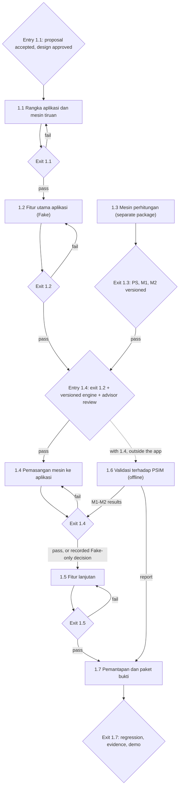

# 10 — Roadmap

> Doc 10 of the doc set. **Aligned with the final seminar-proposal manuscript (`Seminar.pdf`, subbab 4.5.5–4.5.6, Tabel 4.15, Tabel B.1, Gambar 4.5, 4.6, C.8a–C.8d) on 2026-11-01** (Doc 14 item D7); the manuscript wins on any conflict. Software phases P0–P4 of the earlier draft are replaced by the eight work-breakdown elements 1.1–1.8 and their 39 work packages. IDs follow Doc 2 (FR/NFR), Doc 6 (paths), Doc 7 (S-xx). Equations are allowed (user decision 2026-11-01). Prototype `App/` is reference only.

## Ringkasan
Dokumen ini menyusun rencana pengerjaan aplikasi sesuai struktur rincian kerja naskah seminar: delapan elemen tingkat 2 dan 39 paket kerja tingkat 3. Tahap 1.1 membangun rangka aplikasi dan Fake Engine, Tahap 1.2 menyelesaikan seluruh fitur *Must* di atas Fake Engine, Tahap 1.3 membangun mesin perhitungan PS, M1, dan M2, dan Tahap 1.4 memasang mesin itu ke aplikasi melalui Engine Port yang sama. Tahap 1.5 menambah fitur *Should* dan M3d bila waktu cukup, Tahap 1.6 memvalidasi mesin terhadap PSIM secara luring bersama Tahap 1.4, dan Tahap 1.7 berisi pemantapan, regresi penuh, dan paket bukti. Elemen 1.8 (manajemen dan dokumentasi) berjalan sepanjang proyek. Setiap tahap memiliki gerbang masuk dan keluar menurut Tabel 4.15, dan hasil setiap gerbang dicatat di `docs/gate_log.md`. Durasi dinyatakan dalam minggu relatif sesuai perkiraan penulis, sedangkan durasi Tahap 1.4 dibiarkan terbuka karena bergantung pada kesiapan mesin.

## 1. Timeline context
| Item | Statement |
|---|---|
| Start of implementation | After proposal acceptance and design approval (entry gate 1.1). Both recorded PASS on 2026-11-01 in `docs/gate_log.md`. |
| Durations (manuscript 4.5.6) | Relative weeks: 1.1 1–2; 1.2 4–6; 1.5 3–5; 1.7 2–3. Stage 1.4 open (depends on engine readiness). Stages 1.3 and 1.6 not stated [ASSUMPTION: not estimated]. |
| Developer | Solo; gate reviews self-administered; advisor review planned at entry 1.4 and exit 1.7 (manuscript 4.6.2). |

## 2. Stage overview (Gambar 4.6, C.8a–C.8d)

1.8 Manajemen dan dokumentasi proyek runs throughout and is not drawn as a step.

## 3. Stages and gates (manuscript Tabel 4.15)
| Stage | Entry gate | Exit gate |
|---|---|---|
| 1.1 Rangka aplikasi dan mesin tiruan | Proposal accepted; design approved | One start command; six-status contract; RunRecord for every Status |
| 1.2 Fitur utama aplikasi | Exit 1.1; entity contract frozen; Fake scenarios fixed | All Must pass; REPRODUCED on Fake; complete report |
| 1.3 Mesin perhitungan | Not set | PS, M1, M2 package versioned for entry 1.4 |
| 1.4 Pemasangan mesin ke aplikasi | Exit 1.2; versioned engine package; advisor review | Contract passes on both adapters; time budget measured; M5 archived |
| 1.5 Fitur lanjutan | Exit 1.4, or recorded Fake-only decision | Should pass; new analyses pass on both adapters |
| 1.6 Validasi terhadap PSIM | Together with 1.4, outside the app | M1–M2 results to exit 1.4; report to 1.7 |
| 1.7 Pemantapan dan paket bukti | Exit 1.5; feature scope frozen | Full regression; evidence package; demo to the advisor |

### 3.1 Checkable criteria per gate (operational reading of Tabel 4.15)
The manuscript cells are short; the lists below are how each cell is checked. Items in *italics* are the author's operational detail, not manuscript text.

**Exit 1.1**
1. `uv run mgapp` (after one frontend build) serves UI and API from one process on 127.0.0.1 (NFR-02, NFR-17).
2. The contract suite (nine behaviours) passes on the Fake Engine and fails on the defective profile; the Fake returns every allowed Status on demand (NFR-07, NFR-08, FR-22).
3. Over HTTP, every Status — including TIMEOUT, ENGINE_ERROR, DEPENDENCY_NOT_MET, NOT_APPLICABLE, MALFORMED_REQUEST — returns HTTP 200 with a 17-field RunRecord (FR-35, FR-43, FR-46–FR-48).
4. *Import rules pass and fail on a deliberate violation; OpenAPI and generated TS types current; lock files committed (NFR-10, NFR-11, NFR-15; manuscript 4.3.9).*
5. *Canonicalisation rule tests pass (WP 1.1.4).*
6. *DoD (Doc 8 §8) met for the 1.1 scope.*

**Exit 1.2**: every Must FR passes at its seam (Doc 8 §6.1); export → import → rerun gives REPRODUCED on Fake; report shows verdict, limiting constraints, margins, assumptions, RunRecord hash (FR-58, FR-59); *offline key flow; Chrome version logged.*

**Exit 1.4**: same contract suite and the PS/M1/M2 seam-1 and seam-3 tests pass with REAL selected at startup, no router/service change; TIME_BUDGET measured (WP 1.4.3) and recorded in Doc 9; M5 steady-state results archived.

**Exit 1.5**: each Should FR passes; M3a–M3c, M4a–M4b pass the contract suite on both adapters; M3d may be Fake-only (WP 1.5.5).

**Exit 1.7**: full regression log; demo from a clean copy offline with one command; evidence package (RunRecords, M5 report, logs); final limitations list.

### 3.2 Scope per stage (requirements and endpoints)
| Stage | FR / NFR | Endpoints | Screens |
|---|---|---|---|
| 1.1 | FR-17 (spine), FR-20 (all issues collected), FR-21, FR-22, FR-35–FR-38, FR-40, FR-42–FR-44 (API), FR-46–FR-48; NFR-02, NFR-04 (mechanism), NFR-05, NFR-07, NFR-08, NFR-10, NFR-11, NFR-14, NFR-15, NFR-17, NFR-18 | `GET /api/health`, `GET /api/meta`, all nine `POST /api/analyses/{type}` on the Fake (user decision 2026-11-01) | Minimal M1 screen (S-07 thin), engine badge |
| 1.2 | Remaining Must FRs (Doc 8 §6.1); NFR-01, NFR-03, NFR-06, NFR-09, NFR-12, NFR-13, NFR-16 | + `/api/projects/validate`, `/api/projects/import`, `/api/run-records/verify`, `/api/run-records/rerun` | Must screens of Doc 7 (10 routes) |
| 1.4 | Must FRs re-verified on REAL (PS, M1, M2); NFR-04 value; NFR-08 on two adapters | all 15 | engine badge REAL |
| 1.5 | Should FRs; FR-32 (Could) | — | Should and Could routes |
| 1.7 | NFR regression; caps and body limit from measurement (WP 1.7.1) | all 15 | — |

## 4. Work packages (manuscript Tabel B.1)
| No | Work package | Output | Prerequisite |
|---|---|---|---|
| 1.1.1 | Repository structure and import-rule checks | Module folders; import checks | — |
| 1.1.2 | Engine Port and Fake Engine | Port; Fake with six Statuses | 1.1.1 |
| 1.1.3 | Contract test suite | Nine behaviours | 1.1.2 |
| 1.1.4 | Application service spine | Validation, hash, RunRecord, time budget | 1.1.2 |
| 1.1.5 | API description and generated types | OpenAPI; frontend types | 1.1.4 |
| 1.1.6 | Thin M1 slice and start procedure | M1; one start command | 1.1.3, 1.1.5 |
| 1.2.1 | Load data entry and PS | Validated loads; PS | 1.1 |
| 1.2.2 | Network, constraints, M1 and M2 | Network editing; M1, M2 | 1.2.1 |
| 1.2.3 | RunRecord, Project file and report | Re-run; save/open; report | 1.2.2 |
| 1.2.4 | Key-flow tests across increments | E2E; FAKE badge and ENGINE_KIND_FAKE warning | 1.2.3 |
| 1.3.1 | Mathematical core and power-flow solver | Newton–Raphson M1; unit audit | — |
| 1.3.2 | Detailed technical results | Voltages, flows, currents, losses | 1.3.1 |
| 1.3.3 | Constraints and sizing | M2; versioned PS, M1, M2 package | 1.3.2 |
| 1.3.4 | Sensitivity and scenarios | M3a–M3d | 1.3.3 |
| 1.3.5 | Stability | M4a and M4b | 1.3.4 |
| 1.4.1 | Real Engine adapter PS, M1, M2 | Unit conversion; six-Status mapping | 1.2, 1.3.3 |
| 1.4.2 | Tests on two adapters | Tests pass with REAL | 1.4.1 |
| 1.4.3 | Measuring the execution time limit | Measured value replaces initial 30 s | 1.4.1 |
| 1.5.1 | Further Should features from core features | Should app features | 1.4 |
| 1.5.2 | Sensitivity, sweep and scenarios (M3a–M3c) | Screens, endpoints, cap refusal | 1.4 |
| 1.5.3 | Stability (M4a–M4b) | Screens, endpoints, four-disturbance catalogue | 1.4 |
| 1.5.4 | Real Engine adapter for M3a–M3c and M4a–M4b | Contract passes on two adapters | 1.3.5, 1.5.2, 1.5.3 |
| 1.5.5 | Feasibility envelope (M3d, Could) | M3d; may be Fake-only | 1.5.2 |
| 1.6.1 | Reference designs and test families | Reference designs; case list | — |
| 1.6.2 | Frozen tolerance policy | Version 1 locked by hash | 1.6.1 |
| 1.6.3 | Two-layer PSIM models and input sheets | Input sheets; two models | 1.6.1 |
| 1.6.4 | Steady-state validation M1 and M2 | Error tables; cause log | 1.4.1, 1.6.2, 1.6.3 |
| 1.6.5 | Dynamic validation M4 | Error tables; cause log | 1.5.4, 1.6.4 |
| 1.6.6 | Offline validation report | Report without aggregate score | 1.6.4, 1.6.5 |
| 1.7.1 | Limits from measurement | Sweep cap, margin threshold, body limit measured | 1.5 |
| 1.7.2 | Failure-path and accessibility check | Per-Status message review; contrast and zoom check, no WCAG claim | 1.5 |
| 1.7.3 | Full regression | Log of all tests | 1.7.1, 1.7.2 |
| 1.7.4 | Release candidate and demo script | Demo from a clean copy | 1.7.3 |
| 1.7.5 | Evidence package | Archive, M5 report, logs | 1.6.6, 1.7.3 |
| 1.7.6 | Final consistency check | Final limitations list | 1.7.5 |
| 1.8.1 | Design documents and recorded decisions | Current documents | — |
| 1.8.2 | Issue tracker | Triage-labelled issues | — |
| 1.8.3 | Gate log | Result per criterion (`docs/gate_log.md`) | — |
| 1.8.4 | Assumption and risk register | Owned assumptions (Doc 9) | — |

Count: 6 + 4 + 5 + 3 + 5 + 6 + 6 + 4 = 39. A prerequisite numbered at level 2 (e.g. "1.1") means that stage's exit gate. PS is placed in 1.3.3 because it uses the same sizing-rule form as M2 (author's reading, manuscript 4.5.5).

## 5. Gate rules
The manuscript states six gate rules bind the order of Gambar 4.6 and C.8a–C.8d and names two of them (manuscript 4.5.6):

| # | Rule | Source |
|---|---|---|
| G1 | No parallel work passes a failed gate, except offline M5. | Manuscript 4.5.6 |
| G2 | Fake Engine results are never reported as engine results. | Manuscript 4.5.6 |
| G3 | No stage starts until its entry gate is met; the check is recorded per criterion in `docs/gate_log.md`. | Confirmed by the user 2026-11-01; derived from earlier R1 and manuscript "hasil setiap gerbang dicatat pada log gerbang" |
| G4 | Scope moves between stages only through a recorded decision (ADR or Doc 9 entry) naming FR IDs, reason and gate effect. | Confirmed by the user 2026-11-01; earlier R3 |
| G5 | From stage 1.4 the contract suite must stay green on the Fake Engine at every gate. | Confirmed by the user 2026-11-01; earlier R4 |
| G6 | A change to the Engine Port, Doc 3 contracts or Doc 6 shapes after exit 1.2 needs an ADR or register entry and updates Docs 3, 4, 6 before code. | Confirmed by the user 2026-11-01; earlier R5 |

G3–G6 are the author's earlier rules (Doc 10, 2026-10-21); the user confirmed on 2026-11-01 that they match Gambar C.8a–C.8d. Earlier R6 (self-administered review) is a stated limitation (manuscript 4.6.2), and R8 (no equations) is cancelled (Doc 14 A20).

## 6. Mapping to thesis
| Stage | Evidence produced | Thesis chapter |
|---|---|---|
| 1.1–1.2 | Architecture implemented, Engine Port, Fake-first development, requirement↔test traceability, Must pipeline on Fake | Bab 4 (implementation, application verification) |
| 1.3–1.4 | Engine package, two-adapter contract suite, measured time budget | Bab 4 (engine verification levels 1–2, integration) |
| 1.6 | M5 error tables and cause log under frozen policy v1 | Bab 4 (validation) |
| 1.5 | Sensitivity, sweep, scenario, stability features; parametric study | Bab 4 (case study, discussion) |
| 1.7 | Regression logs, demo, evidence package, limitations | Bab 4–5 |

Final chapter mapping is Doc 14 D8 (PENDING-1.7).

## 7. Open points
| # | Item | Tag | → doc |
|---|---|---|---|
| 1 | Gate rules G3–G6 not listed in the manuscript text. | CONFIRMED (user 2026-11-01) | 9 |
| 2 | Durations of 1.3 and 1.6 not estimated. | [ASSUMPTION] | 9 |
| 3 | Stage 1.1 registers all nine analysis routes on the Fake (canned FEASIBLE by default); validate/import/verify/rerun are added in 1.2. | DECIDED (user 2026-11-01) | 6 |
| 4 | Fake-only path into 1.5 needs a recorded decision (Tabel 4.15). | DECIDED (manuscript) | 9 |
| 5 | Caps without values (SCENARIO_CAP, M3A_PARAMETER_CAP, M4B_DURATION_CAP_S) stay null until set at WP 1.7.1. | [ASSUMPTION] | 6, 9 |
| 6 | Branch per stage (`tahap-1.1`), PR to `main` at the exit gate. | DECIDED (user 2026-11-01) | 8 |

## Log
| Date | Change |
|---|---|
| 2026-10-17 – 10-21 | Drafted with phases P0–P4; C5.2, C5.13, C5.18, C5.20, UP-08, UP-13. |
| 2026-11-01 | Aligned with the manuscript (Doc 14 D7): stages 1.1–1.8 replace P0–P4; Tabel 4.15 gates with operational criteria; 39 work packages of Tabel B.1; durations of 4.5.6; six gate rules (two from manuscript text, four confirmed by the user); 1.1 endpoint scope decided; no-equations guardrail removed. |
