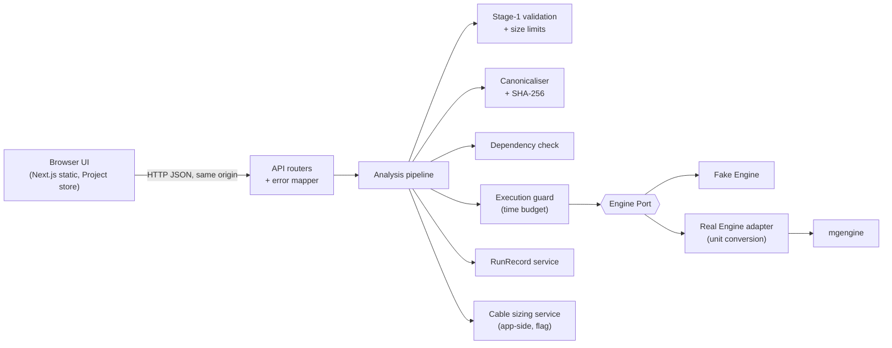

# Project overview

> Written 2026-11-11 from the code and documents on branch `feat/cable-sizing` (commit `0476874`). It describes what is in the repository; it decides nothing. On any conflict the manuscript `Seminar.pdf` and Docs 01–14 win.

## 1. What the project is

A local, single-user web app for the early design of islanded three-phase AC microgrids with grid-forming droop inverters. The user enters loads, a network and design limits, and the app runs a fixed chain of analyses: sizing advice, droop power flow, constraint check with loadability margins, sensitivity and sweeps, and small-signal and transient stability. Every run produces a RunRecord with hashes, so a result can be verified and reproduced later.

One process serves the browser UI and the API on `http://127.0.0.1:8000`. There is no login, database or hosting. The server keeps no state: the open Project lives in the browser and is saved as a JSON file.

## 2. Repository layout

| Path | Content | Size |
|---|---|---|
| `engine/` | `mgengine`, the calculation engine. NumPy and SciPy only, SI units per phase. Own package, version 0.4.0, own tests. | 10 files, 1,719 lines; 53 tests |
| `backend/` | `mgapp`, the FastAPI app: domain contract, Engine Port, two engine adapters, services, API routers. Also serves the built frontend. | 47 files, 5,668 lines |
| `frontend/` | Next.js static export in React 19 and TypeScript with the IBM Carbon design system. 21 pages (19 screens and 2 developer galleries), hand-written SVG charts, single-line diagram. | 84 source files, 9,812 lines; 101 unit tests |
| `tests/` | Backend and browser tests grouped by seam (section 7). | 55 files, 5,989 lines |
| `tools/` | Task scripts: `check.py`, `test.py`, `gen.py`, `build_frontend.py`, `measure_time.py`, `measure_limits.py`. | 7 files |
| `docs/` | Design documents 01–14, ADRs 001–014, feature guidelines, gate log, demo script, review screenshots (`docs/design/`, 807 files, 64 MB). | |
| `data/private/` | Place for user-transcribed standard tables (cable sizing). Git-ignored except its README. | |
| `validation/` | Reserved for the offline PSIM validation (M5). Holds only a README so far. | |
| `.scratch/` | Local issue and spec files per feature. | |

## 3. Architecture



The rules that hold the structure together are checked by tools, not by convention:

- The app reaches calculations only through the **Engine Port** (two operations: `run`, `identity`). The Real Engine adapter is the only module that imports `mgengine`, and the only place where the √3 and 2π unit factors appear.
- Import rules (`import-linter`, seven contracts): `domain` imports nothing else in the app; services never import adapters; only the execution guard imports the Engine Port; the API never imports the port or adapters.
- Frontend rules (`dependency-cruiser`): the store and the API client depend only on generated types; `fetch` is called in `api-client` only.
- TypeScript types are generated from the backend's OpenAPI description (`tools/gen.py`); a stale copy fails the checks.

The engine is chosen once at startup (`MGAPP_ENGINE=FAKE|REAL`), never per request. A Fake Engine result always carries the warning `ENGINE_KIND_FAKE`.

## 4. The analyses

| Type | Name | What it computes | Needs |
|---|---|---|---|
| PS | Saran kapasitas awal | Inverter rating and unit plan from the load table, optional storage energy from a 24-hour profile (Eq. 4.2–4.4, 4.13). | Loads |
| M1 | Power flow | Droop power flow without a slack bus by Newton–Raphson; frequency is a state. Bus voltages, inverter outputs, line flows, losses, power sharing. | Valid design |
| M2 | Constraint check | Five checks with margins, penentuan kapasitas awal, loadability margins λ_c and λ_s. | Current M1 |
| M3a | Sensitivity | Finite-difference sensitivities of key metrics to chosen parameters, ranked. | Current M1 |
| M3b | Sweep | One axis (parameter, scale factor or load scale), status and metrics per point. | Current M1 |
| M3c | Scenarios | Named override sets compared with explicit deltas; also static N−1. | Current M1 |
| M3d | Envelope | Two-axis grid of per-point status, feasible fraction. | Current M1 |
| M4a | Small-signal | Eigenvalues, damping, dominant modes, participation factors, stability class, validity indicators r_τ, κ, r_in, ε_X. | Current M1 |
| M4b | Transient | Time response to a load step, load scaling, reference step or inverter outage on the reduced-order model. | Current M1 |
| CB | Cable and breaker sizing | Overload-only sizing by IEC 60364 / PUIL 2011 from user-entered tables. Computed by the app, not the engine. Experimental, off by default. | Current M2 |

Every analysis returns one of six statuses: `FEASIBLE`, `INFEASIBLE`, `SOLVER_FAILED`, `PHYSICALLY_INADMISSIBLE`, `INPUT_INVALID`, `UNAVAILABLE`. All are HTTP 200 with a RunRecord; HTTP 4xx is for transport problems only.

**Pipeline order for one request:** request model → stage-1 validation (all issues at once) → size limits → canonical form and hashes → dependency check → guarded engine call → RunRecord.

## 5. API (17 routes)

| Route | Purpose |
|---|---|
| `GET /api/health`, `GET /api/meta` | Liveness; versions, engine identity, limits, feature flags. |
| `POST /api/projects/validate` | Stage-1 validation for live feedback and the snapshot hash. No RunRecord. |
| `POST /api/projects/import` | Check a Project file: version, shape, embedded RunRecords, validation. |
| `POST /api/analyses/{PS,M1,M2,M3a,M3b,M3c,M3d,M4a,M4b,CB}` | Run one analysis. |
| `POST /api/run-records/verify`, `/rerun` | Check a RunRecord's schema and hashes; re-run it and report `REPRODUCED` or `DIFFERS`. |
| `POST /api/catalogs/import` | Check a component catalogue file and mark each entry usable or not. |

## 6. Screens

| Step | Screen | Route |
|---|---|---|
| S-01 | Start: create or open a Project, open an example | `/` |
| S-02 | Project overview, save, run the whole guided example | `/project/` |
| S-03 | Loads and 24-hour load profile | `/loads/` |
| S-04 | Sizing advice (PS) | `/sizing/` |
| S-05 | Network editor: buses, lines, inverters, single-line diagram | `/network/` |
| S-06 | Design constraints (no default values) | `/constraints/` |
| S-07 | Power flow (M1) | `/power-flow/` |
| S-08 | Constraint check (M2) | `/constraint-check/` |
| S-09 – S-12 | Sensitivity, sweep, scenarios, envelope | `/sensitivity/`, `/sweep/`, `/scenarios/`, `/envelope/` |
| S-13, S-14 | Small-signal, transient | `/small-signal/`, `/transient/` |
| S-15 | Run history: export, import, verify, re-run, compare | `/runs/` |
| S-16 | Report with print layout | `/report/` |
| S-17 | About and limits | `/about/` |
| S-19 | Cable and breaker sizing (only with the flag on) | `/cable-sizing/` |
| — | Component catalogue | `/catalogue/` |

Supporting features: KPI strips, element inspector, glossary tooltips, validity-indicator panel, A1–A6 checklist in the report, RunRecord diff, constraint-to-sensitivity shortcut, product catalogue with provenance, guided example mode, five example Projects (`d1`, `d2`, `d2h`, `d2s`, `guided-d2`).

## 7. Tests and checks

| Seam | Command | Count on 2026-11-11 |
|---|---|---|
| Static checks: ruff, mypy strict, import rules, OpenAPI and TS types current, `tsc`, dependency rules | `python tools/check.py` | all pass |
| Engine | `python tools/test.py engine` | 53 |
| Backend: static, contract, api, reproducibility, project_file | `python tools/test.py static contract api reproducibility project_file` | 528 |
| Frontend unit (vitest) | `python tools/test.py client` | 101 |
| Browser end-to-end (Playwright) | `python tools/test.py e2e` | 70 |

The contract suite runs on both adapters, so the Fake Engine and the Real Engine are held to the same nine behaviours. The reproducibility seam checks the six canonicalisation rules against shared vectors that the browser canonicaliser is also tested with.

## 8. How to run it

```
cd backend && uv sync && cd ..
cd frontend && npm ci && cd ..
python tools/build_frontend.py
uv run --project backend mgapp
```

Environment options: `MGAPP_ENGINE` (`FAKE` default, `REAL`), `MGAPP_PORT`, `MGAPP_FAKE_PROFILE`, `MGAPP_FEATURE_CABLE_SIZING=1`. The demonstration steps are in `docs/demo_script.md`.

## 9. Documents

| Document | Content |
|---|---|
| `CLAUDE.md` | Rules for work in this repository. |
| Docs 01–11 | Brief, PRD, glossary and data contracts, architecture, ADRs, API, UI, structure and verification, register of assumptions and decisions, roadmap, traceability. |
| Doc 12 | Post-proposal extensions (indicator panel, catalogue, example mode, cable sizing and others). |
| Doc 13 | PSIM modelling basis for the validation. |
| Doc 14 | Alignment list against the manuscript. |
| `gate_log.md` | One row per finished work package with the test counts at that point. |
| `*_GUIDELINES.md`, `PROMPT_*.md`, `HANDOFF_*.md` | Feature build guides and the prompts used in the build sessions. |
| `engine/docs/` | Equation and unit audit of the engine modules. |

## 10. Status against the roadmap

Stages 1.1 to 1.5 and the work packages 1.7.1 to 1.7.4 have rows in the gate log. Two items are open:

- **Stage 1.6, PSIM validation.** `validation/` holds no cases or results yet. Until it is done the validity indicators have no calibrated thresholds: `MetaInfo.indicator_threshold_version` is null and every M4a result of the Real Engine carries the warning `VALIDITY_NOT_CALIBRATED`.
- **Cable and breaker sizing.** Built behind a flag and marked experimental. The register lists K-07 (protection is out of the manuscript's scope, awaiting the supervisor) and K-08 (PUIL 2011 used instead of PUIL 2020) as open.
