# UI/UX audit, post-workspace: Project, Loads, Sizing advice, Constraints, Power flow, Constraint check and margins, Studies

Date: 2026-11-14. Branch `design/ui-redesign` at 9346ec8 (PR ralif444/Microgrid-Design-Tool#9). Analysis only: no code, backend, engine, equation, data-model or API change is proposed here. Anything that would need one is listed under [Out-of-scope observations](#10-out-of-scope-observations).

This audit follows the 2026-11-13 audit `docs/ui-ux-audit.md`, which was written before the workspace, the themes and the functional items. That file was left unchanged, as this task allows only one new file. Where a finding of that audit is now fixed, this audit does not repeat it.

## How this audit was done

| Item | Detail |
|---|---|
| Live inspection **[live]** | App run with `uv run --project backend mgapp`, real engine (`MGAPP_ENGINE=REAL`), port 8010. Guided example D2 opened, "Run the whole example" used. Every screen in scope was visited in the built-in browser at the default desktop width (1024 CSS px, 125 % scaling) and at 375 px. Light and dark themes. Battery and Cable sizing were **not** visible: they show only when their feature flags are on in `/api/meta`, so they are code-only here. |
| Code inspection **[code]** | Every page in scope and the components and CSS modules it uses. Done in four parallel read-only passes (Project/Loads/Sizing, Constraints/Power flow/Constraint check, all Studies, design tokens), each finding spot-checked against the source before it was taken into this document. |
| Not measured | Contrast ratios were not re-measured; the W2 contrast table in `docs/check-screen-changes.md` is the reference. Screen-reader output was inferred from markup, not heard. |

Severity is by impact on the user: **high** = can lead to a wrong design decision, lost work, or a dead end; **medium** = slows the user or costs trust; **low** = polish.

---

## 1. Executive summary (top 5 findings)

1. **Numbers are not presented as engineering results.** The same quantity is shown at several precisions on one screen, and some values print at full float precision. Power flow: "49.877 Hz" in the strip, "49.8774 Hz" in Details. Sizing advice: "Load apparent power 26.925824035672523 kVA" **[live]** (`app/sizing/page.tsx:51,56`). M4a participation factors: "1.25918e-10", "2.17504e-22" **[live]**. Margin chart "0.254722" next to the table's "0.255" **[live]**. A rule exists (`fixed()` in `components/format.ts:17-22`), but only the result tables and the diagram labels use it. For a tool whose output is a design decision, this is the largest single trust problem.
2. **The data model leaks into the interface.** Every study picker lists raw data paths: "inverters/INV1/frequency_droop_hz_per_kw", "lines/LN2/r_ohm_per_km" **[live]** (`app/sensitivity/page.tsx:78-83`, `components/Further.tsx:21-35`). Axis and chart titles print enum codes ("SCALE_FACTOR (factor)", `components/AxisForm.tsx:75,154`). Sizing shows "State: PROPOSED" (`app/sizing/page.tsx:88`). Errors print "INPUT_INVALID" and field paths "parameters / parameter_paths" **[live]**. "RunRecord" and 32-character run ids appear in captions and on every row of the indicator table **[live]**. An engineer has to translate the code's vocabulary back into the domain.
3. **Results do not lead back to their causes.** Power flow tables show values with no limit, margin or flag. Is 0.951 p.u. a problem? The M1 screen cannot say (`components/M1Results.tsx:26-31,103-153`). Clicking an element in the M2 margin table leaves the workspace for `/network/` (`components/M2Results.tsx:70`), while the M1 table selects it in the inspector. A study result vanishes after any edit and the screen reads "Not run yet." (`components/Further.tsx:108`), so the user cannot tell "never run" from "out of date".
4. **Status words contradict each other.** The Power flow (M1) result carries a "FEASIBLE" tag right above "This is not yet a check against your limits." **[live]**. M4a and M4b results carry the same "FEASIBLE" tag, which belongs to the constraint check. Three code paths count "violated" differently (`status-text.ts:38`, `kpi.ts:40`, `CheckStrip.tsx:30-34`). The diagram's "Limiting" mark uses the same icon as "Violated". A student reading "FEASIBLE" on the power-flow screen will believe the design passed.
5. **The Studies area has no overview and hides its own state.** Studies opens straight on "Sensitivity (M3a)". The six (up to eight) studies are named by manuscript code ("Envelope (M3d)"). None shows whether it was run or is stale, and the one aggregate Stale/Blocked tag sits detached at the end of the list (`components/AreaNav.tsx:39-44,84,109,152,165`). Each study form is a long single column on the left, with the right half of a desktop screen empty **[live]**.

---

## 2. Current state

### 2.1 Screen inventory (scope of this audit)

| Area tab | Sub-tab (route) | Purpose | Primary action | Seen |
|---|---|---|---|---|
| Model | Diagram (`/workspace/`) | Element list, single-line diagram, inspector | Select or add an element; Run M1, Run M2 | live |
| Model | Project (`/project/`) | Name, nominal kV and Hz, counts, M1 readiness | "Continue to Loads" | live |
| Model | Loads (`/loads/`) | Load table: bus, P, Q or PF, PF direction | "+ Add load", "Go to sizing advice" | live |
| Model | Sizing advice (`/sizing/`) | Advisory inverter (and storage) sizing, Eq. 4.2, 4.3 | "Re-run advice", Accept, Skip, "Add N inverter drafts" | live |
| Model | Constraints (`/constraints/`) | Seven design limits, all optional | Edit the fields; no button | live |
| Check | Diagram (`/workspace/?area=check`) | Check strip, settings, diagram with marks, results drawer (Margins, Power flow) | Run M1, Run M2 | live |
| Check | Power flow (M1) (`/power-flow/`) | M1 KPIs, Details, tables, voltage, loading and sharing charts | "Run M1" | live |
| Check | Constraint check (M2) (`/constraint-check/`) | m_inv, m_line (+ storage inputs), verdict, margin table and chart, λ_c, λ_s | "Run M2" | live |
| Studies | Sensitivity (M3a), Sweep (M3b), Scenarios (M3c), Envelope (M3d), Small-signal (M4a), Transient (M4b) | Further analyses on a current M1 | "Run M3a" … "Run M4b" | live |
| Studies | Battery, Cable sizing | Shown only when the feature flag is on | Run | code |
| Report | Run history (`/runs/`) | List, compare, verify, re-run RunRecords | View, Export, Verify, Re-run | code |

### 2.2 User flow as built

```mermaid
flowchart LR
  S[Start: new Project or open example] --> W[Model / Diagram]
  W --> P[Project: name, kV, Hz]
  P --> L[Loads table]
  L --> SA[Sizing advice: advisory]
  SA -- Accept --> D[Add N inverter drafts]
  D --> N[Network: complete inverters, lines]
  SA -- Skip --> N
  N --> C[Constraints: limits, all optional]
  C --> M1[Run M1 power flow]
  M1 --> CK[Check strip and diagram marks]
  CK --> M2[Enter m_inv, m_line, run M2]
  M2 --> V{Verdict}
  V -- FEASIBLE / INFEASIBLE --> ST[Studies M3a-M4b, needs current M1]
  V --> R[Report: print / PDF]
  ST --> R
  W -. any edit .-> X[M1 and M2 go stale; study results disappear]
  X -.-> M1
```

The sub-tab order (Project, Loads, Sizing advice, Network, Constraints) still encodes the old eight-step pipeline. The workspace Diagram can do the same edits through the inspector. So there are two ways in to every input, and nothing says which one to use.

### 2.3 Design tokens in use

- **Type:** IBM Plex Sans and Plex Mono, self-hosted (`app/layout.tsx:6-7`), Carbon's own `@font-face` off (`app/carbon.scss:9`). Scale `--text-xs … --text-2xl` in `tokens.css`.
- **Colour:** Carbon `white` and `g100` maps overridden in `carbon.scss:14-35, 41-67`, with ink `#1b2733`, surface `#f7f8f9` and accent `#1f5fbf` (light); ink `#e6eaed`, surface `#252c33` and accent `#7fb0f5` (dark). Status roles `--role-*` in `tokens.css:43-62`: negative `#b53b0b`, caution and attention `#8a5a0b`, success quiet grey. No hex outside `tokens.css` and `carbon.scss`.
- **Spacing:** `--space-0 … --space-12` (no 7, 9 or 11); control height 2 rem.
- **Radius:** all 0 (five literal `0`s; `50%` twice for dots).
- **Breakpoints:** 1100, 900 and 700 px (workspace), 720 px (header).
- **Unused or stale:** the `--n-0 … --n-900` neutral scale (`tokens.css:8-19`) is never referenced. `--series-1` and `--series-2` are still the old teal `#00737d` and navy `#0b1f44` (`tokens.css:37`), so every bar chart is teal in a blue-accented UI **[live]**.

**Visual language today.** A quiet Carbon-derived engineering look: flat panels, hairline rules, no radius, no shadows, one blue accent, status in icon + word. The workspace and the Check area carry it well. The older step pages (Sizing, the Studies) are still default HTML forms inside that frame: fieldsets with browser-default borders, radio and checkbox stacks, ragged label and input columns **[live]**.

---

## 3. What works

| Strength | Where | Why keep it |
|---|---|---|
| Status is never colour-only. Every mark is icon + word ("✓ Pass", "Feasible", "M1 result: current"); the margin table has a Status column with a word. | `CheckStrip.tsx`, `M2Results.tsx`, `sld/symbols.tsx` **[live]** | Survives greyscale print and colour-blind reading; it is the right base for any redesign. |
| The margin table is a real engineering table: Constraint, Element, Value, Limit, Margin, Normalised margin with an inline bar, Status; sorted tightest first, fixed decimals, units set in a lighter weight. | `/constraint-check/` **[live]**, `M2Results.tsx:60-90` | It answers "how close am I and to what?" in one scan; the pattern to copy to M1 and the studies. |
| Empty limits are honest. "Every limit starts empty. An empty limit is not evaluated and is never counted as satisfied." and the verdict says "3 check(s) had no limit and were not evaluated". | `/constraints/`, `status-text.ts:25` **[live]** | It prevents the most dangerous false reassurance in a check tool. |
| Advisory output is fenced off: "Advice (not design data)", the sizing equation and its assumptions sit next to the number ("Line losses are not included; m_inv must absorb them"). | `/sizing/` **[live]**, `app/sizing/page.tsx:45-90` | Traceability from number to equation is what an examiner and an engineer will ask for. |
| Validity indicators carry their equation and assumption: "r_τ line-to-filter time ratio (Eq. 4.23) · A1". The λ_s line says "solution-existence diagnostic, not a stability limit". | M4a, M4b, M2 **[live]** | Model limits are stated where the number is read. |
| The engine kind (REAL or FAKE) and the run record are on every result caption. | `ChartFrame`, header badge **[live]** | Required by the project rules; keep it, but see finding U-7 on its form. |
| Diagram, legend and "View as table" give every graphic a text equivalent. Charts have "Show data" and keyboard readout. | `sld/`, `charts/` **[live]** | Accessibility of results is already above most engineering tools. |

---

## 4. What doesn't work

| # | Issue | Where | Severity | Impact |
|---|---|---|---|---|
| D-1 | Full float precision on Sizing advice ("26.925824035672523 kVA", "32.31098884280703 kVA") | `app/sizing/page.tsx:51,56,64,75` **[live]** | high | The first computed number a user sees looks like a bug; trust in every later number drops. |
| D-2 | One quantity, several precisions: Power flow strip "49.877 Hz" vs Details "49.8774"; table "0.235" vs chart "0.235076"; margin table "0.255" vs chart "0.254722"; bus kV column at 6 significant digits (no `kV` entry in `DP`) | `M1Results.tsx`, `KpiStrip`, `charts/*`, `format.ts:17` **[live]** | high | The reader cannot tell which value is authoritative; comparing across screens needs mental rounding. |
| D-3 | Scientific notation in the participation-factor grid ("1.25918e-10", "2.17504e-22") | `/small-signal/`, `M4aCharts.tsx` **[live]** | medium | Noise that hides the participation pattern; values below ~1e-3 mean "no participation". |
| D-4 | "FEASIBLE" tag on the M1, M4a and M4b result banners, where no constraint check was made | `StatusBanner` on `/power-flow/`, `/small-signal/`, `/transient/` **[live]** | high | Directly misleads: "Power flow completed … not yet a check against your limits" sits under a "FEASIBLE" tag. |
| D-5 | Raw data paths as the only label in every parameter picker, with no unit and no grouping, the same 26-item list repeated per scenario and per axis | `app/sensitivity/page.tsx:78-83`, `Further.tsx:21-35`, `/scenarios/`, `/envelope/` **[live]** | high | Slow, error-prone picking; on a 10-bus design the list runs to ~100 entries. |
| D-6 | Enum codes and internal nouns in UI copy: "SCALE_FACTOR (factor)", "State: PROPOSED", "INPUT_INVALID", "parameters / parameter_paths", "RunRecord", "LoadProfile", "autonomy_h" | `AxisForm.tsx:75,154`, `sizing/page.tsx:83,88`, StatusBanner **[live]** | high | Copy speaks the developer's language, not the engineer's. |
| D-7 | M1 tables show values with no limits, margins or flags | `M1Results.tsx:26-31,103-153` | high | "Is 0.951 p.u. OK?" needs a trip to another screen. |
| D-8 | Line-current chart draws only the project-wide limit, while a line's own limit takes precedence | `M1Results.tsx:78` vs `sld/buildSldModel.ts:261-266` | high | The chart can show a line as inside a limit it actually exceeds. |
| D-9 | M2 element links go to `/network/` and leave the workspace; M1 links select in the inspector | `M2Results.tsx:70` vs `workspace/page.tsx:312` | medium | The same gesture means two things; the user loses the diagram context. |
| D-10 | A study result disappears after any edit and shows "Not run yet." | `Further.tsx:108`, `sensitivity/page.tsx:177`, `cable-sizing/page.tsx:210,374` | high | User thinks the work was lost; can only find it in Run history. |
| D-11 | Studies: no overview, M-codes as names, no per-study run or stale state | `AreaNav.tsx:39-44,84,109,152,165` | high | The user cannot see which analyses were done or are out of date. |
| D-12 | Sizing: Accept and Skip unexplained, still offered on stale advice; "Add N inverter drafts" can be clicked again after leaving and returning (local state) and adds N more | `sizing/page.tsx:88,99-113,293-302` | high | Duplicate inverters; the meaning of Accept is unknown. |
| D-13 | Sizing storage row points to a feature with no UI: "Storage advice needs a LoadProfile and an autonomy time." | `sizing/page.tsx:83`; `loads/page.tsx:4` | high | Dead end, even after the user fills in the autonomy field. |
| D-14 | Loads: one column holds kvar or power-factor ratio per row; header "Q (kvar) or power factor (ratio)" | `loads/page.tsx:70-73` **[live]** | high | PF 0.9 reads as 0.9 kvar in a scan of the column. |
| D-15 | Loads and Project: no sign convention (P consumption positive? Q inductive positive? leading vs lagging) | `loads/page.tsx:46-52,87-100`, `elementFields.ts:52-55` | high | A power engineer cannot tell what a negative kvar does. |
| D-16 | A failed validation request reads as "no problems" on Loads and as "Checking the design…" forever on Project | `useValidation.ts:17`, `loads/page.tsx:25` | high | A backend failure looks like a clean design. |
| D-17 | Project: nominal kV and Hz show no inline error; the problem appears only in the readiness list below, as an `entity / id / field` string | `project/page.tsx:47-62,83` | high | The field the user just typed in looks fine. |
| D-18 | Near-limit threshold never shown; near-limit rows show as "Pass" until `/api/meta` arrives, or always if it fails | `M2Results.tsx:16-20,30-37` | medium | "Pass" on a row that should say "Near limit". |
| D-19 | Workspace M2 settings `
` is open only while a margin is missing, so it collapses after the first margin is typed; results never restate the margins used | `workspace/page.tsx:195` | medium | The form closes under the user's cursor; the verdict cannot be traced to m_inv and m_line. |
| D-20 | m_inv is asked on Sizing advice and again on Constraint check (M2) | `/sizing/`, `/constraint-check/` **[live]** | medium | Two fields with one name; users will assume they are linked. |
| D-21 | Results drawer is an unbounded grid row; the diagram and the margin table cannot be on screen together | `workspace.module.css:40-44` | medium | The workspace promise (diagram plus results) breaks on the Check area. |
| D-22 | Diagram legend has no entry for Pass, Near limit, Violated, Limiting, the loading bar; "not evaluated" draws the same as "pass" or "never checked" | `sld/symbols.tsx:219-257`, `buildSldModel.ts:84-92` | medium | The marks the Check area exists for are not explained on it. |
| D-23 | Run buttons stay enabled on incomplete forms ("Pick at least one parameter." shown, button active); the error comes back from the server | `sensitivity/page.tsx:110-114`, `transient/page.tsx:187,237`, `sweep/page.tsx:133` **[live]** | medium | Round trip for an error the screen already knew. |
| D-24 | M3a error copy names the wrong concept: "This scenario changes something that does not exist." on the Sensitivity screen | `/sensitivity/` **[live]** | medium | The user looks for a scenario that does not exist. |
| D-25 | Internal references in user copy: "Doc 13 §4", "Doc 9 K-07", "KONFLIK, PUIL edition", "awaiting the supervisor's approval" | `scenarios/page.tsx:124-125`, `cable-sizing/page.tsx:256`, `CableReport.tsx:40,50` | medium | Reads as a thesis worksheet; unusable outside the project. |
| D-26 | English screens with Indonesian-only glossary toggletips | `Term.tsx:14`, `battery/page.tsx:25-39`, `cable-sizing/page.tsx:45-62` | medium | Mixed language in one view; the EN/ID switch reaches only the area tabs. |
| D-27 | Run history: unstyled tables, raw ISO timestamps, four identical "View / Export / Verify / Re-run" buttons per row with no row name; detail renders at the bottom of the page | `runs/page.tsx:78-89,119,218-253` | high | Screen readers hear 16 identical buttons for 4 rows; "View" appears to do nothing. |
| D-28 | Chart series colours wrap after five; transient charts draw one line per bus or inverter | `charts/LineChart.tsx:144,157`, `palette.ts:4-6` | medium | Two buses share a colour, dash and legend word on any design with more than five. |
| D-29 | "Validity indicators: threshold not yet calibrated" shown on every M1, M4a and M4b result | IndicatorPanel **[live]** | medium | True, but repeated without saying what the user should do with the number. |
| D-30 | Study forms are one narrow column; right half of the desktop empty; fieldsets with browser-default borders; label and input columns ragged | `/sensitivity/`, `/sweep/`, `/sizing/` **[live]** | medium | Long scroll for a short form; the old-form look breaks the workspace's visual language. |
| D-31 | Bar charts in teal (`--series-1 #00737d`) in a blue-accent UI; `--n-*` neutral scale unused | `tokens.css:8-19,37` **[live]** | low | Two accents compete; dead tokens mislead the next designer. |
| D-32 | Constraint check page scrolls sideways at 375 px (page 502 px wide) | `/constraint-check/` **[live]** | low | Desktop only by decision; matters only at 200 % zoom. |
| D-33 | The parser reads "1.500" as 1.5 and refuses only "1,500" | `format.ts:5-10` | medium | An Indonesian-locale user typing a thousands separator gets a value 1000x too small, with no warning. |

---

## 5. UI findings

**Hierarchy.** The Check area reads in the right order: strip (verdict) → diagram → drawer. The step pages do not. On Power flow the order is Run → strip → Readiness → banner → Details → diagram → tables → three charts → sharing table, all at one weight. The banner, the strip and Details each restate the verdict. On Sizing the advice table, a light box, is visually weaker than the six input fields above it. Studies open on a long form; the result, when present, is below the fold.

**Typography.** Plex Sans throughout, good. Units are set lighter after values in the margin table (keep). Elsewhere units are in parentheses before the field "(kV)" and again as a suffix inside the field "kV", so the unit appears twice per input **[live]** (`NumberField.tsx`). Data paths and run ids are in Plex Mono at body size and dominate the lines they sit on.

**Colour and contrast.** Status colour use is disciplined (abnormal only). Two problems: teal charts against blue actions (D-31); in dark mode the "Example mode" tag is a saturated blue fill, the loudest object in the header **[live]**. Contrast pairs were verified in W2 (`docs/check-screen-changes.md`); not re-measured here.

**Spacing and alignment.** The workspace grid is clean. Step pages: label column width varies per form (`--field-label` 18 rem in workspace settings; other widths elsewhere), so inputs start at different x positions **[live]** on Sizing. The diagram's system box is taller than its content **[live]**.

**Consistency.** Two table implementations (bespoke `<table>` on Battery, Cable and Run history vs `DataTable`). Two link behaviours for element ids (D-9). "pu" in the margin table, "p.u." elsewhere. "Run M1" vs "Run the whole example" vs "Re-run advice" vs "Run sweep".

**Data presentation.** See D-1 to D-3, D-7, D-8, D-28. The margin table is the reference pattern. Charts duplicate tables without adding a reference (the margin bar chart repeats the table's own inline bars).

**Responsiveness.** Desktop only by decision. At 1024 px (a 1280 px laptop at 125 %), the workspace keeps three columns since 9346ec8, but fit-to-view draws D2 at ~62 % and the diagram labels fall to ~7 px **[live]**.

**Accessibility.** Good: labelled inputs (`aria-label="P of L1 (kW)"`), keyboard diagram, chart readouts, focus returns after delete. Problems: identical button names in Run history (D-27); Envelope readout announces every focus change (`envelope/page.tsx:174-178`); M2 settings collapse during input (D-19); the 16 px toggletip "i" buttons are under the 24 px target minimum.

---

## 6. UX and flow findings

| Step | Clarity | Effort | States | Traceability | Friction or drop-off |
|---|---|---|---|---|---|
| Landing (Start) | Clear: new Project or example | Low | Draft offer present | n/a | "Open guided example (D2)" vs four "Open example D1 …" links: two weights for the same action. |
| Project | Clear fields | 3 fields | Validation failure shows as endless "Checking…" (D-16) | Readiness list far from fields (D-17) | Counts table includes "RunRecords 12": irrelevant here. |
| Loads | Table is compact | Low | No sign convention (D-15) | Mixed Q/PF column (D-14) | Two ways to edit loads (table and inspector) with no hint which is canonical. |
| Sizing advice | Advisory nature clear | 6 inputs, 3 optional | Old advice stays under a new error (`sizing/page.tsx:224,283-292`) | Equations shown, good | Accept/Skip meaning (D-12); storage dead end (D-13); raw numbers (D-1). |
| Network | (out of this audit's scope) | | | | Drafts from Sizing arrive without bus, droop or τ, and nothing says which fields remain. |
| Constraints | Honest empty-limit text | No button: edits apply silently | No saved feedback | Limits reappear in the margin table, good | Only "Power-balance tolerance" is labelled optional though all are (`elementFields.ts:46`). |
| Run M1 | Strip, marks, banner | 1 click | Stale chip "M1 result: stale" and banner, good | Tables lack limits (D-7) | "FEASIBLE" tag (D-4). |
| Run M2 | Verdict clear | 2 margins + click | Near-limit hidden until meta (D-18) | Margins used are not restated (D-19) | m_inv asked twice (D-20). |
| Studies | Code names (D-11) | Long single-column forms (D-30) | Results vanish on edit (D-10); server-side validation only (D-23) | Raw paths (D-5) | The highest drop-off risk in the app: a student will not know which study to run or what "Envelope" answers. |
| Report | Print, verdict first | 1 click | n/a | Links back to screens | Still says "What this step shows" though steps are gone. |

**Traceability overall.** Inputs → M1 → M2 is traceable on the diagram (marks on elements, tightest element highlighted). It breaks at three points: M1 tables (no limits), M2 settings (margins not echoed), Studies (results keyed to paths the user did not name, and lost after edits).

---

## 7. Domain-fit findings

- **Units** are present almost everywhere, a strength. Weak spots: "(1)" as the unit of a scale factor on Sweep **[live]**; "ratio" for loading where engineers read %; "count" printed as a unit on integer fields ("Iterations 3 count") **[live]**.
- **Sign and reference conventions** are not stated: load P/Q sign, leading/lagging (D-15), angle reference bus ("0.00 °" on B1 without saying B1 is the reference) **[live]**.
- **Assumptions** are shown where results come from equations (Sizing, indicators), good. The model's fixed assumptions A1–A6 are not reachable from the Check area; they appear only as codes "A1", "A2" in the indicator table.
- **Limits and infeasibility**: the margin table and empty-limit rule are credible. "Limiting" sharing the "Violated" icon (Executive §4), and "FEASIBLE" on non-check analyses (D-4), undermine that.
- **Density** is right in the margin table and the diagram, too low on study forms (one field per row across a 1000 px page), too high on Power flow (three charts restating two tables).
- **Trust**: undermined by D-1 to D-4, by the 32-character run ids, and by "threshold not yet calibrated" repeated with no guidance. Strengthened by equation numbers, engine badge and the "not evaluated" honesty.

---

## 8. Generic-AI-look findings

The app does not read as a generated landing page; Carbon, Plex, zero radius and the SLD keep it engineering-like. What still reads as template or unfinished is listed below, with the fix it gets under the recommended direction.

**Recommended direction (revised 2026-11-14 after the user's answers): an engineering-document identity.** Every result surface becomes a *sheet*: a verdict line, the key figures, the reference table, and a basis block that names every input the result used, closed by a title block (project, sheet, engine, run, date) in place of the mono run-id strings. Generic chrome is replaced by the conventions of the documents engineers already read: single-line drawings and calculation sheets. Two variants are mocked in `docs/design/redesign-2026-11-14/engineering-document-mockup.html` (A, drawing sheet; B, calculation sheet), on the real D2 constraint-check values. The rest of the workspace (header, area tabs, element tree, inspector) keeps today's quiet panel look, so the identity sits where the engineering content is, not in the chrome.

| Element | Where | Why it reads generic | Fix under the engineering-document direction |
|---|---|---|---|
| ALL-CAPS small labels: "INVERTERS", "BUSES", "ADVICE (NOT DESIGN DATA)" | `workspace.module.css:14`, `/sizing/` **[live]** | The tracked-caps eyebrow is a default template device | Sentence case set in Plex Sans Condensed, the face used for title-block labels: "Inverters 2", "Advice, not design data" |
| Status codes as headings: "INPUT_INVALID", "FEASIBLE" | StatusBanner **[live]** | Looks like an unformatted API response | A verdict line in words with its icon ("Feasible. Every evaluated limit is met."); the code moves to Details and to the title block |
| Middle-dot meta strings: "0.44 kV LL · 50 Hz nominal", "M1 · RunRecord … · engine REAL" | SLD system box, chart captions **[live]** | A common generated pattern | A title block of labelled fields (Sheet, Project, System, Engine, Run, Date); the diagram system box becomes the drawing's own title block |
| 32-character run ids in Plex Mono on every caption and indicator row | ChartFrame, IndicatorPanel **[live]** | Debug output left on screen | One title block per sheet with an 8-character run reference; full id in Run history and exports |
| Browser-default fieldsets and checkbox stacks | Studies, Sizing **[live]** | Unstyled-form look inside a styled shell | A "Given" block: grouped element × field tables with units, the same rows as the inspector, beside the result instead of above it |
| Duplicate bar chart under the margin table | `/constraint-check/` **[live]** | "Add a chart" reflex | Removed: the table's inline normalised-margin bars carry the same numbers. Charts stay only where they add information the table lacks (voltage profile against the band, time series, eigenvalue plane) |
| Generic KPI tiles | KpiStrip on M1, M2 | The dashboard-tile default | A row of key figures with the element and the limit under each value ("0.9858 p.u., at B2"), ruled like a table, no tile boxes |
| Empty states as a sentence in the top left: "Create or open a Project first. Go to Start" | `RequireProject` **[live]** | Placeholder feel | An empty sheet: the title block and section headings drawn, with the one action in the verdict line ("Not run yet. Run the power flow.") |
| Teal bar charts in a blue-accent UI | `tokens.css:37` | Two accents with no meaning between them | Chart ink in the neutral and accent scale; colour only for abnormal states, as in the status rules |

---

## 9. Improvement opportunities

### Quick wins (presentation only, small)
1. Route every displayed result through `fixed()`; add `kV` (and `%` if loading is shown as percent) to `DP`; render tiny participation factors as "< 0.001". Fixes D-1, D-2, D-3.
2. Map outcome codes to words in banners and drop the "FEASIBLE" tag where no constraint check ran (D-4, D-6).
3. Human labels for data paths: "INV1 · Frequency droop (Hz/kW)" grouped by element, used in every picker and axis title (D-5, D-6).
4. Give Pass, Near limit, Violated, Limiting and the loading bar legend entries; give Limiting its own icon (D-22).
5. Keep the M2 settings open while editing and echo "m_inv 0.2, m_line 0.1" in the verdict line (D-19).
6. Disable Run until the form is complete, and say why next to the button (D-23).
7. Rename the Studies tabs by question with the code second: "Which parameter matters most? (M3a)" or "Sensitivity" with a one-line purpose (D-11).
8. Remove "Doc …", "KONFLIK", "supervisor" from user copy (D-25); fix the "scenario" wording on M3a (D-24).
9. Set chart series to the blue/ink palette and remove the unused `--n-*` scale (D-31).

### Medium effort
1. A Studies overview page: one row per study with question, last run, current/stale, and a link (D-11).
2. Show stale study results greyed with "out of date, re-run" instead of "Not run yet." (D-10). Presentation-only if the stale run is already in Run history; see Out-of-scope O-3.
3. Add limit, margin and status columns to M1 tables using the M2 table pattern, when an M2 or limits exist (D-7, D-8).
4. One element-link behaviour everywhere: select in the inspector inside the workspace (D-9).
5. Split the Loads Q/PF column into two columns with one unit each (D-14); add a one-line sign convention to Loads and the inspector (D-15).
6. Run history as a proper DataTable with row-named buttons and local time (D-27).
7. A bounded results drawer (resizable, scrolls internally) so diagram and table share the screen (D-21).
8. Two-column study forms: inputs left, result right, so the result is on screen next to the inputs that made it (D-30).

### Larger redesign directions
1. **Engineering-document identity.** Treat each result as a sheet: title block (project, engine, run, date) instead of mono run ids, tables first, one chart that adds information. This is where the tool can be distinctive instead of "Carbon app".
2. **Inputs and results on one surface.** Retire the duplicate step pages for Project, Loads and Constraints into the inspector and the diagram, so every number has one home and one link target.
3. **Studies as questions.** Organise Studies by the engineering question (robustness to load growth, parameter sensitivity, dynamic response) rather than by M-code, with a shared parameter vocabulary across all of them.

---

## 10. Out-of-scope observations

These need a logic, data or API change and are not proposed for implementation here.

| # | Observation | Where |
|---|---|---|
| O-1 | "Add N inverter drafts" state is local; preventing duplicates needs the accepted advice to record that drafts were added | `sizing/page.tsx:99-113` |
| O-2 | Storage advice needs a LoadProfile, which has no UI | `sizing/page.tsx:83`, `loads/page.tsx:4` |
| O-3 | Study results are looked up by the current snapshot hash; showing a stale result needs a lookup by "latest of this type" | `Further.tsx:108` |
| O-4 | Validation failure is indistinguishable from "no report yet" (`null` for both) | `useValidation.ts:17` |
| O-5 | The near-limit threshold comes from `/api/meta`; showing it before meta loads needs it in the bundle or the run result | `M2Results.tsx:16-20` |
| O-6 | "1.500" ambiguity: resolving it by locale changes input parsing | `format.ts:5-10` |
| O-7 | Engine and validation messages ("This scenario changes something that does not exist", "3 check(s)") are server strings | backend adapters |
| O-8 | m_inv appears on Sizing and on M2 as two separate inputs; linking them changes the data model | `/sizing/`, `/constraint-check/` |
| O-9 | Cable sizing is gated on M2 while the nav flag reports M1 | `cable-sizing/page.tsx:242-254`, `AreaNav.tsx:145` |

---

## 11. Open questions for the redesign brainstorm

1. **Primary user.** The 2026-11-13 decision is "engineer first". Should students get any guided layer (study descriptions, worked example), or does the D2 example mode cover them?
2. **Precision policy.** Do you accept fixed decimals per unit everywhere (as in the margin table), with full precision only in "Show data" and exports?
3. **Studies vocabulary.** Keep manuscript codes (M3a…M4b) visible as the primary label, as a secondary label, or only in the report?
4. **Duplicate inputs.** May the step pages for Project, Loads and Constraints be retired in favour of the inspector, or must they stay as separate screens (manuscript 4.3.7 lists them as routes)?
5. **Brand direction.** Stay on the quiet Carbon look, or build an engineering-document identity (title blocks, drawing conventions)? Any references you like?
6. **Language.** Ship EN only until the vocabulary issue closes, or remove the Indonesian toggletips from English screens now?
7. **Charts.** Which charts are essential for the thesis figures? Those set which duplicates can go.
8. **Flags.** Are Battery and Cable sizing in scope for the redesign, given they are flag-gated and partly awaiting approval?

---

## 12. Decisions (user, 2026-11-14)

| # | Question | Decision |
|---|---|---|
| 1 | Guided layer for students | Not needed; example mode covers it. |
| 2 | Precision policy | Fixed decimals per unit everywhere (the margin-table rule, `fixed()`); full precision only in "Show data" and exports. Exceptions are decided per case and reported. |
| 3 | Studies vocabulary | Plain names first, manuscript codes (M3a…M4b) as the secondary label. |
| 4 | Duplicate step pages | May be retired where that is best; the manuscript text is tailored later (as for Doc 14 D15). |
| 5 | Brand direction | Engineering-document identity, to be chosen from the mockup variants before it is built. |
| 6 | Language | Ship English only for now; Indonesian strings wait for the vocabulary issue. |
| 7 | Charts | Duplicates go; charts that carry information not in a table stay; no information may be lost. |
| 8 | Flagged studies | Battery is in scope; Cable sizing is not yet. |
| 9 | Out-of-scope observations | Brought into scope (except O-9, Cable sizing); planned in `.scratch/ui-redesign/plan-audit-improvements.md`. |
