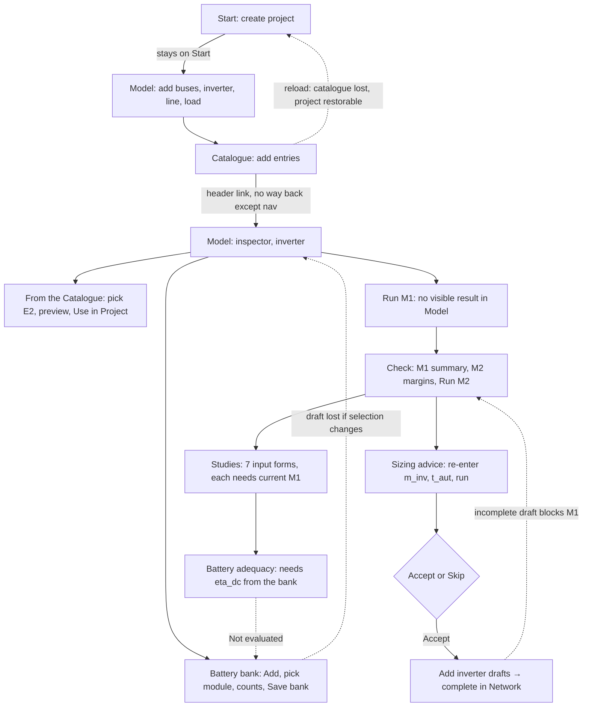

# UI/UX audit: Catalogue, Sizing advice, battery bank, study inputs

Date: 2026-11-15. Branch `design/audit-improvements` at ebf8b08. Analysis only. No code, backend, engine, equation, data-model or API change is proposed here; anything that would need one is under [Out-of-scope observations](#10-out-of-scope-observations).

`docs/ui-ux-audit.md` (2026-11-13) and `docs/ui-ux-audit-2026-11-14.md` were left unchanged, as this task allows one new file only. Findings already listed there are not repeated unless the live test showed them again on the screens in scope.

## Scope

| Area | Screens and components |
|---|---|
| Catalogue and its entries | `/catalogue/` (`frontend/app/catalogue/page.tsx`, `catalogue.module.css`), entry picker in the inspector and on Network (`frontend/components/ElementSource.tsx` `CatalogPick`) |
| Sizing advice | `/sizing/` (`frontend/app/sizing/page.tsx`), result sheet (`ResultSheet.tsx`) |
| Battery bank in the inverter section | Workspace inspector, inverter selected (`ElementForm.tsx:226-247`, `ElementSource.tsx` `BankPick`, `Inspector.module.css`, `workspace.module.css`), plus `/battery/` where the bank's result is read |
| Study inputs | Input forms of Sensitivity, Sweep, Scenarios, Envelope, Small-signal, Transient, Battery adequacy (`frontend/app/{sensitivity,sweep,scenarios,envelope,small-signal,transient,battery}/page.tsx`, `AxisForm.tsx`, `Further.tsx`, `NumberField.tsx`) |

## How this audit was done

| Item | Detail |
|---|---|
| Design-system maturity | L2: IBM Carbon plus project tokens (`frontend/app/tokens.css`) and `docs/VISUAL_DESIGN_GUIDELINES.md`. No `DESIGN.md`, no Figma. Passes run: visual quality, UX heuristics, accessibility (WCAG 2.1 AA), DS compliance (manual), motion (no motion in scope beyond the busy spinner). |
| Build | `frontend/out` was rebuilt from ebf8b08 (`npm run build`) because the existing build predated the last commit. |
| Live E2E **[live]** | Real engine (`MGAPP_ENGINE=REAL`, engine 0.4.0) on port 8010, built-in browser, 1024 px wide (125 % scaling) and 375 px. Origin `127.0.0.1` was used instead of `localhost`, because `localhost` held another session's unsaved work and the app guards it with a native `confirm()` the test browser cannot answer. A project was built from an empty start, not from an example: see [E2E test log](#e2e-test-log). Test inputs were copied from example D2 (`backend/src/mgapp/static/examples/d2.mgproj.json`); the catalogue entries used made-up test values and are not datasheet data. |
| Code review **[code]** | Three parallel read-only passes (Sonnet), one per area. Each cited line used in this document was spot-checked against source by the orchestrating pass. Where a code claim was contradicted live, the live result wins and is noted. |
| Not covered | Dark theme on these screens, screen-reader output (inferred from markup), zoom 200 %, Network-tab variant of the pickers (code only), the Report. |

Severity: **high** = can lead to a wrong decision, a dead end or lost work, or breaks the layout; **medium** = slows the user or costs trust; **low** = polish. Ordered by impact on the user.

---

## E2E test log

Flow run: Start → new project (0.4 kV, 50 Hz) → Model: buses B1, B2, inverter INV1, line LN1, load L1 → Catalogue: battery module entry E1, inverter entry E2 → apply E2 to INV1 → battery bank on INV1 (E1, 8 × 2) → M1 → Check: margins, M2 → Sizing advice: run, Accept, add drafts → all seven studies run once → η_dc set on the bank and Battery adequacy re-run → 375 px pass.

Every function ran and returned a result. Engine output was checked once against the raw response (M1: FEASIBLE, f = 49.80 Hz, lowest V = 0.9721 p.u. at B2, losses 0.096 kW), and the screen showed the same values. Issues seen:

| # | What happened | Where | Severity | In scope |
|---|---|---|---|---|
| E1 | The docked inspector is wider than its column at a 1024 px window: content 340 px in a 303 px panel (measured). Unit tiles are clipped to "k", "Hz" → "H", "count" → "co", "ratio" → "ra"; the "(A2)" note is cut; a horizontal scrollbar appears. Once scrolled, the left edge stays clipped ("oad L1", "ttery bank") for every element selected afterwards. | Model inspector, inverter, battery bank, load | high | yes (bank) |
| E2 | The catalogue is lost on a page reload, without warning. The project is offered back ("Restore unsaved work"), the catalogue is not. Afterwards Sizing said "Usable catalogue inverter entries … : none" although E2 had been usable minutes before. | `/catalogue/`, `/sizing/` | high | yes |
| E3 | Battery adequacy returned "Not evaluated: DC efficiency not set" for both power and autonomy, under a green "Advice ready" banner. The bank form labels the field "DC efficiency η_dc, optional". After η_dc = 0.95 the power check returned OK. | bank form, `/battery/` | high | yes |
| E4 | List items in the Model element list turn white-on-light-blue when hovered or pressed (INV1, INV2, "Design limits"), making the label unreadable. Root cause: `globals.css:48` sets `color: var(--cds-text-on-color)` on every `button:hover`, and `workspace.module.css:20` overrides only the background. | Model element list | medium | indirectly (selecting the inverter for the bank) |
| E5 | "Add 1 inverter drafts of 29.7 kVA" (plural with 1). | `/sizing/` after Accept (`sizing/page.tsx:117`) | low | yes |
| E6 | After Accept, the banner still says "Next step: Accept or skip." and "Advice ready". Only the small "State: Accepted" line changed. | `/sizing/` | medium | yes |
| E7 | The storage row of the advice says "No storage energy: LoadProfile or autonomy_h not given." although t_aut = 2 h was given and is shown in the Basis panel. Only the load profile was missing. | `/sizing/` | medium | yes (text comes from the engine, so the fix is out of scope) |
| E8 | The bank draft was dropped when another element was selected before "Save bank". Edit fields above it save on every keystroke; the bank saves only on its button. | inspector | high | yes |
| E9 | Typing a value into "Modules in series" and "Strings in parallel" and then picking the module cleared the two counts. | inspector bank | medium | yes, uncertain: values were set by the test tool, then retyped by keyboard and kept |
| E10 | Sizing advice and Sweep forms came back with some inputs empty after navigating away and back (Sweep parameter and range; Sizing t_aut), while the results were still shown. | `/sweep/`, `/sizing/` | medium | yes |
| E11 | Studies sub-navigation wraps to a second row at 1024 px once the run check marks appear; on Transient and Battery the row holds only "Battery adequacy". | studies tabs | low | yes |
| E12 | At 375 px the Sweep and Sizing forms are wider than the screen: selects and unit tiles are cut ("cou"). The Sizing advice table squeezes values to broken words ("instal led"). Header plus studies tabs use about 380 px of the 812 px height before the page title. | `/sweep/`, `/sizing/` | medium | yes |
| E13 | "Create project" with unsaved work in the browser asks through native `confirm()`; the page did nothing when the dialog was suppressed, with no in-page message. After a successful create the user stays on Start. | Start | medium | no |
| E14 | "Run M1" in the Model area gives no visible result in the Model area; the result is only in Check. | Model | medium | no |
| E15 | M2 with no design limits set reports "Feasible, 0 pass, 9 not evaluated". | Check | high | no (listed for the redesign brainstorm) |
| E16 | Opening a deep page by URL (`/sizing/`, `/studies/`) after a reload shows "Create or open a Project first. Go to Start" without the restore offer that Start has. Results are dropped by restore (stated on Start). | all project pages | medium | no |

Engine and API behaved correctly in every case seen; all issues above are presentation or state handling.

---

## 1. Executive summary (top 5 findings)

1. **Nothing lines up, and it is one root cause.** `NumberField` defaults its label column to `max-content` (`frontend/components/NumberField.module.css:3`), so every form that forgets `--field-label` has a ragged left edge. Measured live in the Catalogue editor: input left edges at 80, 89, 132, 151, 157, 192, 195, 248, 251, 254 and 356 px for one entry. Sizing advice has six fields at six x-positions, Sensitivity's three fieldsets are 296, 279 and 366 px wide, and selects, text inputs (browser default width) and number inputs (`8em`, `globals.css:84`) never share a right edge. This is the main reason the screens look uneven. (high)

2. **The battery bank sits in a column too narrow for its form.** At ≤ 1100 px the inspector is 19 rem; a 9 rem label + 8 em input + 2.5 rem unit tile needs 308 px in a 272 px content box. Units are cut, a horizontal scrollbar appears and, once used, clips the left edge of every later selection (E1). On top of that the bank is the only part of the inspector with an explicit Save, and its draft is lost when the selection changes (E8). (high)

3. **The battery inputs say "optional" where the result needs them, and the same inputs are asked in three places.** η_dc is "optional" in the bank, yet without it Battery adequacy evaluates nothing, under a green "Advice ready" banner (E3). η_dc, DoD and t_aut also appear in the M2 settings and in Sizing advice, and m_inv in both M2 and Sizing, with nothing carried between them (m_inv 0.1 entered in Check was empty in Sizing). The user cannot tell which copy a result used. (high)

4. **The Catalogue does not yet work as a reference library.** It is lost on reload (E2), its list shows ids but no values, its status column shows raw field paths ("information only: sources.energy_kwh (page or section) is missing; sources.voltage_min_v …"), and the "page or section" fields that decide "usable" carry no required marker. The Kind column breaks words ("modul e", "inverte r") at 1024 px. (high)

5. **Sizing advice reads like an engine log, not a recommendation.** The advice table has no header row; its third column is raw engine text including "S_unit = 0.1[S_inv / (0.1(n − r))] kVA"; the storage line contradicts the inputs (E7); the banner does not follow the decision (E6); the Accept/Skip pair is styled like footnotes. The catalogue and battery-module hints are sentences with selects inside them (`sizing/page.tsx:130-199`). (high)

---

## 2. Current state

### 2.1 Screen inventory (scope only)

| Screen | Route / place | What the user sees, top to bottom |
|---|---|---|
| Catalogue | `/catalogue/` (header link) | h1, intro sentence, "Save catalogue" + native file input, three "+ Add … entry" buttons (a fourth "breaker" with the cable flag), then either "The Catalogue is empty." or a 5-column table (Id, Kind, Manufacturer and model, Use in a Project, Actions), then "Entry E1 (kind)" editor: "Provenance" (4 text fields), "Values" (value + "page or section" per field, italic "not used by the model (A2)" tags), grid-forming checkbox for inverters. Delete uses a Carbon danger modal. |
| Catalogue pick | Inspector "From the Catalogue", Network tab | "Now: typed by hand", entry select, Field/Now/Entry preview table with "changes" marker, "Use in Project", status line "INV1 filled from E2." |
| Battery bank | Inspector, inverter selected, below the catalogue pick | Empty: "No battery bank. A bank is advice only and not part of the network model (A2)." + "Add battery bank". Open: note, module select (label above), Modules in series, Strings in parallel, DC efficiency η_dc optional, Depth of discharge optional, Initial state of charge optional, "16 modules × 5 kWh = 80 kWh nominal", Save bank / Remove bank, status line. |
| Sizing advice | Model › Sizing advice (`/sizing/`) | h1 "Sizing advice (PS)", six fields, "Run advice", then a result sheet: banner (status, message, next step, Details), dashed "Advice (not design data)" panel with a 3-column table, "State: …", catalogue hint, Accept/Skip with a 2-item explanation list; right aside: Basis, Revisions, title block. |
| Study inputs | Studies tabs | Each study: h1 with code, M1 freshness chip, sunken form box, Run button with a "Missing: …" line, result sheet below. Sensitivity: two checkbox lists + step radios. Sweep: axis kind, parameter, From, To, Points, per-point metrics. Scenarios: name + save, one card per scenario, Compare, N−1. Envelope: X and Y axis fieldsets. Small-signal: τ_in, damping threshold. Transient: disturbance + element on one row, step, start, end, Permanent, settling fieldset. Battery adequacy: Start hour. |

### 2.2 User flow (as tested)

### 2.3 Design tokens in use

| Group | Values | Note |
|---|---|---|
| Type | IBM Plex Sans (self-hosted), Plex Mono, Plex Sans Condensed 500/600 for sheet labels; sizes 12 / 14 / 14 / 16 / 20 / 28 px (`--text-xs … --text-2xl`, `tokens.css:77-82`) | `--text-sm` and `--text-md` are both 14 px, so body text and table/form text have no size step. |
| Weight | 400 / 500 / 600 | |
| Space | 0, 4, 8, 12, 16, 20, 24, 32, 40, 48 px (`--space-0 … --space-12`) | Used consistently in the CSS read; ad-hoc spacing comes from whitespace characters between inline elements (`{" "}` in JSX), not px values. |
| Radius | all 0 | Carbon square corners, intentional (VDG §5). |
| Colour | Carbon g10/g100 layers and text; role tokens for caution (#8a5a0b), negative (#b53b0b), error (#a2191f), advisory purple (#6929c4), info/success mapped to secondary text | Success is grey by design (no green), so "Advice ready" and "Completed" use a grey check icon. |
| Measure | `--prose-max: 48rem` | Not applied to the Catalogue intro. |
| Field grid | `--field-label`: 9 rem (inspector), 11 rem (studies), 18 rem (study boxes), unset (Catalogue, Sizing) | The unset cases are the ragged ones. |

### 2.4 Visual language

Carbon light/dark with Plex, square corners, sunken form boxes, hairline separators, and an "engineering document" result sheet (title block, revisions table, basis). Inputs are bottom-border fields with a grey unit tile. Advice is set apart by a dashed border and a purple condensed tag. The shell is coherent; the inconsistency is inside the forms.

---

## 3. What works

1. **The catalogue preview before applying.** "Field / Now / Entry" with the word "changes" (not colour alone) shows exactly what "Use in Project" will overwrite, and the status line confirms "INV1 filled from E2." (`ElementSource.tsx:120-141`) [live]. Keep it and reuse the pattern for the bank.
2. **Copied, not linked, catalogue values.** After the catalogue was lost, the bank still offered "Keep E1 (copied)" and its 5 kWh module, and the inverter still read "From catalogue: E2" [live]. This is the right model for traceable design data.
3. **Run buttons say what is missing.** "Missing: a parameter, an output metric, the step." → "Missing: the step." updated as fields were filled (Sensitivity, Sweep, Envelope, Transient) [live]. Disabled is never silent in those four.
4. **Every result names its basis and run.** The result sheet carries Basis, Revisions (Rev A, date, run id, outcome) and a title block with engine version and design snapshot (Sizing, Sweep, Battery) [live]. This builds trust and suits engineering review.
5. **Delete is safe and well-built.** Carbon danger modal "Delete INV2? … This cannot be undone." with Cancel and Delete [live]; focus starts on Cancel and returns to the trigger (`ConfirmDelete.tsx:16-29`) [code].
6. **Number fields are accessible.** The unit is part of the accessible name through `sr-only` text, parse errors use `aria-invalid` + `role=alert`, comma and dot both parse (`NumberField.tsx:53-81`) [code]. Parameters in pickers are words with units, grouped per element ("INV1, P–f droop (Hz/kW)") [live].
7. **The mobile inspector fits.** Below 900 px the inspector stacks under the canvas and the bank form fits 375 px without clipping [live]. The overflow is a desktop-width problem only.

---

## 4. What doesn't work

| # | Issue | Where | Severity | Impact |
|---|---|---|---|---|
| D1 | Ragged label/input columns in every scoped form; three widths for selects, text and number inputs | `NumberField.module.css:3`, `globals.css:84`, `catalogue/page.tsx:36-74`, `sizing/page.tsx:246-266`, `sensitivity/page.tsx` [live+code] | high | The screens look unfinished; scanning down a column is slow. |
| D2 | Docked inspector overflows at ≤ 1100 px; clipped units and persistent horizontal scroll | `Inspector.module.css:2-4`, `workspace.module.css` (19 rem), `ElementForm.module.css:2-3` [live] | high | Units unreadable while editing the inverter and bank; left edge clipped after scrolling. |
| D3 | η_dc labelled optional but required for any battery result; green "Advice ready" over "Not evaluated" | `ElementSource.tsx:278`, `/battery/` [live] | high | A user sees success and no numbers; may conclude the bank is adequate or the tool is broken. |
| D4 | Same inputs (m_inv, t_aut, η_dc, DoD) in M2 settings, Sizing and the bank, not carried over | `workspace/page.tsx` M2 settings, `sizing/page.tsx:34-41`, `ElementSource.tsx:276-280` [live] | high | Re-entry, divergent values, unclear which copy a result used. |
| D5 | Bank uses a separate Save; draft lost on selection change; no unsaved marker | `ElementSource.tsx:199-230`, `workspace/page.tsx:312` [live+code] | high | Silent loss of typed bank data. |
| D6 | Catalogue lost on reload with no warning or restore | `Catalog.tsx:153-155` [live] | high | Lost entries; Sizing hints then say "none". |
| D7 | Catalogue status column shows raw field paths and long sentences | `catalogue/page.tsx:180-183` [live] | medium | Engineers read code identifiers; the column dominates the table width. |
| D8 | Catalogue list has no values, no selected-row mark, word-breaking Kind column | `catalogue/page.tsx:162-203`, `globals.css:104` [live+code] | medium | Cannot compare entries; cannot see which row is open. |
| D9 | "Page or section" sources decide "usable" but are not marked required; every value row has a second full input with the label repeated | `catalogue/page.tsx:69-71` [live] | medium | Entries stay "information only" with no field-level cue why. |
| D10 | Sizing advice table: no header, raw engine strings, value not primary | `sizing/page.tsx:49-91` [live] | high | The core recommendation is hard to read and to defend. |
| D11 | Sizing banner and state do not follow Accept; plural bug | `sizing/page.tsx:117, 290-311` [live] | medium | User is told to decide after deciding. |
| D12 | Sizing hints are prose with selects embedded | `sizing/page.tsx:130-199` [code] | medium | Hardest control on the page to operate and read. |
| D13 | Basis panels omit inputs that produced the result (Sizing: n, r; Sensitivity: parameters and metrics; Sweep: parameter and range) | `ResultSheet.tsx:30-43` `LABEL` [live] | medium | The user cannot trace a result to its settings on the same sheet. |
| D14 | Sensitivity parameter list is flat and unbounded; step radios not a group (no `name`); 13 × 13 px checkboxes | `sensitivity/page.tsx:80-105` [live] | medium (high for keyboard users) | Long scroll on real projects; arrow keys do not work; small targets. |
| D15 | Study forms are built differently: Sweep axis loose, Envelope axis in fieldsets with "X axis: Axis" labels; Transient puts two selects on one line; Scenarios repeats the full editor per card and has two primary buttons | `AxisForm.tsx:79-149`, `envelope/page.tsx:70-80`, `transient/page.tsx:174-197`, `scenarios/page.tsx:132-183` [live+code] | medium | Each study has to be learned anew; the "even" look is lost between siblings. |
| D16 | Codes and jargon in visible copy: "Run M3a/M4a/M4b", "(PS)", "(A2)", "Eq. 4.17", "RunRecord", "LoadProfile", "autonomy_h", "tau_in", full 32-character run ids | studies, sizing, bank, small-signal table [live] | medium | Engineers outside the project cannot decode it; looks like a debug view. |
| D17 | Hover/press turns list labels white on light blue | `globals.css:48-49` vs `workspace.module.css:20` [live+code] | medium | Unreadable selected element while choosing the inverter. |
| D18 | Inputs reset on navigation while results stay | `/sweep/`, `/sizing/` [live] | medium | The visible form no longer matches the visible result. |
| D19 | 375 px: forms wider than screen, advice table breaks words, ~380 px of chrome above the title | Sweep, Sizing [live] | medium | Phone use is impractical for the study screens. |
| D20 | Number formatting mixes decimals and significant figures in one column (losses 0.026, 0.066, 0.13, 0.23 kW) and `pu` vs `p.u.` | Sweep table [live], `Further.tsx:15-21,54` [code] | low | Small trust cost in tables meant for comparison. |

---

## 5. UI findings

### 5.1 Visual hierarchy

- **Advice values are not the loudest thing on the Sizing sheet.** "29.62 kVA" has the same size and weight as the formula text beside it; the widest column is the basis text (`sizing/page.tsx:53-81`) [live]. (high)
- **Banner duplicates heading and subheading.** "Advice ready / Advice produced. / Sizing advice produced from the load data …", "Completed / Analysis completed. / Analysis completed; the status …" [live]. Three lines say one thing before the result. (medium)
- **Catalogue top row has no primary action.** Five or six outlined buttons of equal weight in two whitespace-separated rows; the file input is a native "Choose File / No file chosen" (`catalogue/page.tsx:130-158`) [live]. The clicked button turns fully blue (primary fill) under the pointer and after the click, because the same global `button:hover`/`:active` rule (`globals.css:48-49`) fills every outlined button; for a moment it looks like the page's primary action. (medium)
- **Catalogue editor legends** ("Provenance", "Values") render as small grey text inside `fieldset { display: inline }` (`globals.css:91`) and sit below the label weight [live]. (medium)
- **Inspector sections all share one heading rank.** "From the Catalogue", "Battery bank", "Latest power flow (M1)", "Constraint check (M2)" are the same `h3` style; the bank form is the third block and below the fold on a 768 px-high window [live]. (medium)

### 5.2 Typography

- Body and table/form text are both 14 px (`tokens.css:78-79`), so labels, values and helper text differ only by colour.
- Symbols are typed with underscores: "m_inv", "t_aut", "η_dc", "τ_P", "τ_in", "λ_c", "ζ_min" [live]. They read as identifiers, not notation.
- Italic is used for the most important fact in the catalogue editor ("not used by the model (A2)") in the least prominent style (`catalogue/page.tsx:72`) [live].
- Long labels wrap to two lines in the 9 rem inspector column ("DC efficiency η_dc, / optional", "Initial state of charge, / optional"), so row heights vary [live].

### 5.3 Colour and contrast

- **Hover/pressed list items: white text on `--cds-layer-hover-01`.** Seen three times live (D17). At rest the pressed item measures 12.4:1, so the failure is only in the hover/active states, which is where the user is looking. Fails WCAG 1.4.3.
- Success is grey by token design (`tokens.css:44-45`), so a green-free "Advice ready" next to a caution note works; the problem in D3 is the word, not the colour.
- Dark theme on these screens was not checked (see "Not covered").

### 5.4 Spacing and alignment

- D1 in detail, measured live on the Catalogue battery-module entry: value inputs start at x = 80 … 356 px and the "page or section" inputs at x = 431 … 757 px; the grid-forming row runs the checkbox label straight into the next label ("… in the datasheet Grid-forming declaration: page or section").
- Sizing: six fields, six left edges [live]. The cause is confirmed: no `--field-label` on the page (grep finds none in `app/sizing`, `app/catalogue`).
- Studies: `.form button { margin-top: var(--space-2) }` (`Further.module.css:11`) applies to every button, including Remove and Add in scenario cards, so vertical rhythm differs from the Run row [code].
- Scenarios: "Change in Base" and "Change in Base copy" put the select at different x because the scenario name is inside the label [live].
- Envelope: Axis select at x ≈ 113, Parameter select at ≈ 149, number inputs at ≈ 195 (screenshot at 800 px scale) [live].

### 5.5 Consistency

- Two form grammars in the inspector: selects label-above, number fields label-left (`ElementSource.module.css:14-15` vs `NumberField.module.css:3`) [live].
- Three placeholder spellings: "(choose)", "Choose…", "Choose..." [live].
- "Add bus" is an inline text field with a submit button; "+ Add inverter", "+ Add line", "+ Add load" open an inspector [live].
- Run labels: "Run M3a", "Run sweep", "Compare", "Run M4a", "Run M4b", "Run envelope", "Run battery adequacy" [live].
- Errors: Toast (Battery, studies), bare `
` (Sizing), `role=status` plain text (bank refusals) (`battery/page.tsx:112`, `sizing/page.tsx:278-284`, `ElementSource.tsx:201-203`) [code].

### 5.6 Data presentation

- Catalogue list: no values column; "—" for empty names; status as sentences (D7, D8).
- Advice table: no `<thead>`; one row's first cell empty; "1 × 29.70 kVA (installed 29.70 kVA, redundancy 0)" as one sentence in a value cell [live].
- Battery results: 12 columns, headers "Capability from", "Power reason", "Autonomy outcome"; header row clipped at 1024 px; a 7-column variant already exists for the Report (`BatteryResults.tsx:39-47`) [live+code].
- Bank total uses raw JS multiplication (`ElementSource.tsx:283`), so non-integer module energies can print float noise [code].
- Small-signal and Transient validity tables print full 32-character run ids in the "From" column [live].
- Sweep: mixed precision in one column (D20).

### 5.7 Responsiveness

- 1024 px: inspector overflow (D2); studies tabs wrap to two rows (E11); battery table clipped.
- 375 px: Sweep form wider than the screen, units cut [live]; Sizing fields and advice table overflow or break words [live]; the inspector stacks and fits [live]. Header (title, project, 4 area links, Catalogue/About, Save/Open, theme, engine badge) plus the 7-item studies tab bar take about 380 of 812 px.

### 5.8 Accessibility (WCAG 2.1 AA)

| Criterion | Finding | Where | Severity |
|---|---|---|---|
| 1.4.3 Contrast | White text on light hover background for list buttons | `globals.css:48` + `workspace.module.css:20` [live] | high |
| 2.1.1 / 4.1.2 Keyboard, name-role-value | Step-size radios have no `name` (measured: both `""`), so not a group | `sensitivity/page.tsx:100-105` [live] | high |
| 2.5.5 (AAA) / usability | Native checkboxes 13 × 13 px in Sensitivity, Sweep, Scenarios | [live] | medium |
| 4.1.3 Status messages | Bank refusals ("Enter whole numbers …") and picker refusals use `role=status`, same as success | `ElementSource.tsx:81-83, 201-203` [code] | medium |
| 1.3.1 Info and relationships | Envelope labels announce the placeholder unit "(1)" before a parameter is chosen ("X axis: From (1)") | `AxisForm.tsx` [live] | low |
| 2.4.3 Focus order | "Edit E1" and "+ Add … entry" open the editor below the table without moving focus or scrolling | `catalogue/page.tsx:101-105, 205-212` [code] | medium |
| 3.3.2 Labels or instructions | Required vs optional marked only by ", optional" in some labels; required fields unmarked | bank, Sizing, studies [live] | medium |
| 2.4.7 Focus visible | Not verified live | — | — |

Labels themselves are correct: every select and input checked has a `<label for>` (verified by script; the test browser's "on" names were a tool artefact).

---

## 6. UX and flow findings

| Step | Clarity | Effort | States and feedback | Traceability | Friction / drop-off risk |
|---|---|---|---|---|---|
| Create project | Clear | 3 fields | No feedback after create; native `confirm()` when unsaved work exists (E13) | — | User does not know where to go next |
| Add catalogue entries | Values are clear; "usable" rules are not | Battery module: 4 + 7 values + 6 sources; inverter: 4 + 7 + 8 sources + checkbox. The sources were required to reach "usable" and nothing marked them | "checking…" flashes per keystroke; status as raw paths; no save prompt | Provenance is captured, which is good | High: the user reaches "information only" with no field marked; reload loses everything (D6) |
| Apply entry to inverter | Very clear (preview) | 2 clicks | Confirmation line; "Use in Project" stays primary after applying | "From catalogue: E2" in the edit fields | Low |
| Battery bank | Field meanings clear; optionality wrong (D3) | 5 fields + Save | Save confirmation; no dirty state; draft lost (D5) | Total line "16 modules × 5 kWh = 80 kWh nominal" is a good sanity check | High: clipped units at 1024 px; separate save; η_dc |
| Run M1 / M2 | M1 from Model shows nothing there (E14) | 1 click | Result only in Check | — | Medium |
| Sizing advice | Inputs clear; result hard to read (D10) | Re-enter m_inv and t_aut (D4) | Banner not updated after Accept (E6); stale alert is plain text (`sizing/page.tsx:290-294`) | Basis lists m_inv and t_aut but not n and r (D13) | Medium |
| Accept → drafts | Clear explanation of both choices | 2 clicks | "1 inverter draft added. Complete them in Network" | — | The incomplete draft then blocks M1 with a readiness list whose items are not links (seen on `/power-flow/`) |
| Study inputs | Words with units, good; codes on buttons | Sensitivity: up to ~40 checkboxes on real projects; Envelope: 10 fields | "Missing:" reasons; busy spinner; inputs reset on navigation (E10) | Basis shows operating point only (D13) | Medium |
| Battery adequacy | Caveat is clear and placed first | 1 field | Green "Advice ready" over "Not evaluated" (E3) | Points back to the bank only via the reason text | High until η_dc is fixed |

**Cognitive load:** high on the Catalogue editor (up to 30 inputs with repeated labels) and the Sizing result; medium elsewhere. Intrinsic load is appropriate for engineers; the extraneous part is repetition (sources, "optional", scenario-name labels) and code vocabulary.

---

## 7. Domain-fit findings

- **Units are present and right, but sometimes unreadable.** Every number field carries its unit, which is good. The 1024 px inspector cuts them to one or two letters (D2), and before a parameter is chosen the unit tile shows "1" (Sweep, Envelope) or "—" (Scenarios), which looks like a value.
- **Assumptions are cited as codes.** "(A2)", "assumptions A1–A6", "Eq. 4.2", "Eq. 12.6 – 12.8" appear in labels and captions. For a thesis reviewer this is traceability; for an engineer using the tool it is noise in the main reading path. The manuscript numbers are correct to keep; the question is where (see Open questions).
- **Optionality must match the model.** η_dc is optional for the bank as data but required for the battery check (D3). DoD and initial SoC defaults are filled silently (DoD from the module entry, SoC = 1, `ElementSource.tsx:162, 194-198`) and nothing on screen says so.
- **Infeasibility and "not evaluated" need stronger words than success.** "Advice ready" over two "Not evaluated" outcomes (E3) and "Feasible, 0 pass, 9 not evaluated" (E15) both let a reader take an unchecked design as checked.
- **Information density is right on result tables, wrong on forms.** The result sheets are dense and organised; the forms spend rows on repetition (two rows per range in the catalogue: "P–f droop range, from" and "… to", each with its own source field).
- **Trust builders already present:** revision table, snapshot hash, engine version, "copied" catalogue values, "hint only" labels on catalogue suggestions, discharge-only caveat before battery results. They should be kept through the redesign.

---

## 8. Generic-AI-look findings

Carbon, Plex, square corners and the result-sheet title block are deliberate and read as an engineering document, not a template. The template-like parts are inside the forms and states:

| Element | Where | Why it reads as generic | What would make it intentional |
|---|---|---|---|
| Boxes inside boxes | Result sheet: outer double border, inner banner box, dashed advice box inside it (Sizing, studies) [live] | Stacked frames with no clear role per frame | One frame per level: sheet border, then rules and spacing inside |
| Identical "ⓘ Not run yet." empty cards | Every study and Scenarios [live] | Same icon, same card, same sentence pattern on seven pages | A one-line empty state in the result area that names what this study answers (the Studies overview already has these questions) |
| "Advice ready / Advice produced." | Sizing, studies, Battery [live] | Heading + restated subheading + restated sentence | Status word + one sentence with the main number |
| Native widgets in a Carbon UI | "Choose File / No file chosen", 13 px native checkboxes and radios [live] | Browser defaults next to Carbon fields | Carbon file button and checkbox styles (Carbon is already installed) |
| "+ Add … entry" row of equal outlined buttons | Catalogue [live] | Generic CRUD toolbar | One "Add entry" menu by kind, file actions grouped apart |
| Sentence-style status everywhere | Catalogue status, bank summary on Network ("Banks: INV1: 4 × 2 of E1; …"), Sizing hints [live+code] | Reads like a generated paragraph | Short status word + icon, details on a second line or in a table |
| Code words as labels | "Run M3a", "(PS)", "RunRecord", "autonomy_h", 32-character ids [live] | Looks like a debug or scaffold screen | Plain names on screen, codes as small secondary labels |

---

## 9. Improvement opportunities

All presentation-only. Ordered by impact within each group.

### Quick wins

1. Give `NumberField` a default label column (e.g. one token used by every form) and set it on Catalogue and Sizing; one shared width for selects and text inputs in the control column. Fixes D1 on all four areas at once.
2. Stack label above field when the inspector column is narrow (≤ 1100 px), or set the inspector's `--field-label` and number width to fit 19 rem; add `overflow-x: hidden` only after the fit, not instead of it. Fixes D2.
3. Fix the hover rule: list buttons keep `color: var(--color-fg)` on hover/active (D17).
4. Remove "optional" from η_dc in the bank and say what it is needed for ("Needed for the battery check"); state the DoD and SoC prefills in one helper line (D3, presentation part).
5. Battery and Sizing banners: use the outcome word that matches the payload ("Not evaluated" with the reason) instead of "Advice ready" when no bank was evaluated; update the Sizing next-step line after Accept/Skip (E3, E6). Uses data already in the payload.
6. Plural fix "Add 1 inverter draft(s)" (E5); placeholder "Choose…" everywhere; `name` on the Sensitivity radios; `role=alert` and error style for refusals.
7. Catalogue status column: "Usable" / "Information only" with an icon, reasons on a muted second line with field labels instead of paths (labels exist in `ENTRY_FIELDS`); `white-space: nowrap` on Kind.
8. Add the missing PS and study settings to the Basis list in `ResultSheet` (the `basis` prop exists, `ResultSheet.tsx:57`).
9. Advice table: header row (Quantity / Value / Basis), value in semibold, basis text in secondary colour and smaller size.

### Medium effort

1. One study-form template: fieldset per group, one control per row, Run row with "Missing:" for all seven (Scenarios included), word labels on Run buttons, codes as secondary text.
2. Sensitivity parameter list grouped per element in collapsible groups with "n selected" and a bounded height.
3. Catalogue editor as a two-column table (Value | Source) with one header, range pairs on one row, "Recorded, not used by the model" as a separate group; required markers on the source cells that decide "usable".
4. Catalogue list through the shared `DataTable` (selected row, scroll wrapper, a key-values column).
5. Bank form: same field grid as the edit fields above it; module, series, parallel as "Bank layout", η_dc, DoD, SoC as "Operating limits"; unsaved marker on the section while the draft differs.
6. Sizing hints as a small labelled form and a result list, not sentences.
7. Battery results: 7-column table first, full table under "Show details".
8. 375 px: label-above below ~40 rem in study and sizing forms; scroll wrapper on the advice table; collapse the header actions into a menu.

### Larger redesign directions

1. **One home per input.** Decide where m_inv, t_aut, η_dc and DoD live and show them read-only (with a link) elsewhere. This is partly functional (see §10) but the redesign has to choose the layout first.
2. **Inspector as a real side panel.** Wider docked inspector or a resizable split, with collapsible sections (edit, catalogue, bank, results) and the bank visible without scrolling past the catalogue.
3. **Catalogue as a library view.** Card or table of entries with key values, status and source, a side editor, and an explicit "file" state (saved / unsaved) in the header like the project's unsaved dot.
4. **Advice as a decision sheet.** Headline recommendation, the inputs that produced it, the reasoning collapsed, and the decision (Accept / Skip) as the primary action with its state shown in the banner.
5. **Words-first vocabulary pass** across the four areas with a rule for codes, equation numbers and assumption ids (in toggletips, Details, or the Report).

---

## 10. Out-of-scope observations

These need a logic, state, store, API or engine change and are not proposed for implementation here.

| # | Observation | Why out of scope |
|---|---|---|
| O1 | Catalogue persistence across reloads (or a restore offer like the project's) | `CatalogProvider` keeps state in `useState` (`Catalog.tsx:153-155`) |
| O2 | Bank draft autosave or a guard on selection change | State/remount logic (`workspace/page.tsx:312`) |
| O3 | Carrying m_inv, t_aut, η_dc, DoD between M2 settings, Sizing and the bank | Store/data model decision |
| O4 | Form inputs (Sweep, Sizing t_aut) kept across navigation | Store logic |
| O5 | Engine message "No storage energy: LoadProfile or autonomy_h not given" when only the profile is missing; the "0.1[ … ]" ceiling notation in S_unit | Text produced by the engine (`real_engine/engine.py:173-192`) |
| O6 | "checking…" forever when the catalogue check request fails | Needs a failed flag in `useCatalog` (`Catalog.tsx:159`) |
| O7 | Confirm before "Open catalogue file" replaces entries; re-opening the same file | Handler logic (`catalogue/page.tsx:107-115, 136`) |
| O8 | Validation of catalogue ranges (min > max, negative R/X) and study ranges (From ≥ To, Points < 2) | Rules must come from the contract, not be invented |
| O9 | Native `confirm()` on Create project; staying on Start after create; Run M1 without visible result in Model; M2 "Feasible" with zero checks; deep links without restore offer | Outside the four areas, listed from the E2E run (E13–E16) |
| O10 | Example D2 description in `d2.mgproj.json` contains a mis-encoded section sign ("§4") | Data file encoding; not checked whether it is shown on screen |

**Status (2026-11-15, after the user decisions):**

- O1: done. The Catalogue is kept in the browser (`mgapp-catalog`).
- O2: done. A flag only; there is no bank draft autosave.
- O3: done.
  - The bank pre-fills η_dc and DoD and its basis names the source.
  - M2 shows the m_inv, t_aut, η_dc and DoD values of the accepted Sizing advice, each with a "Use … from sizing advice" button.
  - Each screen keeps its own input.
- O4: done. Study inputs are kept across navigation, in memory only.
- O5: done. The message names what is missing (a LoadProfile, the autonomy time t_aut, or both). The S_unit basis reads "rounded up to the next 0.1 kVA". Both texts are app-side adapter texts, not engine numbers.
- O6: done. A failed check shows "Not checked: …" with the error, not "Checking…".
- O7: done. Opening a file over existing entries asks "Replace the Catalogue?". The same file can be opened again.
- O8: the study part is done. "To above From" and "at least 2 Points" are named beside Run (`SWEEP_RANGE_INVALID`, Doc 3 §5). The catalogue part is not done: the contract has no rule for droop min > max or for negative R/X (only `voltage_min_v > voltage_max_v`, already checked), and no rule is invented.
- O9: done.
  - Create project, Open example and Open project file ask in the in-app dialog, not `confirm()`.
  - Create still goes to the workspace.
  - Model shows the M1 outcome with a link to Check.
  - M2 with no evaluated margin reads "Nothing checked: no limits set" ("Not evaluated"), not "Feasible".
  - A deep link with no Project open points to the restore offer on Start when unsaved work is kept.
- O10: no change. The file is valid UTF-8 and is served as `application/json`; "§" came from the viewer decoding it with another code page.

---

## 11. Open questions for the redesign brainstorm

1. **Inputs with several homes (m_inv, t_aut, η_dc, DoD):** which screen owns each, and should the others show it read-only?
2. **Codes on screen:** keep "M3a", "PS", "(A2)", "Eq. 4.17" visible (thesis traceability) or move them to toggletips/Details/Report (engineer-first)? The memory note says engineer-first; the manuscript cites them.
3. **Inspector width:** may the docked inspector take more width (e.g. a resizable split), or must the canvas keep its share? This decides label-left vs label-above for the bank.
4. **Catalogue role:** is it a per-user library file (as now) or part of the project? How much provenance must be required before an entry is "usable" (all page/section fields, or only the values the model uses)?
5. **Target widths:** is 375 px a real use case for study inputs, or is tablet (768 px) the smallest to design for?
6. **Language:** the battery glossary toggletips are Indonesian inside an English page (`battery/page.tsx:27-40`). Is the EN/ID switch still planned for these screens?
7. **References:** any engineering tools whose forms you want this to feel like (for example ETAP, PowerFactory, HOMER input dialogs), or ones to avoid?
8. **Priority:** fix the four areas in place first (quick wins), or go straight to the larger directions?

---

## Appendix: evidence

- Live measurements (1024 px window): inspector `scrollWidth` 340 vs `clientWidth` 303; Catalogue E1 input left edges 80–356 px; Sensitivity fieldset widths 296 / 279 / 366 px; checkbox 13 × 13 px; step radios `name=""` × 2; pressed list item contrast at rest 12.39:1.
- Engine responses used: M1 FEASIBLE (3 iterations), M2 feasible with 0 checks evaluated, PS advice 29.62 kVA total (S_L = 26.93 kVA, m_inv = 0.1), Sweep 4/4 feasible, Envelope 9 points, M4a STABLE, M4b simulated (no class without settling criteria), Battery: power OK after η_dc = 0.95, autonomy not evaluated (no load profile).
- Code passes (scratchpad, not part of the repo): audit-catalogue.md (28 findings), audit-sizing-battery.md (15 + 17), audit-studies-inputs.md (22). Contradicted live and dropped or corrected here: "Sizing basis shows no inputs" (it shows m_inv and t_aut; n and r are missing), "disabled Run gives no reason" (it does for missing inputs; the M1-not-current case was not reached).
