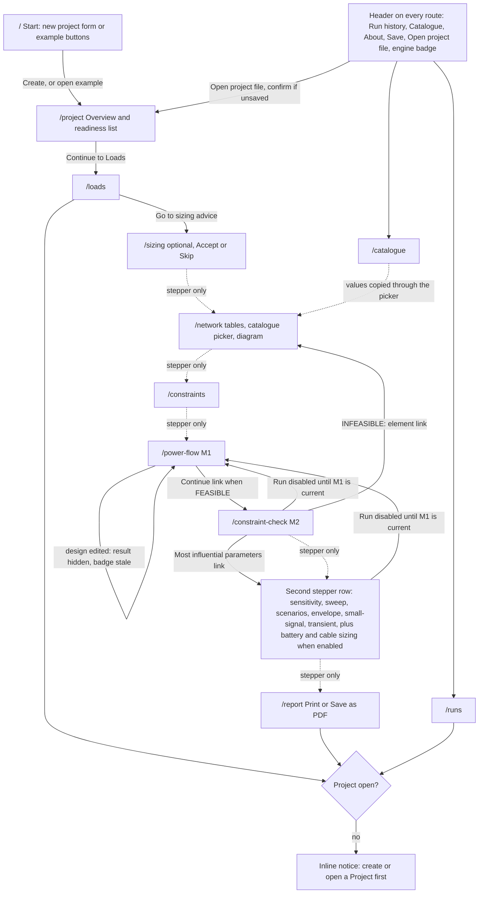

# UI/UX audit: Microgrid Design Tool frontend

Date: 2026-11-13. Scope: presentation layer only (`frontend/`). Analysis only: no redesign, no code changes. Backend, engine, equations, data model and API contracts are treated as fixed.

## How this audit was done

| Item | Detail |
|---|---|
| Design-system maturity | L2: IBM Carbon (`@carbon/react` 1.119) plus project tokens in `frontend/app/tokens.css` and written rules in `docs/VISUAL_DESIGN_GUIDELINES.md` (VDG). No Figma source, no `DESIGN.md`. |
| Passes run | Visual quality, UX heuristics (Nielsen H1 to H10), accessibility (WCAG 2.1 AA), design-system compliance (manual checklist), motion. |
| Live inspection | The app was run from the existing static build (`frontend/out`, built 2026-11-13) through `uv run --project backend mgapp`, on three instances: Fake Engine default, real engine (`MGAPP_ENGINE=REAL`), and Fake Engine profile `m2-infeasible`. The guided example D2 was opened and "Run the whole example" was used to populate results. Viewports: 1440x900 and 375x812. |
| Code inspection | Every `frontend/app/**/page.tsx`, every non-test module in `frontend/components/`, all CSS modules, `tokens.css`, `globals.css`, `carbon.scss`. Contrast ratios were computed from the colours actually emitted. |
| Evidence tags | **[live]** seen in the running app. **[code]** read in source, not confirmed in the browser. |

Not covered live, so code-based inference only:

- `/cable-sizing` (feature flag was off in this installation) and `/battery` (needs a battery bank).
- Screen-reader output (NVDA, JAWS, VoiceOver), print/PDF output of the Report, 200 % and 400 % zoom, tablet width.
- Keyboard focus-ring appearance (rules were read in CSS; the live check was inconclusive).
- Failure states other than INFEASIBLE (solver failure, timeout, transport error).

Severity scale used in this document: **high** = blocks or misleads the user, or risks lost work (P0/P1 in the review rubric); **medium** = slows or confuses (P2); **low** = polish (P3). Ordering is by impact on the user, not by ease of fixing.

---

## 1. Executive summary (top 5 findings)

1. **The interface speaks the project's internal language, not the user's.** Module codes (M1, M2, M3a to M4b, PS), `RunRecord`, "snapshot hash", document references ("Doc 3 §3.7", "Doc 13 §4"), an environment variable (`MGAPP_ENGINE=REAL`), raw API paths (`inverters/INV1/frequency_droop_hz_per_kw`) and enum words (`INPUT_INVALID`, `State: PROPOSED`) all appear in visible copy. The glossary and the model assumptions are in Indonesian inside an otherwise English UI and Report. For a student this is the largest barrier; for an engineer it reads as unfinished. (high)

2. **Work can be lost silently.** The project lives only in browser memory. A reload or a typed URL empties it, "Save" is a file download, and every delete (bus, line, inverter, load, scenario, catalogue entry) happens immediately with no confirmation and no undo. Deleting an inverter also removes its battery bank without saying so. (high)

3. **Results are honest but hard to read.** Every number is shown to six significant figures with no per-quantity rule ("0.127361 Hz", "0.043353 kW", droop gain "0,0079577471"), units appear in four different places, unit words such as "ratio" and "count" are printed as if they were units ("3 count"), and input fields use a decimal comma while results use a decimal point in the same browser. The participation-factor grid overflows its cells. Precision that the model does not have undermines trust. (high)

4. **Wayfinding breaks after the first six steps.** "Further analyses" (step 7) is a label that does not respond to a click; the six to eight analyses under it are a 12 px text row with 15 px-high targets. Outside example mode most pages end with no onward link. The stepper marks a constraint check as done with a tick even when the verdict is INFEASIBLE, and "Blocked" gives its reason only to screen readers. (high)

5. **The visual design is disciplined but anonymous and uses the screen badly.** Tokens, contrast and status roles are consistent and well reasoned, which is worth keeping. But the look is unmodified Carbon white theme with IBM Plex: the only owned elements are a navy header and a 4 px teal-to-green gradient bar. The landing page is a bare heading and a form. At 1440 px all content hugs the left half of the page; at 375 px the header and stepper take 488 px of an 812 px screen before any content, and the Report scrolls sideways. (medium, high on mobile if mobile is in scope)

The strongest parts, which a redesign should protect: the status banner pattern (status word, icon, plain headline, next step), the strict "not evaluated is never counted as satisfied" rule, the single-line diagram with keyboard access and a table alternative, the Fake Engine marking on every result surface, and the traceability section of the Report.

---

## 2. Current state

### 2.1 Screen inventory

22 routes. All except Start, Catalogue, About and the two `/dev` galleries are gated by `RequireProject` (shows "Create or open a Project first" with a link; no redirect).

| Route | Heading shown | Purpose | Inputs | Primary action |
|---|---|---|---|---|
| `/` | Microgrid design tool | Create a project or open an example | 3 fields | Create project; Open guided example (D2); 4 example buttons |
| `/project` | Project overview | Name, nominal values, element counts, readiness list | 4 fields | Continue to Loads; Run the whole example (example mode) |
| `/loads` | Loads | Load table | 4 to 5 per row | + Add load |
| `/sizing` | Sizing advice (PS) | Advisory inverter and storage sizing | 6 fields | Run advice; Accept; Skip |
| `/network` | Network | Buses, Lines, Inverters tabs; catalogue picker; battery bank; diagram; issues | 1 per bus, 6 per line, 10 per inverter | Add bus; + Add line; + Add inverter |
| `/constraints` | Design constraints | Seven limits, none defaulted | 7 fields | none |
| `/power-flow` | Power flow (M1) | Operating point | none | Run M1 |
| `/constraint-check` | Constraint check (M2) | Margins, verdict, loadability | 5 fields | Run M2 |
| `/sensitivity` | Sensitivity (M3a) | Tornado per metric | parameter checklist | Run M3a |
| `/sweep` | Sweep (M3b) | One-axis sweep | axis, range, metrics | Run sweep |
| `/scenarios` | Scenarios and comparison (M3c) | Overrides, comparison, N-1 | per scenario | Compare; Run N-1 check |
| `/envelope` | Envelope (M3d) | Two-axis status grid | two axes | Run envelope |
| `/small-signal` | Small-signal (M4a) | Eigenvalues, participation | 2 fields | Run M4a |
| `/transient` | Transient (M4b) | One disturbance, time responses | about 10 fields | Run M4b |
| `/battery` | Battery adequacy | Shown only when a bank exists | start hour | Run battery adequacy |
| `/cable-sizing` | Cable and breaker sizing | Shown only when the feature flag is on | about 8 settings plus a table file | Run cable sizing |
| `/report` | Report: {project} | Seven numbered sections from the latest runs | none | Print / Save as PDF |
| `/runs` | Run history | List, view, export, verify, re-run, compare | checkbox, file input | View; Export; Verify; Re-run |
| `/catalogue` | Catalogue | Reusable inverter, conductor, battery entries | per entry | Save catalogue; + Add ... entry |
| `/about` | About and limits | Versions, active limits, glossary | none | none |
| `/dev/components`, `/dev/sld` | galleries | Not linked from the app | n/a | n/a |

Global chrome (`frontend/components/AppShell.tsx`): navy header with wordmark, project name and unsaved dot, Run history, Catalogue, About, Save, Open project file, example-mode tag and "Leave example mode", engine badge; a 4 px gradient bar; the pipeline stepper strip (`PipelineStepper.tsx`) with nine entries and a second row of "further" links.

Shared building blocks (37 non-test modules): `StatusBanner`, `KpiStrip`, `DataTable`, `EntityTable`, `NumberField`, `EmptyState`, `Inspector`, `AdvisoryPanel`, `IndicatorPanel`, `Term` (glossary toggletip), `Toast`, `ExampleForm`, hand-built SVG charts (`charts/BarChart`, `LineChart`, `GridChart`, `LoadabilityAxis`, `ChartFrame`) and the single-line diagram (`sld/*`, laid out with elkjs).

### 2.2 User flow as built

Solid edges are in-page links or run gating. Dotted edges exist only through the stepper, because the page offers no onward link outside example mode.

### 2.3 Design tokens in use

Source: `frontend/app/tokens.css`, `frontend/app/carbon.scss`, `frontend/app/globals.css`.

| Group | Values |
|---|---|
| Theme | Carbon `white` base with overrides: page `#f4f2ee` (warm), layers `#ffffff` and `#faf9f7`, text `#0b1f44` (navy) and `#4a5468`, interactive, link and focus `#00737d` (teal), hover `#005f67`, active `#004b52`. Light scheme only (`color-scheme: light`). |
| Brand | Header `#0b1f44`; header focus `#5dc4cc`; signature gradient `linear-gradient(90deg, #0e9aa7, #7ed957)`, used once as a 4 px bar. |
| Status roles | Seven roles, each with edge, icon, text and tint: success (FEASIBLE), negative (INFEASIBLE, orange), error (red), caution (yellow), attention (blue), info (grey), advisory (purple, dashed outline). Contrast targets are documented beside each token. |
| Chart series | `#00737d`, `#0b1f44`, `#8a3ffc`, `#d02670`, `#b28600` (`components/charts/palette.ts`); the only hex literals outside the token files. |
| Type | IBM Plex Sans and IBM Plex Mono, self-hosted. Scale 12, 14, 14, 16, 20, 28 px (`--text-xs` to `--text-2xl`; `--text-sm` and `--text-md` are both 14 px). Weights 400, 500, 600; only 400 and 600 render in practice [live]. `tabular-nums lining-nums` on all numbers. |
| Spacing | 4 px base: 0, 4, 8, 12, 16, 20, 24, 32, 40, 48. Control height 32 px. Content max 1584 px; prose max 768 px. |
| Radius, elevation | All radii 0, no shadows, 1 px hairlines, 3 px status edge. |
| Motion | No motion tokens. One animation: the busy-button spinner (0.8 s linear), disabled under `prefers-reduced-motion`. |
| Breakpoints | One width breakpoint in the whole app: `max-width: 720px` in `AppShell.module.css`. No Carbon Grid. |
| Icons, imagery | 14 Carbon icons through `components/Icon.tsx`. No emoji, no images, no logo, no favicon. |

Token discipline is high: zero colour literals in CSS modules; 58 lines with literal lengths across 22 files, mostly component widths. The diagram stylesheet (`components/sld/sld.module.css`) is the exception, with literal 12, 13 and 16 px font sizes and literal weight 600.

Overall visual language: flat, square, dense, grey-on-warm-white, enterprise Carbon. Hierarchy is carried almost entirely by position and a small size step; weight contrast is limited to regular and semibold.

---

## 3. What works

Each item is worth carrying into the redesign unchanged in substance.

1. **Status banner pattern.** Status word, icon, one plain sentence, "Next step", collapsible details (`components/StatusBanner.tsx:30-66`). On INFEASIBLE it says a valid operating point exists and how many constraints are violated, then tells the user what to change [live]. This is the best piece of interaction design in the app.
2. **"Not evaluated" is never read as a pass.** Empty limits show "not evaluated" beside the field (`app/constraints/page.tsx:46`), the verdict sentence counts unevaluated checks, charts say "No voltage limit set: not evaluated" (`components/M1Results.tsx:57`). This is correct engineering behaviour and builds trust.
3. **Violations are specific.** The limiting-constraints table gives constraint, element (linked to its row in Network), value, limit, unit and "Violated by 0.1 pu", plus a "Most influential parameters" shortcut (`components/M2Results.tsx:41-84`) [live].
4. **Status is never colour alone.** Every status role pairs colour with an icon and a word; role text is 7:1 or better on its tint, role icons 3:1 or better (`tokens.css:43-70`, ratios recomputed).
5. **Fake Engine cannot be missed on screen.** Engine badge in the header, a note in the banner, under the KPI strip, under every chart and at the top of the Report, and a caption burned into exported SVGs. The intent is right even though the wording varies (see finding 16).
6. **Charts are accountable.** Axis titles with units, limits drawn only when the user set them, a "Show data" table alternative, SVG download, and a caption with run id and engine (`components/charts/ChartFrame.tsx`).
7. **Single-line diagram.** Each element is a focusable button with a descriptive name ("Bus B2, 0 inverters, 1 load, 2 lines"), Enter and Escape work, results overlay on the same drawing, zoom controls, a legend and "View as table" [live]. This is the most domain-specific and distinctive asset.
8. **Run gating explains itself.** When the design changed after the last power flow, later Run buttons are disabled and a note says why with a link back (`components/M1Freshness.tsx:20-30`).
9. **Report traceability.** Section 6 maps each model assumption to how it is handled and to indicator values; section 7 lists run id, snapshot hash and result hash per analysis.
10. **Careful form details.** No spinner arrows on numeric fields, right-aligned tabular numbers, units inside the field, Enter moves down a column and Escape restores a cell (`components/DataTable.tsx:38-53`), bus deletion is refused with the names of the dependents (`components/EntityTable.tsx:86`).
11. **Guided example.** One click opens a filled project and "Run the whole example" walks the pipeline with a per-step status list [live]. It is the fastest route to understanding the tool.

---

## 4. What doesn't work

| # | Issue | Where | Severity | Impact |
|---|---|---|---|---|
| 1 | Internal codes, document references, enum words and an environment variable in visible copy | Stepper and every page heading (`PipelineStepper.tsx:19-38`); `app/constraints/page.tsx:34`; `app/scenarios/page.tsx:122-123`; `components/ExampleForm.tsx:116`; `app/runs/page.tsx:200`; `app/sizing/page.tsx:88`; `components/CableReport.tsx:40,51` | high | Users must learn the project's private vocabulary before they can read a screen; the tool looks unfinished. |
| 2 | Raw API field paths as control labels and chart axis names | `app/sensitivity/page.tsx:82`; `components/AxisForm.tsx:95-99,118,141-143`; scenario buttons "Remove loads/L1/p_kw" [live] | high | Users cannot map a parameter to the table column where they entered it. |
| 3 | Project held only in memory; Save is a download; reload empties the app | `frontend/store/*` (no storage), `components/ProjectFileMenu.tsx:38-53` | high | One reload or mistyped URL loses the session. |
| 4 | Deletes are immediate, unconfirmed and cannot be undone; inverter delete silently removes its battery bank | `components/EntityTable.tsx:81-92`; `app/loads/page.tsx:133`; `app/scenarios/page.tsx:157`; `app/catalogue/page.tsx:180`; `store/reducer.ts:199` | high | Accidental data loss with no recovery. |
| 5 | Uniform six significant figures, trailing zeros dropped, some cells unformatted | `components/format.ts:2`; `components/M2Results.tsx:48-49`; `app/sizing/page.tsx:51-79` | high | False precision, ragged columns, exponent values overflowing cells (participation grid) [live]. |
| 6 | Decimal comma in inputs, decimal point in results (browser-locale dependent) | native `type="number"` in `components/NumberField.tsx:37-46` versus `num()` output | high | "0,2" beside "0.254722" on the same screen [live]; copy-paste between them fails. |
| 7 | "Further analyses" step is not a link; its children are a 12 px row with 15 px targets; the "Step 7:" prefix is CSS-generated | `components/PipelineStepper.tsx:112-115`; `PipelineStepper.module.css:29-33` | high | Six to eight analyses are hard to discover and hard to hit. |
| 8 | Stepper tick means "ran", not "passed"; Report step is done when any run exists | `components/PipelineStepper.tsx:57-68` | high | An INFEASIBLE check shows a tick [live]; progress overstates readiness. |
| 9 | Model assumptions and scope limits appear only in the Report; the indicator panel shows bare "A1", "A2", "A4" | `app/report/page.tsx:33-40`; `components/IndicatorPanel.tsx:77,86`; `app/about/page.tsx` | high | Users run analyses without seeing what the model leaves out. |
| 10 | Glossary and assumption statements are Indonesian inside an English UI and Report | `components/glossary.ts`; `app/about/page.tsx:74`; `app/report/page.tsx:34-39` | high | Mixed-language Report; definitions unusable for non-Indonesian readers. |
| 11 | Validation service failure shows "Checking the design…" forever and turns the stepper stale or blocked | `components/useValidation.ts:16-18,34` | high | A service problem looks like a design problem. |
| 12 | No progress, elapsed time or cancel while an analysis runs; leaving the page loses the indicator | `components/useAnalysisCall.ts:15-25` | medium | Users cannot tell a slow run from a hung one. |
| 13 | No onward link outside example mode on Network, Constraints, M2 and all further analyses | `components/ExampleForm.tsx:141-151` (example mode only) | medium | The pipeline stops guiding exactly where it gets harder. |
| 14 | "Blocked" and "Stale" give their reason only as screen-reader text | `components/PipelineStepper.tsx:117-127` | medium | Sighted users see "Blocked" with no explanation. |
| 15 | No echo of the inputs that produced a result | all result pages; inputs appear only as raw JSON in `app/runs/page.tsx:62-64` | medium | The form above a result may have been edited since the run. |
| 16 | Fake Engine warning has six different wordings; tables carry no per-table mark | `exportSvg.ts:7`, `ChartFrame.tsx:65`, `KpiStrip.tsx:32`, `StatusBanner.tsx:40`, `app/report/page.tsx:130`, `app/page.tsx:73` | medium | A cropped screenshot of a results table carries no fake mark. |
| 17 | Units placed four ways; "p.u." versus "pu"; "ratio" and "count" printed as units | `M1Results.tsx:20-24`, `DataTable.tsx:167`, `M2Results.tsx:50,60`, `Further.tsx:12-17`, `kpi.ts` | medium | Inconsistent reading pattern; "3 count" reads as machine output. |
| 18 | Content hugs the left; tables 297 to 923 px wide in a 1425 px column; charts fixed at 640 px | `globals.css:14,93`; `charts.module.css:2` | medium | Half the desktop screen is empty while pages run 4000 to 8000 px tall [live]. |
| 19 | Mobile: 488 px of header and stepper before content; Report overflows sideways | `AppShell.module.css:24` (only breakpoint) | medium, high if mobile is a target | The tool is not usable on a phone [live]. |
| 20 | Result pages are one long scroll with no local navigation | `/power-flow` 4025 px, `/constraint-check` 4010 px, `/report` 8075 px at 1440 px [live] | medium | Users lose their place between banner, diagram, charts and tables. |
| 21 | Report omits sensitivity, sweep, scenarios, envelope and transient; header "Engine" and "Date" are current values, not the runs' | `app/report/page.tsx:62-68,114-117` | medium | The exported document can be incomplete and its header can disagree with the runs it shows. |
| 22 | Every route has the same browser title; no skip link; about 20 tab stops before content | `app/layout.tsx:11`; `components/AppShell.tsx:31-74` | medium | Poor keyboard and screen-reader orientation. |
| 23 | Field errors are not tied to their fields; `NumberField` error path is unused | `components/NumberField.tsx:43-56` (no caller passes `error`) | medium | Assistive technology cannot associate a message with its input. |
| 24 | Run outcome may not be announced; busy button is disabled, dropping focus | `components/StatusBanner.tsx:30`; run buttons on 10 pages | medium | Screen-reader users get no result announcement (needs live confirmation). |
| 25 | Form layout differs page to page: inline labels with ragged field edges on Start, Project, Sizing, Constraints; a two-column panel on M2 and Transient | [live]; `components/NumberField.module.css` | medium | Looks unplanned; harder to scan. |
| 26 | Landing page is a bare heading and form; no Open button on the page; no description of what the tool does | `app/page.tsx:72-95` | medium | The first screen is the least guided and gives no reason to trust the tool. |
| 27 | Two-series bar chart distinguishes P and Q by colour only (teal against navy, 2.90:1) | `components/charts/BarChart.tsx:67,106`; `M1Results.tsx:130-133` | medium | Fails for colour-blind users and in greyscale print. |
| 28 | Run history is developer-shaped: ISO timestamps with microseconds, type codes, four buttons per row, raw JSON detail | `app/runs/page.tsx:225-249` | medium | The audit trail exists but is unreadable for its audience. |
| 29 | Native file inputs ("Choose File, No file chosen") beside styled buttons | `/runs`, `/catalogue` [live] | low | Visual inconsistency. |
| 30 | Example-mode banner repeats on every page with a developer instruction | `components/ExampleForm.tsx:109-116` | low | Noise; pushes content down. |
| 31 | Unsaved state is an 8 px dot; any run marks the project unsaved | `components/AppShell.tsx:17-24`; `store/reducer.ts:251` | low | Easy to miss; noisy after a pure run. |
| 32 | 43 targets under 24 px on the power-flow page (glossary buttons 16 px, further links 15 px, header links 20 px) | [live measurement] | low | Hard to hit; fails WCAG 2.2 target size where spacing does not compensate. |
| 33 | Sizing advice uses its own `.advice` block instead of `AdvisoryPanel` | `app/sizing/page.tsx:45-46` | low | Advice looks different here than on M1 and M2. |
| 34 | Single-line diagram system block has no focus indicator; violated stroke `#ff832b` is 2.46:1 | `components/sld/symbols.tsx:175-195`; `sld.module.css:5,7` | low | Minor keyboard and contrast gaps. |

---

## 5. UI findings

### 5.1 Visual hierarchy

- **Squint test fails on result pages.** On `/power-flow` the banner, six KPI tiles, the diagram, four charts, four tables and the indicator panel all have the same visual weight: white box, hairline border, 14 px text [live]. Nothing says "this is the answer". The verdict is the most important object and is the same size as a table caption.
- **Three-second test passes on input pages** (heading, form, one primary button) and **fails on the landing page**: the heading repeats the product name, there is no statement of what the tool does, and two competing primary-looking actions ("Create project", "Open guided example") sit in a plain column.
- **Greyscale test passes.** Hierarchy and status do not depend on colour, with the exception of the P/Q bar chart (issue 27).
- **Table captions are 14 px semibold, section headings 20 px regular.** A caption therefore looks heavier than the heading above it on some pages (`globals.css:15-19,100`).

### 5.2 Typography

- One family (IBM Plex Sans) at six sizes; 12 px and 14 px carry almost everything. On `/power-flow`, 98 text nodes are 12 px and 175 are 14 px, against 12 at 16 px, 11 at 20 px and one at 28 px [live]. The scale exists but the page lives in its bottom two steps.
- `--text-sm` and `--text-md` are both 14 px, so "small" and "body" are the same size (`tokens.css:82-83`).
- Weight 500 is defined and loaded by intent but only 400 and 600 render; mid-weight emphasis is unavailable in practice.
- Greek symbols are written as plain text with underscores: "λ_c", "ζ_min", "r_τ", "m_inv", "η_dc" [live]. For an engineering audience, proper subscripts would read as intentional.
- The project description field uses IBM Plex Mono (`globals.css:88` styles every `textarea` as monospace), which makes ordinary prose look like code [live].
- No text under 12 px on screen. Diagram labels can render below 12 px when "Fit to view" scales down (44 % at 375 px [live]).

### 5.3 Colour and contrast

- Body text 14.5:1 on the page, secondary text 6.8:1, links 5.0:1, primary button 5.6:1. All comfortable.
- Failures and marginal cases (computed): header focus ring teal on navy for the file button 2.90:1 (`ui.module.css:11`); chart teal against navy as adjacent fills 2.90:1; diagram violated stroke `#ff832b` 2.46:1; isolated-bus outline `#f1c21b` 1.68:1; input bottom border `#8d8d8d` on the warm page 2.97:1; chart yellow `#b28600` on the teal band 2.91:1.
- Teal carries three jobs at once: interactive (links, buttons), "done" in the stepper, and data series 1 in charts. A teal bar chart under a teal button under a teal stepper reads as one undifferentiated colour [live].
- Light scheme only. There is no dark theme and no token layer prepared for one.

### 5.4 Spacing and alignment

- **Ragged field edges.** On Start, Project, Sizing and Constraints, labels are inline and of different lengths, so each input starts at a different x position [live]. M2 and Transient use a fixed label column inside a white panel. Two form layouts coexist.
- **Left-heavy composition.** `main` is up to 1584 px wide but tables shrink to their content and chart frames are capped at 640 px, so at 1440 px the right 45 to 55 % of every page is empty [live].
- **Stepper wraps.** At 1440 px in example mode with "Blocked" tags, the ninth step ("Report") drops to a second row [live].
- **Label glued to field** on "Project name" (no gap between label and input) on Start and Project [live].
- Spacing values themselves are on the 4 px scale almost everywhere; the rhythm problem is layout, not token misuse.

### 5.5 Consistency

- Two table implementations: `DataTable` (captioned, unit-aware) and hand-written tables on Run history and Catalogue.
- Two error surfaces: `Toast` on analysis pages, inline `
` on Start, Sizing and Catalogue.
- Two advisory treatments: `AdvisoryPanel` with a purple tag, and the Sizing page's own `.advice` block.
- Native `window.confirm` for unsaved work, where the written guideline (VDG §6) specifies a Carbon modal.
- Button labels mix plain names and codes: "Run sweep", "Run envelope" beside "Run M1", "Run M3a", "Run M4b".
- Ellipsis is "Running..." in some places and "running…" in others.

### 5.6 Data presentation

- **Numbers.** One rule for everything: six significant figures (`components/format.ts:2`). Live examples: frequency margin "0.127361 Hz", losses "0.043353 kW", bus angle "-0.0532505 °", lowest damping "0.0972585", droop input "0,0079577471". Engineering practice would set decimals per quantity (for example p.u. to 3 or 4, kW to 1 or 2, Hz to 3).
- **Unformatted cells.** M2 "Value" and "Limit" print raw numbers while "Margin" beside them is rounded (`M2Results.tsx:48-49`).
- **Overflow.** In the participation-factor grid, values such as "1.25918e-10" run into neighbouring cells [live] (`components/charts/GridChart.tsx`).
- **Units.** In the header in most tables, in a separate "Unit" column in others, as a suffix inside the cell in the margin column, and as a KPI suffix. "ratio", "count", "points" and "factor" are printed in the unit position.
- **Tables.** No sorting, filtering or paging anywhere; the sweep table can reach 1000 rows.
- **Charts.** Honest and labelled, but all the same teal, all the same 640 px width, with value labels at six figures. The loadability axis and the eigenvalue plane are well conceived. The Fake Engine produces all-zero data, so on the default installation most charts are empty frames with "No data" [live].
- **Diagram.** Clean and readable; result overlays (voltage, angle, loading, current) sit on label pills. It is hidden inside a closed disclosure on the Network page, where it would help most.

### 5.7 Responsiveness

- One width breakpoint (720 px) that only reflows the header. No grid system.
- At 375 px: header 180 px tall, stepper 308 px tall, content starts at 488 px [live]. The Report page is 447 px wide and scrolls sideways; 248 elements extend past the viewport [live]. Wide tables scroll inside their own region, which is correct, but the inverter table has 10 columns.
- At 1440 px the opposite problem: unused width (see 5.4).
- Tablet width was not inspected.

### 5.8 Accessibility (WCAG 2.1 AA)

Overall status: **needs work**. The foundations are better than most projects at this stage; the gaps are in orientation and announcements.

| Area | Finding | Evidence |
|---|---|---|
| Page titles | Every route is titled "Microgrid design tool" | `app/layout.tsx:11` |
| Bypass blocks | No skip link; about 20 tab stops before `<main>` | `components/AppShell.tsx` [live: no skip link in DOM] |
| Status messages | The result banner mounts together with its content, so it may not be announced; the busy Run button is disabled, which usually drops focus | `StatusBanner.tsx:30`; needs screen-reader confirmation |
| Error association | Field messages are free-standing; `aria-invalid` and `aria-describedby` path in `NumberField` is never used | `NumberField.tsx:43-56` |
| Colour alone | P and Q bars differ by fill only | `BarChart.tsx:67,106` |
| Focus visible | Global 2 px teal ring is good; missing on the diagram's system block; teal-on-navy ring on the header file button | `sld.module.css:7`; `ui.module.css:11` |
| Chart keyboard access | Crosshair readout is not a live region; eigenvalue damping and frequency exist only as hover titles | `LineChart.tsx:94-105,168` |
| Tables | `role="alert"` on a table cell breaks cell semantics and re-announces on every keystroke | `DataTable.tsx:201` |
| Tabs | Network tabs have `role="tab"` without `aria-controls` or arrow keys | `app/network/page.tsx:262-269` |
| Target size | 43 targets under 24 px on one page | [live] |
| Layering | Inspector is `z-index: 8000`, toasts `z-index: 10`: an error toast can hide behind the open Inspector | `Inspector.module.css:3`; `ui.module.css:30` |
| Language | `lang="en"` on the page, `lang="id"` on most Indonesian text; missing on the "Glosarium" heading | `app/about/page.tsx:74` |

Done well: one `h1` per page with no skipped levels, landmarks present, `aria-current` on navigation, labelled inputs with units exposed to assistive technology, table header scopes and captions, the diagram's keyboard model, the Inspector's focus handling, the glossary toggletip (click or Enter, Escape returns focus).

### 5.9 Motion

One animation in the project: the busy spinner on Run buttons (0.8 s, linear, transform only, disabled under reduced motion). No transitions on panels, tabs, the Inspector or the stepper. Motion quality: purposeful and minimal. The absence is a missed opportunity for continuity (for example the Inspector appearing, or results arriving), not a defect.

### 5.10 Design-system compliance (manual checklist)

- Colour tokens: compliant (0 literals in CSS modules; 5 in `palette.ts`).
- Spacing and type tokens: mostly compliant; `sld.module.css` uses literal font sizes and weights.
- Carbon usage: only `Header`, `HeaderName`, `Tag` and `ToastNotification` come from Carbon. Buttons, inputs, selects, tables, tabs, the stepper, the toggletip and modals are hand-built look-alikes in `globals.css` and CSS modules. The app therefore carries Carbon's appearance without Carbon's behaviour (no `DataTable` sorting, no `Modal`, no `InlineLoading`, no `ProgressIndicator`).
- Deviations from the written guideline: no start-page hero or cards (VDG §5), native confirm instead of a modal (VDG §6), hand-built Run history table (VDG §6), no Report cover (VDG §10), Sizing advice without the purple advisory tag (VDG §8).

---

## 6. UX and flow findings

### 6.1 Journey, step by step

| Step | Clarity | Effort | States and feedback | Friction and drop-off risk |
|---|---|---|---|---|
| Landing | Low: no description of the tool, no Open button on the page, examples named D1, D2, D2S, D2H with "prototype values, to be confirmed" | 3 fields or 1 click | No busy state while an example loads; failure is a bare alert line | A new user does not know what they will get. Nominal voltage can be left empty and only fails later. |
| Project overview | Medium | 4 fields | "Checking the design…", then "No problems found." | Readiness problems are plain text with no link to the screen that fixes them. Counts table shows "RunRecords". |
| Loads | High | 4 to 5 inputs per load | Row-level errors appear as soon as a blank row is added | The only onward link goes to Sizing, which is optional. |
| Sizing advice | Medium | 6 fields, Run, then Accept or Skip | Stale-advice note is good | Stepper shows it as a required numbered step until Accept or Skip. "State: PROPOSED" is unexplained. |
| Network | Medium | 1 + 6 + 10 fields per element type | Tabs disabled until a bus exists, reason in small text | The diagram is collapsed by default. Inverter table needs sideways scrolling at 1440 px [live]. Droop gains must be typed to 10 digits. |
| Constraints | High | 7 optional fields | "not evaluated" per empty field | No onward link. |
| Power flow | High | 1 click | Spinner and "Running...", then banner | After any design edit the result disappears and is replaced by an empty state. |
| Constraint check | High for the verdict, low for what follows | 2 required fields, 1 click | Best feedback in the app | 4000 px page; violated rows appear in two tables; no onward link. |
| Further analyses | Low | varies; Sensitivity is a list of raw parameter paths; Scenarios repeats a full form per scenario | After a design edit, shows the same "Not run yet" as a page that never ran | Entry is the small second stepper row. No overview of which analysis answers which question. |
| Run history | Low | per-row buttons | Raw data | Written for a developer. |
| Report | High | 1 click | Browser print dialog | Omits five analyses; mixed language; 8000 px on screen. |
| Leave | Low | Save downloads a file | Dot clears on click | Nothing confirms where the file went; reload still empties the app. |

### 6.2 Can the user trace results back to inputs?

Partly. What exists: a freshness badge ("M1 result: current"), a run id and engine under every chart, hashes in the Report and Run history, and gating that prevents later analyses from running on a changed design. What is missing: a readable statement, next to each result, of the inputs and settings that produced it. The M2 margins, the sweep axis and range, and the transient disturbance are visible only in a form that the user may have edited since the run. Hashes prove integrity to a developer; they do not answer "which load and which droop gains gave me this voltage" for a student.

### 6.3 States matrix (summary)

| State | Coverage |
|---|---|
| Empty | Good on most pages, with specific instructions on M2. Generic "Not run yet." on six analysis pages. |
| Running | Spinner and label only. No elapsed time, no time budget shown, no cancel. |
| Success | Banner, KPI strip, results. No scroll or focus move to the result. |
| Validation error | Live, debounced 300 ms; shown under rows or as lists; not linked to fields or screens. |
| Engine verdicts | INFEASIBLE is excellent. Solver failure and inadmissible results give a generic hint ("keep the RunRecord for the developer"). |
| Transport failure | Toast titled "Error" with an HTTP code and no recovery step; silent on design pages; "Checking…" forever on Project. |
| Stale | Clear on M1 and M2; indistinguishable from "never run" on the further analyses. |

### 6.4 Heuristic verdicts

| Heuristic | Verdict | Strongest evidence |
|---|---|---|
| H1 Visibility of system status | Partial | Strong static status (badges, banner); weak during runs and on service failure |
| H2 Match with the real world | Weak | Module codes, hashes, API paths, enum words in copy |
| H3 User control and freedom | Weak | No undo, no confirm on delete, no cancel |
| H4 Consistency and standards | Weak | Six fake-warning wordings, four unit placements, two table and two error patterns |
| H5 Error prevention | Moderate | Good gating and refusal messages; empty nominal voltage accepted; invalid number text becomes empty |
| H6 Recognition over recall | Moderate | Stepper and KPI strip help; no input echo; further analyses hidden |
| H7 Flexibility and efficiency | Moderate | Good cell keyboard model and example runner; no sort, filter or bulk edit |
| H8 Aesthetic and minimalist design | Mixed | Clean forms; overloaded, undifferentiated result pages |
| H9 Error recovery | Partial | INFEASIBLE well diagnosed; other failures generic |
| H10 Help and documentation | Weak | About page has versions and an Indonesian glossary; no assumptions or scope |

Cognitive load: **high** on result pages (many equal-weight objects, internal vocabulary), **low to medium** on input pages.

---

## 7. Domain-fit findings

1. **Assumptions and scope are not where decisions are made.** A1 to A6 appear only in section 6 of the Report, in Indonesian. The About page ("About and limits") lists software limits (time budget, sweep cap) but not model limits. An engineer needs to see "balanced three-phase, islanded, droop primary control only" before trusting a verdict, not after exporting. (high)
2. **Precision overstates the model.** Six significant figures on quantities from an early-design steady-state model signals accuracy the method does not claim. The validity indicators even say "threshold not yet calibrated" a few lines below a damping ratio printed as 0.0972585. (high)
3. **Infeasibility is handled credibly.** The split between INFEASIBLE (operating point exists, constraints violated), solver failure and physical inadmissibility is correct and clearly worded for the first case. The loadability axis with λ_c, λ_s and the explicit caption "solution existence, not a stability limit" is exactly the kind of caveat an engineer respects. Keep this. (strength)
4. **Advice is correctly separated from results.** Sizing advice and the sizing check sit in dashed "Advice" panels and are described as "advisory, not a constraint". The separation is right; the visual treatment is inconsistent (issue 33).
5. **Units are present but not systematic.** Every value has a unit somewhere, which is the hard part. The placement varies, and both "p.u." and "pu" appear. Voltage is shown in kV and p.u. on M1 but only kV on Transient.
6. **Symbols without definitions.** m_inv, m_line, t_aut, η_dc, DoD, r_τ, κ, r_in, ε_X appear in labels. Some have a glossary toggletip (in Indonesian); the module codes, "RunRecord" and "snapshot" have no entry at all.
7. **Information density is right for engineers on tables, too low on layout.** 32 px controls and 4 px cell padding suit the audience. But density is wasted by the left-hugging layout and the long single scroll: an engineer would expect the diagram, the key numbers and the limiting constraints on one screen.
8. **Equation and citation references are a strength if presented as such.** "(Eq. 4.23)" and "(Eq. 4.1)" link the UI to the manuscript, which builds trust for an academic tool. "[19]" and "Doc 3 §3.7" do not, because the user cannot resolve them.
9. **Run history proves reproducibility but hides it.** Verify and Re-run are rare and valuable features for an engineering tool. They are presented as four identical buttons beside a microsecond timestamp.
10. **Fake Engine default.** A fresh installation shows zeros and empty charts. A first-time user's first impression of every result page is therefore empty frames with warnings. This is honest, but it means the default experience undersells the tool.

---

## 8. Generic-AI-look findings

Checked specifically for the usual template tells. Most are **absent**, which should be stated plainly:

| Tell | Present? | Evidence |
|---|---|---|
| Emoji as icons | No | Zero emoji in source; 14 Carbon icons |
| Purple or blue hero gradients | No | One 4 px gradient bar only |
| Rounded cards with soft shadows | No | Radius 0, no shadows |
| Uniform three-column feature-card grid | No | No marketing sections at all |
| Placeholder marketing copy ("Empower your…") | No | Copy is terse and technical |
| Default system font | No | IBM Plex, self-hosted |
| Stock illustrations | No | No images |

So the app does not look AI-generated. Its problem is the neighbouring one: it looks like an **unmodified enterprise component library**, which is equally anonymous.

| Element | Why it reads as template | What would make it intentional |
|---|---|---|
| Carbon white theme with IBM Plex Sans throughout | This exact pairing is the default look of IBM's own products and of many internal tools | A deliberate type decision: either commit to Plex and use its range (Mono for all numeric data, Sans Condensed for dense tables, real weight contrast) or choose a face with an engineering or academic character for headings |
| Teal-to-green gradient bar (`--mdt-gradient`) | A two-stop horizontal gradient is the most common "brand accent" shortcut; here it is the only brand element and has no relation to the content | Tie the accent to the domain (for example the diagram's line language, or a status-derived colour system), or drop it and let the diagram be the identity |
| No logo, wordmark treatment or favicon | The product name is set in the header's default text style; the browser tab shows a blank icon | A simple mark derived from the single-line diagram symbols (the inverter symbol already exists in `sld/symbols.tsx`) |
| Landing page: `h1` plus a form | Looks like a scaffolded page before design | A first screen that shows what the tool produces (a small diagram and a verdict), with New, Open and Example as three clear entry points |
| Six equal KPI tiles in a row | Uniform tile strips are a dashboard-template habit; the verdict tile is no larger than "Iterations: 3 count" | Give the verdict and the tightest margin real prominence; demote bookkeeping values |
| Every chart the same teal at the same size | Reads as chart-library defaults even though the charts are hand-built | Size and colour by importance; use the status roles on charts where a limit applies |
| White boxes with hairline borders for everything | Banner, form panel, chart frame, KPI tile and table all share one container style | Differentiate containers by role: input, result, advice, evidence |
| "ratio", "count", "RunRecord", "State: PROPOSED" | Machine-shaped text reads as generated output | Human units and sentences |
| Symbols typed as `λ_c`, `m_inv` | Looks like raw variable names | Typeset subscripts |

The most distinctive assets already in the product are the single-line diagram, the loadability axis and the status-role system. None of them is used as identity. A redesign that builds on those would look like nothing else.

---

## 9. Improvement opportunities

All items below are presentation-layer changes. Grouped by effort, ordered by user impact within each group. This is a list of options for the brainstorm, not a plan.

### Quick wins

1. Replace internal vocabulary in visible copy: plain analysis names first with the code as a small secondary tag; remove "Doc …", "[19]", `MGAPP_ENGINE=REAL`, "prototype values, to be confirmed", "State: PROPOSED"; rename "RunRecord" and "snapshot hash" in the UI.
2. Map API paths to the labels used in the Network table ("INV1, P-f droop (Hz/kW)") in Sensitivity, Sweep, Scenarios and chart axes.
3. Format M2 Value and Limit like the Margin beside them; stop exponent values overflowing the participation grid.
4. One shared Fake Engine sentence used on all six surfaces; add it as a caption on result tables.
5. Show the "Blocked" and "Stale" reason visibly in the stepper; make the stepper tick reflect the verdict (tick, cross or warning) rather than "ran".
6. Make "Further analyses" a real target and raise the second row to body size with 24 px or larger targets.
7. Reuse the example-mode "Next:" link for all users on every page.
8. Per-route browser titles, a skip link, and a utility `<nav>` in the header.
9. Use the stale-result message from M1 and M2 on the six further-analysis pages.
10. Use `AdvisoryPanel` on the Sizing page; use one ellipsis character; use "not classified" consistently.
11. Add a pattern or direct "P" and "Q" labels to the two-series bar chart.
12. Open the Network diagram by default.
13. Replace the unsaved dot with the words "Unsaved changes"; after Save, show the file name.
14. Toast copy: say what failed and what to do ("The local service is not answering. Check that the app is running, then try again.").
15. Plain sans-serif for the project description field.

### Medium effort

1. A number-formatting rule per quantity (decimals by unit), applied through one place, with full precision available on demand; one unit placement rule (column header), and no "ratio" or "count" in the unit slot.
2. A consistent form layout: fixed label column, aligned fields, helper text with valid ranges, one container style.
3. Confirmation for destructive actions with a statement of side effects ("also removes the battery bank of INV2").
4. "Inputs used for this result" beside every result, in readable form, built from data the page already holds.
5. An "Assumptions and scope" section in About, with A1 to A6 expanded wherever the codes appear; English and Indonesian side by side in the glossary and the Report.
6. A results layout that uses the width: diagram and verdict together, key numbers beside them, detail tables and charts below or in tabs; an in-page section index on long pages and the Report.
7. Run history as a readable log: local time, analysis name, verdict icon, one primary action with the rest in a menu, human-readable detail.
8. A landing page that explains the tool and offers New, Open and Example as equal entry points.
9. A visible, always-mounted status region for run progress with elapsed time and the time budget; focus moved to the result when it arrives.
10. Field-level error association (`aria-invalid`, `aria-describedby`) and links from readiness problems to the screen and field.
11. A responsive pass: collapsible header and stepper on narrow screens, no page-level sideways scroll.
12. Sorting on result tables and a row cap with "Show all" on long ones.

### Larger redesign directions

1. **Workspace instead of wizard.** Keep the pipeline as the mental model but put the single-line diagram at the centre as a persistent canvas, with inputs in an inspector and results as overlays and side panels. The diagram is already interactive and results-aware; this would make it the product rather than one figure among many.
2. **Verdict-first results.** One screen per design state that answers "does it work, what limits it, by how much, what should I change", with every further analysis reachable as a drill-down from a specific limit rather than from a numbered list.
3. **An owned visual identity.** Typography, a mark and a colour system derived from the domain (diagram line language, status roles), replacing the default Carbon appearance while keeping its accessibility discipline.
4. **Two reading levels.** A student level with plain names, definitions and assumptions inline, and an engineer level with codes, equation references and hashes. The same content, two densities.
5. **Report as a designed document.** A cover, a one-page summary with the verdict and the diagram, selectable sections, consistent language, and print-first page layout.
6. **Analysis hub.** A page for the further analyses that states the question each one answers ("How far can load grow?", "Which parameter matters most?", "Is it stable?") instead of M3a to M4b.

---

## 10. Out-of-scope observations

These would improve the experience but need functional, state or engine changes. They are listed only so they are not lost; none is proposed for the presentation redesign.

| Observation | Why it is out of scope |
|---|---|
| Browser autosave and "Restore unsaved work" (described in `docs/07_ui_ia.md` §7, not built) | Needs persistence in the store |
| Undo and redo for edits and deletions | Reducer and state history |
| Cancel a running analysis; real progress reporting | Needs API and engine support |
| Report including sensitivity, sweep, scenarios, envelope and transient results; per-run engine and date in the header | Report data assembly |
| Element-specific messages for solver failure and physical inadmissibility | Depends on engine diagnostics |
| Locale-independent numeric input (decimal comma versus point) | Changes input parsing behaviour |
| Required nominal voltage at project creation | Validation rule |
| Stepper state rules (what counts as done) | State derivation logic, although the display of the state is presentational |
| Run history and RunRecord import without an open project | Route gating |
| Catalogue unsaved indicator and leave-page guard | State change |
| Engine choice (Fake or real) visible and switchable from the UI rather than an environment variable | Backend configuration |
| "Edit values" action on sizing advice (specified in `docs/07_ui_ia.md` §6.2, acknowledged as deferred) | Feature |
| Dark theme | Not a functional change, but a decision with token-wide consequences; listed here because it changes scope |

---

## 11. Open questions for the redesign brainstorm

**Users and use**
1. Who is the primary user: a final-year student learning the method, a supervisor or examiner assessing the work, or a practising engineer doing early design? The answer decides vocabulary, density and how much explanation is inline.
2. Is the tool used in one sitting to produce a report, or returned to over days? This decides how much the save and history experience matters.
3. Will it be demonstrated live (seminar, defence)? If so, which screens must look best on a projector?

**Language and vocabulary**
4. One language or two? If two, is English primary with Indonesian definitions, or should the whole UI switch?
5. Are the module codes (M1 to M4b, PS) part of the manuscript's vocabulary that readers are expected to know, or internal names that can be demoted?
6. Should equation and section references to the manuscript stay visible in the UI?

**Brand and visual direction**
7. Is there an institution or lab identity (colours, logo, typeface) that the tool should follow or sit beside?
8. Should the tool keep the Carbon look as a deliberate "engineering software" signal, or move away from it? ADR-012 chose Carbon; is that decision open?
9. Two or three reference products whose feel you want (for example ETAP, PSIM, DIgSILENT PowerFactory, a modern data tool, an academic publication style), and one you want to avoid.
10. Light theme only, or dark as well?

**Structure**
11. Is the nine-step linear pipeline a fixed requirement, or may the redesign reorganise around the diagram or around the verdict?
12. Which result matters most to show first: the feasibility verdict, the limiting constraint, the stability class, or the diagram with values?
13. Which of the further analyses are core to the thesis and which are secondary? This decides their prominence.

**Devices and output**
14. Is desktop the only target? What is the smallest screen that must work (laptop at 1280 or 1366 px, tablet, phone)?
15. Is the printed or PDF Report the main deliverable? Who reads it, and should it follow a thesis-appendix format?

**Constraints and priorities**
16. Which out-of-scope items in section 10, if any, may be included? Autosave, delete confirmation and locale-safe number input have the largest effect on trust.
17. Must the existing end-to-end and unit tests (which rely on current labels and test ids) keep passing unchanged, or can copy change freely?
18. Time available before the next milestone, and whether the redesign lands in one step or screen by screen.
19. If only three things could change, which three?
